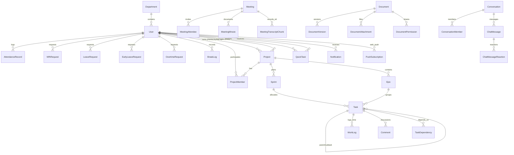

# 🗄️ Thiết Kế Cơ Sở Dữ Liệu & Sơ Đồ ERD (Database Schema & ERD) — WorkSync
> **Hệ quản trị CSDL:** PostgreSQL 16 | **ORM:** Prisma 5  
> **Quy chuẩn thiết kế:** Khóa chính định dạng `cuid()`, 100% entity có `createdAt`, `updatedAt`, `deletedAt` (xóa mềm - Soft Delete).  
> **Số lượng thực thể:** **37 Tables / Models** & **26 Enums** vận hành thực tế.

---

## 1. Sơ Đồ Thực Thể Quan Hệ Tổng Quan (Entity Relationship Diagram)



---

## 2. Danh Mục Các Kiểu Dữ Liệu Liệt Kê (System Enums)

| Tên Enum | Các giá trị cho phép | Ý nghĩa nghiệp vụ |
| :--- | :--- | :--- |
| **`Role`** | `ADMIN`, `HR`, `PM`, `EMPLOYEE`, `DEPARTMENT_HEAD` | 5 Vai trò phân quyền tài khoản người dùng |
| **`UserStatus`** | `ACTIVE`, `INACTIVE`, `SUSPENDED` | Trạng thái kích hoạt tài khoản |
| **`Language`** | `VI`, `EN`, `KO` | Ngôn ngữ giao diện người dùng |
| **`AttendanceStatus`** | `ON_TIME`, `LATE`, `VERY_LATE`, `WFH`, `BUSINESS_TRIP`, `ABSENT_APPROVED`, `ABSENT_UNAPPROVED`, `EARLY_LEAVE_APPROVED`, `EARLY_LEAVE_UNAPPROVED` | 9 Trạng thái chuyên cần hàng ngày |
| **`RequestStatus`** | `PENDING`, `APPROVED`, `REJECTED`, `AUTO_APPROVED` | Trạng thái xét duyệt đơn từ |
| **`BreakType`** | `MANUAL`, `EARLY_LEAVE_OUT` | Phân loại ra ngoài tạm thời |
| **`LeaveType`** | `ANNUAL`, `SICK`, `UNPAID`, `COMPENSATORY` | Các loại hình nghỉ phép |
| **`ProjectStatus`** | `PLANNING`, `ACTIVE`, `ON_HOLD`, `COMPLETED`, `ARCHIVED` | Vòng đời dự án |
| **`ProjectKind`** | `TEAM`, `PERSONAL` | Dự án nhóm phối hợp vs Không gian việc cá nhân |
| **`ProjectWorkflowType`**| `SCRUM`, `KANBAN`, `DAILY`, `SIMPLE` | 4 Mô hình quản lý tiến độ dự án |
| **`SprintStatus`** | `PLANNING`, `ACTIVE`, `COMPLETED` | Vòng đời Sprint Agile |
| **`TaskStatus`** | `TODO`, `IN_PROGRESS`, `IN_REVIEW`, `BLOCKED`, `DONE` | 5 Bước tiến trình công việc Kanban |
| **`Priority`** | `LOW`, `MEDIUM`, `HIGH`, `URGENT` | 4 Mức độ ưu tiên |
| **`DependencyType`** | `FINISH_TO_START`, `START_TO_START`, `FINISH_TO_FINISH`| Mối quan hệ phụ thuộc công việc |
| **`CustomFieldType`** | `TEXT`, `NUMBER`, `DATE`, `DROPDOWN`, `CHECKBOX` | Kiểu trường tùy biến dự án |
| **`MeetingStatus`** | `SCHEDULED`, `IN_PROGRESS`, `COMPLETED`, `CANCELLED` | Trạng thái cuộc họp |
| **`MeetingScope`** | `PROJECT`, `DEPARTMENT`, `ONE_ON_ONE` | Phạm vi cuộc họp |
| **`RSVP`** | `PENDING`, `ACCEPTED`, `DECLINED` | Trạng thái phản hồi lời mời họp |
| **`AiJobStatus`** | `PENDING`, `PROCESSING`, `DONE`, `FAILED` | Trạng thái xử lý tiến trình Gemini AI |
| **`DocVisibility`** | `PUBLIC`, `PRIVATE`, `SHARED` | Phạm vi công khai tài liệu |
| **`SharePerm`** | `VIEW`, `EDIT` | Quyền hạn chia sẻ tài liệu |
| **`DocumentScope`** | `PERSONAL`, `PROJECT`, `DEPARTMENT`, `COMPANY` | Không gian lưu trữ tài liệu |
| **`DocumentType`** | `STANDARD`, `TASK_REQUIREMENT`, `TASK_SUBMISSION`, `MEETING_MINUTES`, `COMPANY_POLICY`, `TEMPLATE` | 6 Phân loại văn bản doanh nghiệp |
| **`NotificationType`** | `MEETING`, `ATTENDANCE_APPROVAL`, `QUICK_TASK`, `MENTION`, `TASK`, `SYSTEM`, `CHAT` | 7 Phân loại thông báo hệ thống |
| **`ConversationType`** | `DIRECT`, `PROJECT`, `DEPARTMENT` | 3 Loại hình hội thoại trò chuyện |
| **`ChatMessageType`** | `TEXT`, `FILE`, `SYSTEM` | Phân loại tin nhắn chat |

---

## 3. Cấu Trúc Chi Tiết Các Bảng Dữ Liệu Theo Nhóm Phân Hệ

### 👥 Nhóm 1: Tổ Chức & Người Dùng (Users & Organization)

#### 1. `User` (Bảng người dùng hệ thống)
```prisma
model User {
  id           String      @id @default(cuid())
  email        String      @unique
  passwordHash String
  name         String
  avatar       String?
  role         Role        @default(EMPLOYEE)
  status       UserStatus  @default(ACTIVE)
  position     String?
  language     Language    @default(VI)
  departmentId String?
  department   Department? @relation(fields: [departmentId], references: [id])
  createdAt    DateTime    @default(now())
  updatedAt    DateTime    @updatedAt
  deletedAt    DateTime?
}
```

#### 2. `Department` (Phòng ban trực thuộc doanh nghiệp)
```prisma
model Department {
  id          String    @id @default(cuid())
  name        String
  code        String    @unique
  description String?
  managerId   String?
  manager     User?     @relation("DeptManager", fields: [managerId], references: [id])
  users       User[]
  createdAt   DateTime  @default(now())
  updatedAt   DateTime  @updatedAt
  deletedAt   DateTime?
}
```

#### 3. `SystemConfig` (Cấu hình hệ thống toàn cục)
- Lưu trữ: Tọa độ Geofencing các văn phòng, dải IP Wifi hợp lệ, giờ làm việc chuẩn, thời gian auto-approve WFH.

---

### ⏰ Nhóm 2: Điểm Danh & Chuyên Cần (Smart Attendance)

#### 4. `AttendanceRecord` (Bản ghi điểm danh hàng ngày)
- `id`, `userId`, `date`, `checkIn`, `checkOut`, `ipAddress`, `latitude`, `longitude`, `officeLocation` (Đà Nẵng/Hà Nội/TP.HCM), `status` (`AttendanceStatus`), `workHours`, `note`.

#### 5. `WfhRequest` (Đơn đăng ký làm việc từ xa)
- `id`, `userId`, `startDate`, `endDate`, `reason`, `status` (`RequestStatus`), `approvedById`, `approvedAt`.

#### 6. `LeaveRequest` (Đơn xin nghỉ phép & Quỹ ngày phép)
- `id`, `userId`, `leaveType`, `startDate`, `endDate`, `dayCount`, `reason`, `status`, `approvedById`.

#### 7. `EarlyLeaveRequest` (Đăng ký về sớm trước 17:30)
- `id`, `userId`, `date`, `leaveTime`, `reason`, `status`, `approvedById`.

#### 8. `OvertimeRequest` (Đăng ký làm thêm giờ - OT)
- `id`, `userId`, `date`, `registeredHours`, `actualHours`, `reason`, `status`.

#### 9. `BreakLog` (Nhật ký ra ngoài tạm thời)
- `id`, `attendanceId`, `breakStart`, `breakEnd`, `breakType` (`MANUAL` / `EARLY_LEAVE_OUT`), `durationMinutes`.

---

### 🗂️ Nhóm 3: Dự Án, Sprints & Công Việc (Projects, Sprints, Tasks)

#### 10. `Project` (Dự án nhóm hoặc Không gian cá nhân)
```prisma
model Project {
  id           String              @id @default(cuid())
  name         String
  code         String              @unique
  description  String?
  kind         ProjectKind         @default(TEAM)      // TEAM hoặc PERSONAL
  workflowType ProjectWorkflowType @default(KANBAN)    // SCRUM, KANBAN, DAILY, SIMPLE
  status       ProjectStatus       @default(ACTIVE)
  color        String?
  ownerId      String?                                 // Sở hữu đối với PERSONAL
  pmId         String?                                 // Project Manager đối với TEAM
  pm           User?               @relation("ProjectPM", fields: [pmId], references: [id])
  members      ProjectMember[]
  sprints      Sprint[]
  tasks        Task[]
}
```

#### 11. `ProjectMember` (Thành viên dự án)
- `id`, `projectId`, `userId`, `projectRole` (`PM`, `DEV`, `QA`, `BA`), `joinedAt`.

#### 12. `Sprint` (Chu kỳ phát triển Agile)
- `id`, `projectId`, `name`, `goal`, `startDate`, `endDate`, `status` (`SprintStatus`), `velocity`.

#### 13. `Epic` (Hạng mục công việc lớn)
- `id`, `projectId`, `title`, `description`, `color`.

#### 14. `Task` (Nhiệm vụ công việc)
```prisma
model Task {
  id           String      @id @default(cuid())
  title        String
  description  String?
  status       TaskStatus  @default(TODO)
  priority     Priority    @default(MEDIUM)
  projectId    String
  sprintId     String?
  epicId       String?
  assigneeId   String?     // Người nhận việc được PM chỉ định
  creatorId    String      // Người tạo task
  dueDate      DateTime?
  storyPoints  Int?
  timeEstimate Float?
  timeTracked  Float?      @default(0)
  boardOrder   Float       @default(0)  // Vị trí kéo thả Kanban
  labels       String[]
}
```

#### 15. `TaskDependency` — Ràng buộc phụ thuộc công việc (Finish-to-Start).
#### 16. `WorkLog` — Nhật ký ghi nhận thời gian thực tế triển khai công việc.
#### 17. `Comment` & 18. `Reaction` — Trao đổi thảo luận trên task kèm thả emoji.
#### 19. `CustomField` & 20. `CustomFieldValue` — Trường thông tin bổ sung tùy chỉnh theo dự án.
#### 21. `QuickTask` — Công việc giao nhanh 1-chạm của Trưởng phòng ban.

---

### 📹 Nhóm 4: Cuộc Họp Trực Tuyến & Biên Bản AI (Meetings)

#### 22. `Meeting` (Phòng họp trực tuyến)
- `id`, `title`, `description`, `scope` (`PROJECT`/`DEPARTMENT`/`ONE_ON_ONE`), `projectId`, `departmentId`, `hostId`, `startTime`, `endTime`, `status`, `meetingLink`.

#### 23. `MeetingAttendee` (Người tham gia & Phản hồi)
- `id`, `meetingId`, `userId`, `rsvp` (`ACCEPTED`/`DECLINED`/`PENDING`), `joinedAt`, `leftAt`, `durationMinutes`.

#### 24. `MeetingMinute` (Biên bản cuộc họp & Phân tích Gemini AI)
- `id`, `meetingId`, `rawTranscript`, `aiSummary`, `actionItems` (JSON), `decisions` (JSON), `keyDiscussions` (JSON), `risks` (JSON), `aiStatus`.

#### 25. `MeetingTranscriptChunk` (Phân mảnh nhận diện giọng nói STT)
- `id`, `meetingId`, `speakerId`, `speakerName`, `content`, `timestamp`, `chunkIndex` (Loại bỏ race condition khi nói đồng thời).

---

### 📄 Nhóm 5: Không Gian Quản Trị Tri Thức (ClickUp Docs)

#### 26. `Document` (Tài liệu rich-text)
- `id`, `title`, `content` (HTML/JSON Tiptap), `scope`, `docType` (`TASK_REQUIREMENT`/`TASK_SUBMISSION`/`COMPANY_POLICY`/v.v.), `projectId`, `taskId`, `meetingId`, `authorId`, `version`.

#### 27. `DocumentVersion` (Lịch sử các phiên bản)
- `id`, `documentId`, `versionNumber`, `title`, `content`, `editedById`, `createdAt`.

#### 28. `DocumentAttachment` (Tệp tin đính kèm tài liệu dung lượng tới 25MB)
- `id`, `documentId`, `fileName`, `fileSize`, `mimeType`, `storagePath`, `uploaderId`.

#### 29. `DocumentPermission` & 30. `DocumentTemplate` (Quyền chia sẻ & Mẫu văn bản hành chính).

---

### 💬 Nhóm 6: Trò Chuyện Trực Tuyến & Thông Báo (Chat & Notifications)

#### 31. `Conversation` (Hội thoại trò chuyện)
- `id`, `type` (`DIRECT` / `PROJECT` / `DEPARTMENT`), `projectId`, `departmentId`, `name`, `avatar`, `lastMessageAt`.

#### 32. `ConversationMember` (Thành viên cuộc trò chuyện)
- `id`, `conversationId`, `userId`, `isPinned`, `isMuted`, `unreadCount`, `lastReadAt`.

#### 33. `ChatMessage` (Tin nhắn văn bản & tệp tin)
- `id`, `conversationId`, `senderId`, `type` (`TEXT` / `FILE` / `SYSTEM`), `content`, `fileUrl`, `fileName`, `fileSize`, `replyToMessageId`.

#### 34. `ChatMessageReaction` (Cảm xúc emoji trên tin nhắn)
- `id`, `messageId`, `userId`, `emoji` (👍, ❤️, 😂, 🎉, 🚀).

#### 35. `Notification` & 36. `PushSubscription` — Thông báo nội bộ & Web Push native VAPID.
#### 37. `DailyReport` — Báo cáo cuối ngày tự động.

---

## 4. Các Chỉ Mục Trọng Điểm Tối Ưu Hóa Hiệu Năng (Key Database Indexes)

Để đảm bảo thời gian phản hồi API P95 <= 120ms trên quy mô lớn, toàn bộ các quan hệ truy vấn thường xuyên đều được lập chỉ mục:
1. `User`: `@unique([email])`, `@@index([departmentId, role])`.
2. `AttendanceRecord`: `@@unique([userId, date])`, `@@index([date, status])`.
3. `Task`: `@@index([projectId, status])`, `@@index([assigneeId, status])`, `@@index([sprintId])`.
4. `ChatMessage`: `@@index([conversationId, createdAt])`.
5. `MeetingTranscriptChunk`: `@@index([meetingId, chunkIndex])`.
6. `Document`: `@@index([scope, docType, projectId])`.
