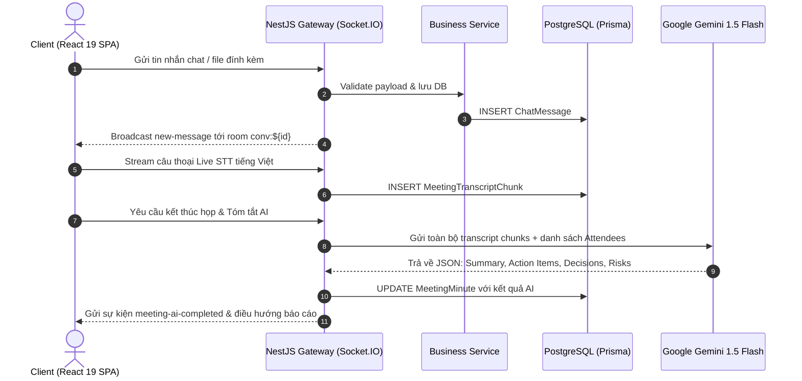

# 🛠️ Kiến Trúc Công Nghệ & Hạ Tầng (Tech Stack & Architecture) — WorkSync
> **Phiên bản:** 2.0 (Enterprise Updated) | **Ngày cập nhật:** 21/10/2026  
> **Mô hình kiến trúc:** Monorepo (Tách biệt Frontend SPA & Backend Modular REST/WS API).

---

## 1. Bảng Tổng Hợp Công Nghệ Thực Tế (Technology Landscape)

| Phân tầng (Layer) | Công nghệ sử dụng | Phiên bản thực tế | Lý do lựa chọn & Ứng dụng |
| :--- | :--- | :---: | :--- |
| **Frontend Framework** | **React** + **Vite** | React 19.2 / Vite 8.3 | Hiệu năng render vượt trội, HMR tức thời, kiến trúc Component linh hoạt |
| **Frontend Language** | **TypeScript** | Strict Mode | Type-safety tuyệt đối, Zero `any`, phát hiện lỗi tại thời điểm biên dịch |
| **Styling & Design Tokens** | **TailwindCSS** + **Vanilla CSS** | 3.4.x | Token màu HSL tùy biến, chuẩn hóa spacing, tối ưu bundle CSS siêu nhẹ |
| **State Management** | **Zustand** | 5.0.x | Quản lý state gọn nhẹ, tối ưu re-render, hỗ trợ Optimistic UI rollback khi lỗi |
| **Drag & Drop Engine** | **@hello-pangea/dnd** | 18.x | Đảm bảo tương thích hoàn hảo React 19 Strict Mode trên bảng Kanban |
| **Interactive Maps** | **Leaflet** + **React-Leaflet** | 1.9.x | Bản đồ tương tác OpenStreetMap hiển thị vùng Geofence 500m các cơ sở FPT |
| **Data Visualization** | **Recharts** | 2.x | Biểu đồ Burndown Chart Sprint, biểu đồ cột năng suất 7 ngày, donut chart |
| **Rich-Text Editor** | **Tiptap** | 2.x | Trình soạn thảo văn bản phong phú cho tài liệu ClickUp Docs và mô tả task |
| **WebRTC & Signaling** | **simple-peer** + **Socket.IO** | 9.x / 4.8.x | Truyền phát video P2P, âm thanh và chia sẻ màn hình chất lượng cao |
| **Speech-to-Text (STT)** | **Web Speech API** | Native Browser | Nhận diện giọng nói tiếng Việt trực tiếp, stream chunks thời gian thực |
| **Đa ngôn ngữ (i18n)** | **i18next** + **react-i18next** | 26.x / 17.x | Bản địa hóa song ngữ Tiếng Việt & Tiếng Anh 100%, chuyển đổi 1-chạm |
| **Biểu tượng (Icons)** | **Lucide React** | 1.52.x | Hệ thống vector icon sắc nét, đồng bộ chuẩn Bauhaus, thay thế toàn bộ emoji |
| **Backend Framework** | **NestJS** | 10.x / 12.x | Kiến trúc module doanh nghiệp, Dependency Injection, Controller/Service |
| **Cơ sở dữ liệu (Database)** | **PostgreSQL** | 16-alpine (port 5433) | ACID an toàn, hỗ trợ JSONB cho Action Items/Decisions, độ tin cậy cao |
| **ORM & Data Layer** | **Prisma** | 5.22.x | Type-safe schema-first, quản lý migration mượt mà, hỗ trợ `$transaction` |
| **In-Memory Cache** | **Redis** | 7-alpine (port 6380) | Caching phiên làm việc, lưu trữ room chat history và counter |
| **Trí tuệ nhân tạo (AI Engine)**| **Google Generative AI** | Gemini 1.5 Flash | Tóm tắt cuộc họp tự động, trích xuất Action Items/Decisions, AI doc summary |
| **Thời gian thực (Real-time)** | **NestJS Socket.IO Gateway** | 4.8.x | Vận hành độc lập namespace `/chat`, `/meetings`, `/notifications` |
| **Thông báo đẩy (Web Push)** | **web-push** | 3.6.x | Chuẩn VAPID native đẩy thông báo tới trình duyệt khi người dùng đóng tab |
| **Xác thực & Bảo mật** | **Passport JWT** + **Google OAuth 2.0**| - | Cơ chế Access Token 15m + Refresh Token HttpOnly Cookie, bcrypt cost 10 |
| **Kiểm thử tự động** | **Vitest** | 4.1.x | Tốc độ chạy siêu tốc, ESM native: 311 tests Backend + 106 tests Frontend |
| **Đóng gói & Triển khai** | **Docker** + **Docker Compose** | - | Chuẩn hóa môi trường chạy CSDL PostgreSQL và Redis |

---

## 2. Cấu Trúc Dự Án Thực Tế (Workspace Architecture)

```
Ver2/
├── backend/                        # Máy chủ API NestJS
│   ├── prisma/
│   │   ├── schema.prisma           # 37 models, 26 enums, quan hệ CSDL
│   │   ├── migrations/             # Lịch sử migrations an toàn
│   │   └── seed-enterprise-full.ts # Nạp dữ liệu doanh nghiệp mẫu 19 tài khoản
│   ├── src/
│   │   ├── attendance/             # Module Chấm công, GPS, WFH, Nghỉ phép, OT
│   │   ├── auth/                   # Module JWT, Google OAuth, Guards, Decorators
│   │   ├── calendar/               # Module Lịch làm việc hợp nhất 6 nguồn, ICS export
│   │   ├── chat/                   # Module Trò chuyện thời gian thực Socket.IO
│   │   ├── common/                 # Interceptors, Filters, DTOs chung
│   │   ├── dashboard/              # Thống kê tổng quan & velocity
│   │   ├── documents/              # Module ClickUp Docs, đính kèm 25MB, versioning
│   │   ├── meetings/               # WebRTC signaling, Live STT, Gemini 1.5 Flash AI
│   │   ├── notifications/          # Socket.IO notifications & Web Push VAPID
│   │   ├── projects/               # Module Dự án nhóm vs Cá nhân, swap-pm
│   │   ├── quick-tasks/            # Giao việc nhanh 1-chạm Trưởng phòng
│   │   ├── sprints/                # Module Quản lý Sprint Agile, Burndown Chart
│   │   ├── tasks/                  # Bảng Kanban, CRUD Task, kéo thả atomic
│   │   └── users/                  # Quản lý người dùng, phân quyền RBAC
│   └── test/                       # Unit tests & integration test suites
│
├── frontend/                       # Ứng dụng SPA React 19 + Vite 8
│   ├── src/
│   │   ├── components/             # Reusable UI components (Button, Modal, Input...)
│   │   ├── features/
│   │   │   ├── attendance/         # Giao diện check-in GPS, Leaflet, Heatmap, đơn từ
│   │   │   ├── auth/               # Trang đăng nhập, đăng ký, callback OAuth
│   │   │   ├── calendar/           # TimelineCanvas, popover, conflict banner
│   │   │   ├── chat/               # Khung chat 2 cột, bubble, emoji bar, context menu
│   │   │   ├── dashboard/          # Executive & Department Head dashboard layouts
│   │   │   ├── documents/          # Danh sách tài liệu, Tiptap editor, viewer
│   │   │   ├── meetings/           # Phòng họp WebRTC, PiP, Gemini AI summary, reports
│   │   │   ├── notifications/      # Chuông thông báo, notification popover
│   │   │   ├── projects/           # Chi tiết dự án, ProjectSprintsView (Jira-style)
│   │   │   ├── quick-tasks/        # Nút giao việc nhanh, modal ⚡ QuickTask
│   │   │   └── tasks/              # Trang KanbanPage, Linear Task Detail Drawer
│   │   ├── i18n/
│   │   │   └── locales/            # Từ điển song ngữ hoàn chỉnh: vi.json & en.json
│   │   ├── lib/                    # Axios API client, utils, date formatters
│   │   ├── stores/                 # Zustand stores (auth, task, project, chat...)
│   │   └── index.css               # Design tokens Bauhaus, typography Google Fonts
│   └── index.html                  # Khai báo font Plus Jakarta Sans & Inter
│
└── docs/                           # Bộ tài liệu dự án hoàn chỉnh (PRD, API, DB...)
```

---

## 3. Kiến Trúc Luồng Dữ Liệu Thời Gian Thực (Real-Time Architecture)



---

## 4. Giải Pháp Phòng Chống Rủi Ro Kỹ Thuật (Resilience & Security)

1. **Phòng Chống Lỗi Race Condition**:
   - Sử dụng Database Transaction nguyên tử (`prisma.$transaction`) cho mọi chuỗi thao tác: Trừ quỹ ngày phép, tạo dự án cá nhân song hành khi đăng ký, đổi vị trí kéo thả Kanban, và hoán đổi PM dự án (`swap-pm`).
2. **Cơ Chế Multi-Model Fallback Cho Gemini AI**:
   - Khi gọi Google Generative AI, nếu model `gemini-1.5-flash` phản hồi lỗi bận máy chủ (503), hệ thống tự động fallback qua `gemini-1.5-flash-8b` hoặc mô hình dự phòng mà không làm gián đoạn trải nghiệm người dùng.
3. **Phòng Ngừa Lỗ Hổng IDOR (Insecure Direct Object References)**:
   - Tất cả các endpoint cập nhật dữ liệu (`tasks`, `projects`, `documents`, `attendance`) đều được bọc qua lớp Service kiểm tra tư cách thành viên và quyền sở hữu (RBAC Guard).
