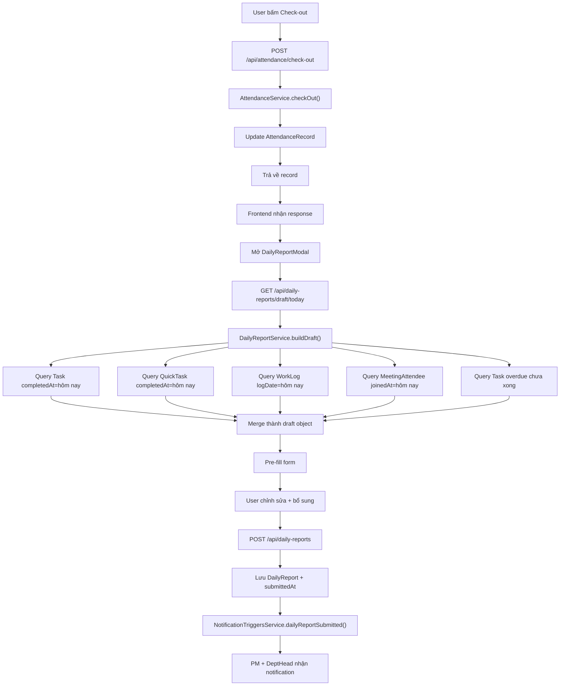
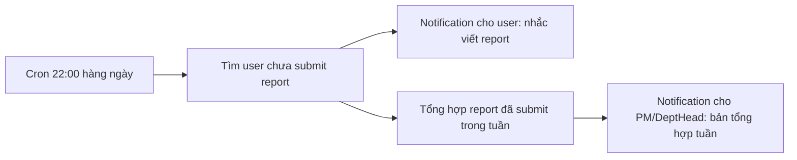
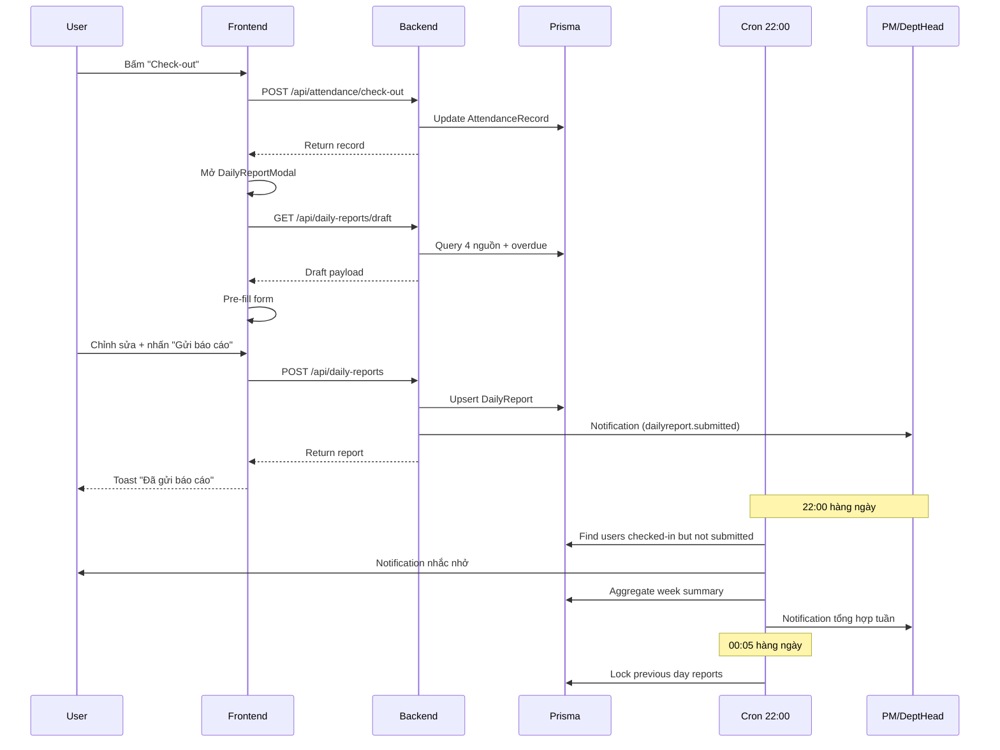

# M10 Daily Report — Báo cáo Cuối Ngày Tự Động

> **Trạng thái:** Plan (chưa triển khai)
> **Ngày:** 22/10/2026
> **Mức độ ưu tiên:** Cao (bổ sung nghiệp vụ chấm công & quản lý)
> **Người dùng:** AI Coding Agent (hướng dẫn triển khai từ UI → Backend)

---

## 0. Tóm tắt Quyết Định Nghiệp Vụ

| Hạng mục | Quyết định đã chốt |
|----------|---------------------|
| **Trigger mở form** | Tự động mở modal ngay sau khi **check-out thành công** |
| **Dữ liệu tự động điền** | 4 nguồn: Task hoàn thành hôm nay + QuickTask hoàn thành + WorkLog + Meeting đã tham dự |
| **Bổ sung** | Task quá hạn còn lại (auto-listing) |
| **Quyền xem** | PM (của dự án user tham gia) + DEPARTMENT_HEAD (cùng phòng ban) |
| **Phạm vi xem** | Theo **TUẦN** (Mon → Sun) |
| **Khoá báo cáo** | Sau midnight → report bị khoá, **không sửa được**. Chỉ PM/DeptHead xem được |
| **Notification** | **22:00 cuối ngày**: nhắc nhở người chưa viết report + gửi báo cáo tổng hợp cho PM/DeptHead |

---

## 1. Phân Tích Hiện Trạng

### 1.1 Đã có sẵn (Reuse được)

| Thành phần | Vị trí | Ghi chú |
|------------|--------|---------|
| `DailyReport` model | `backend/prisma/schema.prisma` L837-852 | **Đã có đầy đủ fields**: `content`, `tasksDone String[]`, `blockers String?`, `plannedTomorrow String?`, `aiDrafted Boolean`, `submittedAt DateTime?` |
| `User.dailyReports` relation | schema.prisma L253 | Đã khai báo |
| `AttendanceService.checkOut()` | `backend/src/attendance/attendance.service.ts` L209-281 | Điểm hook mở modal |
| `NotificationsService.create()` | `backend/src/notifications/notifications.service.ts` L24 | Dùng để tạo notification |
| `NotificationTriggersService` | `backend/src/notifications/notification-triggers.service.ts` | Pattern chuẩn để thêm trigger mới |
| `NotificationsCronService` | `backend/src/notifications/notifications.cron.ts` | Pattern chuẩn cho cron job |
| `TodayStatusBanner` | `frontend/src/features/attendance/components/TodayStatusBanner.tsx` | Nơi gọi `handleCheckOut()` → cần trigger modal |
| `AttendancePage` | `frontend/src/features/attendance/components/AttendancePage.tsx` | Quản lý tab, modal state |
| `AttendanceTeamView` | `frontend/src/features/attendance/components/AttendanceTeamView.tsx` | Pattern cho view quản lý của PM/DeptHead |
| `PermissionGuard` | `frontend/src/components/layout/PermissionGuard.tsx` | Bảo vệ route/view theo role |

### 1.2 Chưa có (Cần tạo mới)

| Hạng mục | Ghi chú |
|----------|---------|
| `DailyReportService` | Business logic: auto-fill, submit, week aggregation, RBAC |
| `DailyReportController` | REST endpoints |
| `DailyReportModule` | NestJS module |
| `NotificationType.DAILY_REPORT` | Enum mới trong schema.prisma |
| `DailyReportDraftService` (auto-fill) | Query 4 nguồn dữ liệu |
| Frontend: `DailyReportModal` | Form tự động điền + nút gửi |
| Frontend: `DailyReportTeamView` | PM/DeptHead xem theo tuần |
| Frontend: `MyDailyReportsList` | EMPLOYEE xem lịch sử của mình |
| Cron 22:00 | Nhắc nhở + báo cáo tổng hợp |

### 1.3 Schema Prisma — Cần mở rộng

Model `DailyReport` hiện tại:

```prisma
model DailyReport {
  id        String   @id @default(cuid())
  userId    String
  user      User     @relation(fields: [userId], references: [id])
  date      DateTime @db.Date
  content   String
  tasksDone String[]
  blockers  String?
  plannedTomorrow String?
  aiDrafted Boolean  @default(false)
  submittedAt DateTime?
  createdAt DateTime @default(now())
  updatedAt DateTime @updatedAt

  @@unique([userId, date])
}
```

**Cần thêm:**
- `isLocked Boolean @default(false)` — khoá sau midnight
- `submittedBy String?` — ai đã gửi (self hoặc manager nhập hộ)
- `reviewerId String?` + `reviewerComment String?` — PM/DeptHead có thể comment (tùy chọn, mở rộng sau)
- `lateSubmission Boolean @default(false)` — đánh dấu gửi trễ
- Index `@@index([date])` cho query tuần

**Enum cần thêm:**
```prisma
enum NotificationType {
  MEETING
  ATTENDANCE_APPROVAL
  QUICK_TASK
  MENTION
  TASK
  SYSTEM
  DAILY_REPORT   // ← MỚI
}
```

---

## 2. Kiến Trúc Luồng Dữ Liệu





---

## 3. Backend Implementation

### 3.1 Prisma Migration

**File:** `backend/prisma/schema.prisma`

Sửa model `DailyReport`:

```prisma
model DailyReport {
  id              String    @id @default(cuid())
  userId          String
  user            User      @relation(fields: [userId], references: [id])
  date            DateTime  @db.Date
  content         String
  tasksDone       String[]
  blockers        String?
  plannedTomorrow String?
  aiDrafted       Boolean   @default(false)
  isLocked        Boolean   @default(false)   // ← MỚI: khoá sau midnight
  lateSubmission  Boolean   @default(false)   // ← MỚI: gửi trễ
  submittedAt     DateTime?
  submittedById   String?                     // ← MỚI
  createdAt       DateTime  @default(now())
  updatedAt       DateTime  @updatedAt

  @@unique([userId, date])
  @@index([date])                             // ← MỚI: query tuần
  @@index([userId, date])                     // ← MỚI
}
```

Thêm enum value:
```prisma
enum NotificationType {
  MEETING
  ATTENDANCE_APPROVAL
  QUICK_TASK
  MENTION
  TASK
  SYSTEM
  DAILY_REPORT   // ← MỚI
}
```

**Migration file:** `backend/prisma/migrations/<timestamp>_add_daily_report_fields/migration.sql`

```sql
-- AlterTable
ALTER TABLE "DailyReport" ADD COLUMN "isLocked" BOOLEAN NOT NULL DEFAULT false,
ADD COLUMN "lateSubmission" BOOLEAN NOT NULL DEFAULT false,
ADD COLUMN "submittedById" TEXT;

-- CreateIndex
CREATE INDEX "DailyReport_date_idx" ON "DailyReport"("date");
CREATE INDEX "DailyReport_userId_date_idx" ON "DailyReport"("userId", "date");
```

### 3.2 Module Structure

```
backend/src/daily-reports/
├── daily-reports.module.ts
├── daily-reports.controller.ts
├── daily-reports.service.ts
├── daily-reports.draft.service.ts    # Auto-fill logic (4 nguồn + overdue)
├── daily-reports.permissions.ts      # RBAC matrix
├── dto/
│   ├── submit-daily-report.dto.ts
│   └── list-daily-reports.dto.ts
├── types/
│   └── daily-report.types.ts
└── __tests__/
    ├── daily-reports.service.spec.ts
    └── daily-reports.draft.service.spec.ts
```

### 3.3 Permissions (RBAC Matrix)

**File:** `backend/src/daily-reports/daily-reports.permissions.ts`

```typescript
import { Role } from '@prisma/client';

export interface ActorContext {
  id: string;
  role: Role;
  departmentId: string | null;
}

/**
 * Ai được xem daily report của user khác?
 * - ADMIN / HR: tất cả
 * - DEPARTMENT_HEAD: cùng phòng ban
 * - PM: các user trong dự án mà PM quản lý
 */
export function canViewReportsOf(
  actor: ActorContext,
  targetUserId: string,
  context: { sameDepartment: boolean; isProjectMember: boolean },
): boolean {
  if (actor.id === targetUserId) return true;              // Chính mình
  if (actor.role === Role.ADMIN || actor.role === Role.HR) return true;
  if (actor.role === Role.DEPARTMENT_HEAD && context.sameDepartment) return true;
  if (actor.role === Role.PM && context.isProjectMember) return true;
  return false;
}

/**
 * PM/DeptHead có thể nhập báo cáo hộ nhân viên khi nhân viên quên viết?
 */
export function canSubmitOnBehalf(
  actor: ActorContext,
  context: { sameDepartment: boolean; isProjectMember: boolean },
): boolean {
  if (actor.role === Role.ADMIN) return true;
  if (actor.role === Role.DEPARTMENT_HEAD && context.sameDepartment) return true;
  if (actor.role === Role.PM && context.isProjectMember) return true;
  return false;
}
```

### 3.4 Draft Service (Auto-fill Logic)

**File:** `backend/src/daily-reports/daily-reports.draft.service.ts`

```typescript
import { Injectable } from '@nestjs/common';
import { PrismaService } from '../prisma/prisma.service.js';

export interface DraftTaskItem {
  id: string;
  title: string;
  projectName: string;
  status: string;
  completedAt: string | null;
  workLogs: { id: string; duration: number; description: string | null }[];
}

export interface DraftMeetingItem {
  id: string;
  title: string;
  startTime: string;
  endTime: string;
  durationMinutes: number;
  roomCode: string | null;
}

export interface DraftPayload {
  date: string;
  attendance: {
    checkInTime: string | null;
    checkOutTime: string | null;
    status: string | null;
    workHours: number | null;
    breakMinutes: number | null;
  };
  completedTasks: DraftTaskItem[];
  completedQuickTasks: DraftTaskItem[];
  workLogs: {
    id: string;
    taskTitle: string;
    duration: number;
    description: string | null;
    logDate: string;
  }[];
  attendedMeetings: DraftMeetingItem[];
  overdueTasks: {
    id: string;
    title: string;
    projectName: string;
    dueDate: string;
    daysOverdue: number;
    priority: string;
  }[];
  suggestedContent: string;
  suggestedBlockers: string;
  suggestedPlannedTomorrow: string;
  totalWorkMinutes: number;
}

@Injectable()
export class DailyReportsDraftService {
  constructor(private readonly prisma: PrismaService) {}

  private getDateOnly(date = new Date(), timezone = 'Asia/Ho_Chi_Minh'): Date {
    const formatter = new Intl.DateTimeFormat('en-CA', {
      timeZone: timezone, year: 'numeric', month: '2-digit', day: '2-digit',
    });
    return new Date(`${formatter.format(date)}T00:00:00.000Z`);
  }

  /**
   * Build draft từ 4 nguồn dữ liệu + task quá hạn
   */
  async buildDraft(userId: string, date?: Date): Promise<DraftPayload> {
    const targetDate = date ?? this.getDateOnly();
    const nextDate = new Date(targetDate.getTime() + 24 * 60 * 60 * 1000);

    // 1. Attendance hôm nay
    const [attendance, breaks] = await Promise.all([
      this.prisma.attendanceRecord.findUnique({
        where: { userId_date: { userId, date: targetDate } },
      }),
      this.prisma.breakLog.findMany({
        where: { userId, date: targetDate },
      }),
    ]);

    // 2. Task hoàn thành hôm nay (completedAt trong ngày)
    const completedTasks = await this.prisma.task.findMany({
      where: {
        assigneeId: userId,
        status: 'DONE',
        completedAt: { gte: targetDate, lt: nextDate },
        deletedAt: null,
      },
      select: {
        id: true, title: true, status: true, completedAt: true,
        project: { select: { name: true } },
        workLogs: {
          select: { id: true, duration: true, description: true },
          where: { logDate: targetDate },
        },
      },
      orderBy: { completedAt: 'asc' },
    });

    // 3. QuickTask hoàn thành hôm nay
    const completedQuickTasks = await this.prisma.quickTask.findMany({
      where: {
        assigneeId: userId,
        status: 'DONE',
        completedAt: { gte: targetDate, lt: nextDate },
      },
      select: {
        id: true, title: true, status: true, completedAt: true,
        project: { select: { name: true } },
      },
      orderBy: { completedAt: 'asc' },
    });

    // 4. WorkLog hôm nay
    const workLogs = await this.prisma.workLog.findMany({
      where: { userId, logDate: targetDate },
      select: {
        id: true, duration: true, description: true, logDate: true,
        task: { select: { id: true, title: true } },
      },
      orderBy: { logDate: 'asc' },
    });

    // 5. Meeting đã tham dự hôm nay
    const attendedMeetings = await this.prisma.meetingAttendee.findMany({
      where: {
        userId,
        joinedAt: { gte: targetDate, lt: nextDate },
      },
      select: {
        joinedAt: true,
        meeting: {
          select: {
            id: true, title: true, startTime: true, endTime: true, roomCode: true,
          },
        },
      },
    });

    // 6. Task quá hạn còn lại
    const now = new Date();
    const overdueTasks = await this.prisma.task.findMany({
      where: {
        assigneeId: userId,
        status: { notIn: ['DONE'] },
        dueDate: { lt: now },
        deletedAt: null,
      },
      select: {
        id: true, title: true, dueDate: true, priority: true,
        project: { select: { name: true } },
      },
      orderBy: { dueDate: 'asc' },
      take: 20,
    });

    // Tính toán
    const totalWorkMinutes = workLogs.reduce((sum, wl) => sum + wl.duration, 0);
    const breakMinutes = breaks.reduce((sum, b) => {
      if (!b.endTime) return sum;
      return sum + Math.round((b.endTime.getTime() - b.startTime.getTime()) / 60000);
    }, 0);

    const checkIn = attendance?.checkInTime ?? null;
    const checkOut = attendance?.checkOutTime ?? null;
    const workHours = checkIn && checkOut
      ? Math.round(((checkOut.getTime() - checkIn.getTime()) / 3600000) * 100) / 100
      : null;

    // Auto-generate suggested content
    const suggestedContent = this.buildSuggestedContent({
      completedTasks, completedQuickTasks, workLogs, attendedMeetings, totalWorkMinutes,
    });
    const suggestedBlockers = this.buildSuggestedBlockers(overdueTasks);
    const suggestedPlannedTomorrow = this.buildSuggestedTomorrow(overdueTasks);

    return {
      date: targetDate.toISOString().split('T')[0],
      attendance: {
        checkInTime: checkIn?.toISOString() ?? null,
        checkOutTime: checkOut?.toISOString() ?? null,
        status: attendance?.status ?? null,
        workHours,
        breakMinutes: breakMinutes > 0 ? breakMinutes : null,
      },
      completedTasks: completedTasks.map((t) => ({
        id: t.id,
        title: t.title,
        projectName: t.project?.name ?? '',
        status: t.status,
        completedAt: t.completedAt?.toISOString() ?? null,
        workLogs: t.workLogs.map((w) => ({
          id: w.id, duration: w.duration, description: w.description,
        })),
      })),
      completedQuickTasks: completedQuickTasks.map((t) => ({
        id: t.id,
        title: t.title,
        projectName: t.project?.name ?? '',
        status: t.status,
        completedAt: t.completedAt?.toISOString() ?? null,
        workLogs: [],
      })),
      workLogs: workLogs.map((w) => ({
        id: w.id,
        taskTitle: w.task?.title ?? '',
        duration: w.duration,
        description: w.description,
        logDate: w.logDate.toISOString().split('T')[0],
      })),
      attendedMeetings: attendedMeetings.map((m) => {
        const durationMs = m.meeting.endTime.getTime() - m.meeting.startTime.getTime();
        return {
          id: m.meeting.id,
          title: m.meeting.title,
          startTime: m.meeting.startTime.toISOString(),
          endTime: m.meeting.endTime.toISOString(),
          durationMinutes: Math.round(durationMs / 60000),
          roomCode: m.meeting.roomCode,
        };
      }),
      overdueTasks: overdueTasks.map((t) => {
        const daysOverdue = t.dueDate
          ? Math.floor((now.getTime() - t.dueDate.getTime()) / 86400000)
          : 0;
        return {
          id: t.id,
          title: t.title,
          projectName: t.project?.name ?? '',
          dueDate: t.dueDate?.toISOString() ?? '',
          daysOverdue,
          priority: t.priority,
        };
      }),
      suggestedContent,
      suggestedBlockers,
      suggestedPlannedTomorrow,
      totalWorkMinutes,
    };
  }

  private buildSuggestedContent(input: {
    completedTasks: Array<{ title: string; projectName: string; workLogs: Array<{ duration: number; description: string | null }> }>;
    completedQuickTasks: Array<{ title: string; projectName: string }>;
    workLogs: Array<{ taskTitle: string; duration: number; description: string | null }>;
    attendedMeetings: Array<{ title: string; durationMinutes: number }>;
    totalWorkMinutes: number;
  }): string {
    const lines: string[] = [];

    if (input.totalWorkMinutes > 0) {
      const h = Math.floor(input.totalWorkMinutes / 60);
      const m = input.totalWorkMinutes % 60;
      lines.push(`Tổng thời gian làm việc: ${h}h${m > 0 ? `${m}p` : ''}.`);
    }

    if (input.completedTasks.length > 0) {
      lines.push('', 'Công việc đã hoàn thành:');
      for (const t of input.completedTasks) {
        const logInfo = t.workLogs.length > 0
          ? ` (${t.workLogs.reduce((s, w) => s + w.duration, 0)} phút)`
          : '';
        lines.push(`- ${t.title}${t.projectName ? ` [${t.projectName}]` : ''}${logInfo}`);
      }
    }

    if (input.completedQuickTasks.length > 0) {
      lines.push('', 'Việc nhanh đã hoàn thành:');
      for (const t of input.completedQuickTasks) {
        lines.push(`- ${t.title}${t.projectName ? ` [${t.projectName}]` : ''}`);
      }
    }

    if (input.attendedMeetings.length > 0) {
      lines.push('', 'Cuộc họp đã tham dự:');
      for (const m of input.attendedMeetings) {
        lines.push(`- ${m.title} (${m.durationMinutes} phút)`);
      }
    }

    if (input.workLogs.length > 0) {
      const withDesc = input.workLogs.filter((w) => w.description);
      if (withDesc.length > 0) {
        lines.push('', 'Ghi chú công việc:');
        for (const w of withDesc) {
          lines.push(`- ${w.taskTitle}: ${w.description}`);
        }
      }
    }

    return lines.join('\n');
  }

  private buildSuggestedBlockers(overdue: Array<{ title: string; daysOverdue: number }>): string {
    if (overdue.length === 0) return '';
    const lines = overdue.slice(0, 5).map(
      (t) => `- ${t.title} (trễ ${t.daysOverdue} ngày)`,
    );
    return `Các công việc còn tồn đọng:\n${lines.join('\n')}`;
  }

  private buildSuggestedTomorrow(overdue: Array<{ title: string }>): string {
    if (overdue.length === 0) return '';
    return overdue.slice(0, 3).map((t) => `- ${t.title}`).join('\n');
  }
}
```

### 3.5 Main Service

**File:** `backend/src/daily-reports/daily-reports.service.ts`

```typescript
import {
  Injectable, ForbiddenException, NotFoundException, BadRequestException,
} from '@nestjs/common';
import { PrismaService } from '../prisma/prisma.service.js';
import { NotificationsService } from '../notifications/notifications.service.js';
import { NotificationTriggersService } from '../notifications/notification-triggers.service.js';
import { DailyReportsDraftService } from './daily-reports.draft.service.js';
import { canViewReportsOf, canSubmitOnBehalf, ActorContext } from './daily-reports.permissions.js';
import { SubmitDailyReportDto } from './dto/submit-daily-report.dto.js';

@Injectable()
export class DailyReportsService {
  constructor(
    private readonly prisma: PrismaService,
    private readonly draftService: DailyReportsDraftService,
    private readonly notificationsService: NotificationsService,
    private readonly triggers: NotificationTriggersService,
  ) {}

  private getDateOnly(date = new Date(), timezone = 'Asia/Ho_Chi_Minh'): Date {
    const formatter = new Intl.DateTimeFormat('en-CA', {
      timeZone: timezone, year: 'numeric', month: '2-digit', day: '2-digit',
    });
    return new Date(`${formatter.format(date)}T00:00:00.000Z`);
  }

  /** Lấy draft tự động điền cho form */
  async getDraft(userId: string, date?: string) {
    const targetDate = date ? this.getDateOnly(new Date(date)) : this.getDateOnly();
    return this.draftService.buildDraft(userId, targetDate);
  }

  /** Lấy report của chính mình theo khoảng ngày */
  async getMyReports(userId: string, fromDate?: string, toDate?: string) {
    const where: any = { userId };
    if (fromDate || toDate) {
      where.date = {};
      if (fromDate) where.date.gte = this.getDateOnly(new Date(fromDate));
      if (toDate) where.date.lte = this.getDateOnly(new Date(toDate));
    }
    return this.prisma.dailyReport.findMany({
      where,
      orderBy: { date: 'desc' },
    });
  }

  /** Lấy 1 report theo id (có kiểm tra RBAC) */
  async getReportById(actor: ActorContext, reportId: string) {
    const report = await this.prisma.dailyReport.findUnique({
      where: { id: reportId },
      include: { user: { select: { id: true, name: true, avatar: true, role: true, departmentId: true } } },
    });
    if (!report) throw new NotFoundException('Không tìm thấy báo cáo');

    if (report.userId === actor.id) return report;

    const ctx = await this.buildViewContext(actor, report.userId);
    if (!canViewReportsOf(actor, report.userId, ctx)) {
      throw new ForbiddenException('Bạn không có quyền xem báo cáo của nhân viên này');
    }
    return report;
  }

  /** Tổng hợp report theo TUẦN cho PM/DeptHead */
  async getTeamReports(actor: ActorContext, query: { weekStart?: string; userId?: string }) {
    const weekStart = this.getWeekStart(query.weekStart ? new Date(query.weekStart) : new Date());
    const weekEnd = new Date(weekStart.getTime() + 7 * 86400000);

    // Xác định danh sách user mà actor được xem
    const targetUserIds = await this.resolveVisibleUserIds(actor, query.userId);
    if (targetUserIds.length === 0) {
      return { weekStart: weekStart.toISOString().split('T')[0], weekEnd: weekEnd.toISOString().split('T')[0], members: [] };
    }

    const reports = await this.prisma.dailyReport.findMany({
      where: {
        userId: { in: targetUserIds },
        date: { gte: weekStart, lt: weekEnd },
      },
      include: {
        user: { select: { id: true, name: true, avatar: true, role: true, position: true } },
      },
      orderBy: [{ userId: 'asc' }, { date: 'asc' }],
    });

    // Gom theo user
    const byUser = new Map<string, typeof reports>();
    for (const r of reports) {
      const list = byUser.get(r.userId) ?? [];
      list.push(r);
      byUser.set(r.userId, list);
    }

    // Thêm user chưa có report nào (để PM thấy ai trễ)
    const allUsers = await this.prisma.user.findMany({
      where: { id: { in: targetUserIds } },
      select: { id: true, name: true, avatar: true, role: true, position: true },
    });

    const members = allUsers.map((u) => {
      const userReports = byUser.get(u.id) ?? [];
      const submittedDays = userReports.length;
      const blockers = userReports.map((r) => r.blockers).filter(Boolean) as string[];
      return {
        user: u,
        reports: userReports,
        summary: {
          submittedDays,
          totalWorkMinutes: userReports.reduce((s, r) => s + (r.tasksDone?.length ?? 0) * 0, 0),
          blockerCount: blockers.length,
          hasBlockers: blockers.length > 0,
        },
      };
    });

    return {
      weekStart: weekStart.toISOString().split('T')[0],
      weekEnd: new Date(weekEnd.getTime() - 86400000).toISOString().split('T')[0],
      members,
    };
  }

  /** Submit daily report */
  async submit(actor: ActorContext, dto: SubmitDailyReportDto) {
    const reportDate = this.getDateOnly(new Date(dto.date));
    const isToday = reportDate.getTime() === this.getDateOnly().getTime();
    const isPast = reportDate.getTime() < this.getDateOnly().getTime();

    // Nếu là ngày quá khứ → report đã bị khoá, không cho sửa
    if (isPast) {
      const existing = await this.prisma.dailyReport.findUnique({
        where: { userId_date: { userId: actor.id, date: reportDate } },
      });
      if (existing?.isLocked) {
        throw new ForbiddenException(
          'Báo cáo đã khoá sau 00:00. Bạn không thể sửa báo cáo của ngày đã qua.',
        );
      }
    }

    // Nếu là ngày hôm nay → cho sửa (thay thế, không tạo mới)
    const existing = await this.prisma.dailyReport.findUnique({
      where: { userId_date: { userId: actor.id, date: reportDate } },
    });

    if (existing?.isLocked) {
      throw new ForbiddenException('Báo cáo này đã khoá, không thể sửa.');
    }

    const lateSubmission = isPast;
    const data = {
      content: dto.content,
      tasksDone: dto.tasksDone ?? [],
      blockers: dto.blockers ?? null,
      plannedTomorrow: dto.plannedTomorrow ?? null,
      submittedAt: new Date(),
      submittedById: actor.id,
      lateSubmission,
      isLocked: false,
    };

    const report = existing
      ? await this.prisma.dailyReport.update({ where: { id: existing.id }, data })
      : await this.prisma.dailyReport.create({
          data: { ...data, userId: actor.id, date: reportDate },
        });

    // Trigger notification cho PM/DeptHead
    await this.triggers.dailyReportSubmitted({
      id: report.id,
      userId: actor.id,
      date: reportDate,
      lateSubmission,
    });

    return report;
  }

  /** Manager nhập báo cáo hộ nhân viên */
  async submitOnBehalf(
    actor: ActorContext,
    targetUserId: string,
    dto: SubmitDailyReportDto,
  ) {
    const ctx = await this.buildViewContext(actor, targetUserId);
    if (!canSubmitOnBehalf(actor, ctx)) {
      throw new ForbiddenException('Bạn không có quyền nhập báo cáo hộ nhân viên này');
    }

    const reportDate = this.getDateOnly(new Date(dto.date));
    const existing = await this.prisma.dailyReport.findUnique({
      where: { userId_date: { userId: targetUserId, date: reportDate } },
    });
    if (existing?.isLocked) {
      throw new ForbiddenException('Báo cáo này đã khoá, không thể sửa.');
    }

    const data = {
      content: dto.content,
      tasksDone: dto.tasksDone ?? [],
      blockers: dto.blockers ?? null,
      plannedTomorrow: dto.plannedTomorrow ?? null,
      submittedAt: new Date(),
      submittedById: actor.id,
      lateSubmission: reportDate.getTime() < this.getDateOnly().getTime(),
      isLocked: false,
    };

    const report = existing
      ? await this.prisma.dailyReport.update({ where: { id: existing.id }, data })
      : await this.prisma.dailyReport.create({
          data: { ...data, userId: targetUserId, date: reportDate },
        });

    return report;
  }

  /** Khoá tất cả report của ngày hôm qua (cron 00:05) */
  async lockPreviousDayReports() {
    const yesterday = new Date(this.getDateOnly().getTime() - 86400000);
    const result = await this.prisma.dailyReport.updateMany({
      where: { date: yesterday, isLocked: false },
      data: { isLocked: true },
    });
    return result.count;
  }

  // ---- Helper ----
  private getWeekStart(date: Date): Date {
    const d = this.getDateOnly(date);
    const day = d.getUTCDay(); // 0 = CN
    const diff = day === 0 ? -6 : 1 - day; // Monday start
    return new Date(d.getTime() + diff * 86400000);
  }

  private async buildViewContext(
    actor: ActorContext,
    targetUserId: string,
  ): Promise<{ sameDepartment: boolean; isProjectMember: boolean }> {
    const target = await this.prisma.user.findUnique({
      where: { id: targetUserId },
      select: { departmentId: true },
    });
    const sameDepartment =
      actor.departmentId != null && target?.departmentId === actor.departmentId;

    let isProjectMember = false;
    if (actor.role === 'PM') {
      const shared = await this.prisma.projectMember.findFirst({
        where: { userId: targetUserId, project: { pmId: actor.id } },
        select: { id: true },
      });
      isProjectMember = shared !== null;
    }
    return { sameDepartment, isProjectMember };
  }

  private async resolveVisibleUserIds(
    actor: ActorContext,
    explicitUserId?: string,
  ): Promise<string[]> {
    if (actor.role === 'ADMIN' || actor.role === 'HR') {
      if (explicitUserId) return [explicitUserId];
      const users = await this.prisma.user.findMany({
        where: { status: 'ACTIVE' },
        select: { id: true },
      });
      return users.map((u) => u.id);
    }

    if (actor.role === 'DEPARTMENT_HEAD' && actor.departmentId) {
      const members = await this.prisma.user.findMany({
        where: { departmentId: actor.departmentId, status: 'ACTIVE' },
        select: { id: true },
      });
      const ids = members.map((m) => m.id);
      if (explicitUserId) return ids.includes(explicitUserId) ? [explicitUserId] : [];
      return ids;
    }

    if (actor.role === 'PM') {
      const members = await this.prisma.projectMember.findMany({
        where: { project: { pmId: actor.id } },
        select: { userId: true },
      });
      const ids = Array.from(new Set(members.map((m) => m.userId)));
      if (explicitUserId) return ids.includes(explicitUserId) ? [explicitUserId] : [];
      return ids;
    }

    return explicitUserId ? [explicitUserId] : [];
  }
}
```

### 3.6 DTOs

**File:** `backend/src/daily-reports/dto/submit-daily-report.dto.ts`

```typescript
import {
  IsString, IsOptional, IsArray, IsDateString, ArrayMaxSize, MinLength, MaxLength,
} from 'class-validator';

export class SubmitDailyReportDto {
  @IsDateString({ message: 'Ngày không hợp lệ' })
  date!: string;

  @IsString()
  @MinLength(10, { message: 'Nội dung báo cáo phải có ít nhất 10 ký tự' })
  @MaxLength(5000, { message: 'Nội dung báo cáo không được vượt quá 5000 ký tự' })
  content!: string;

  @IsOptional()
  @IsArray()
  @ArrayMaxSize(100)
  @IsString({ each: true })
  tasksDone?: string[];

  @IsOptional()
  @IsString()
  @MaxLength(2000)
  blockers?: string;

  @IsOptional()
  @IsString()
  @MaxLength(2000)
  plannedTomorrow?: string;
}
```

**File:** `backend/src/daily-reports/dto/list-daily-reports.dto.ts`

```typescript
import { IsOptional, IsDateString, IsString } from 'class-validator';

export class ListDailyReportsDto {
  @IsOptional()
  @IsDateString()
  fromDate?: string;

  @IsOptional()
  @IsDateString()
  toDate?: string;

  @IsOptional()
  @IsString()
  weekStart?: string;

  @IsOptional()
  @IsString()
  userId?: string;
}
```

### 3.7 Controller

**File:** `backend/src/daily-reports/daily-reports.controller.ts`

```typescript
import {
  Controller, Get, Post, Patch, Param, Body, Query, UseGuards,
} from '@nestjs/common';
import { JwtAuthGuard } from '../auth/guards/jwt-auth.guard.js';
import { RolesGuard } from '../common/guards/roles.guard.js';
import { Roles } from '../common/decorators/roles.decorator.js';
import { CurrentUser } from '../common/decorators/current-user.decorator.js';
import { DailyReportsService } from './daily-reports.service.js';
import { SubmitDailyReportDto } from './dto/submit-daily-report.dto.js';
import { ListDailyReportsDto } from './dto/list-daily-reports.dto.js';
import type { ActorContext } from './daily-reports.permissions.js';

@Controller('daily-reports')
@UseGuards(JwtAuthGuard)
export class DailyReportsController {
  constructor(private readonly dailyReportsService: DailyReportsService) {}

  /** Draft tự động điền (dùng cho modal sau check-out) */
  @Get('draft')
  async getDraft(@CurrentUser() user: ActorContext, @Query('date') date?: string) {
    return this.dailyReportsService.getDraft(user.id, date);
  }

  /** Report của chính mình */
  @Get('mine')
  async getMine(@CurrentUser() user: ActorContext, @Query() query: ListDailyReportsDto) {
    return this.dailyReportsService.getMyReports(user.id, query.fromDate, query.toDate);
  }

  /** Tổng hợp tuần cho PM/DeptHead */
  @Get('team')
  @UseGuards(RolesGuard)
  @Roles('ADMIN', 'HR', 'DEPARTMENT_HEAD', 'PM')
  async getTeam(@CurrentUser() user: ActorContext, @Query() query: ListDailyReportsDto) {
    return this.dailyReportsService.getTeamReports(user, query);
  }

  /** Lấy 1 report (RBAC check) */
  @Get(':id')
  async getById(@CurrentUser() user: ActorContext, @Param('id') id: string) {
    return this.dailyReportsService.getReportById(user, id);
  }

  /** Gửi báo cáo (chính mình) */
  @Post()
  async submit(@CurrentUser() user: ActorContext, @Body() dto: SubmitDailyReportDto) {
    return this.dailyReportsService.submit(user, dto);
  }

  /** Manager nhập báo cáo hộ nhân viên */
  @Post('on-behalf/:userId')
  @UseGuards(RolesGuard)
  @Roles('ADMIN', 'HR', 'DEPARTMENT_HEAD', 'PM')
  async submitOnBehalf(
    @CurrentUser() user: ActorContext,
    @Param('userId') userId: string,
    @Body() dto: SubmitDailyReportDto,
  ) {
    return this.dailyReportsService.submitOnBehalf(user, userId, dto);
  }

  /** Khoá report của ngày hôm qua (cron) */
  @Patch('lock-previous')
  @UseGuards(RolesGuard)
  @Roles('ADMIN')
  async lockPrevious(@CurrentUser() user: ActorContext) {
    const count = await this.dailyReportsService.lockPreviousDayReports();
    return { locked: count };
  }
}
```

### 3.8 Module

**File:** `backend/src/daily-reports/daily-reports.module.ts`

```typescript
import { Module } from '@nestjs/common';
import { DailyReportsController } from './daily-reports.controller.js';
import { DailyReportsService } from './daily-reports.service.js';
import { DailyReportsDraftService } from './daily-reports.draft.service.js';
import { NotificationsModule } from '../notifications/notifications.module.js';

@Module({
  imports: [NotificationsModule],
  controllers: [DailyReportsController],
  providers: [DailyReportsService, DailyReportsDraftService],
  exports: [DailyReportsService],
})
export class DailyReportsModule {}
```

### 3.9 Notification Trigger

**File:** `backend/src/notifications/notification-triggers.service.ts` — **thêm method mới**

```typescript
// ==========================================
// 6. DAILY REPORT TRIGGERS
// ==========================================

async dailyReportSubmitted(report: {
  id: string;
  userId: string;
  date: Date;
  lateSubmission: boolean;
}) {
  const user = await this.prisma.user.findUnique({
    where: { id: report.userId },
    select: { name: true, departmentId: true, position: true },
  });

  // Tìm PM của các dự án user tham gia + DeptHead của phòng ban
  const pmIds = await this.prisma.projectMember.findMany({
    where: { userId: report.userId, project: { pmId: { not: null } } },
    select: { project: { select: { pmId: true } } },
  });
  const pmIdSet = new Set(
    pmIds.map((p) => p.project.pmId).filter((v): v is string => v !== null),
  );

  const deptHeads = user?.departmentId
    ? await this.prisma.user.findMany({
        where: { departmentId: user.departmentId, role: 'DEPARTMENT_HEAD', status: 'ACTIVE' },
        select: { id: true },
      })
    : [];

  const recipientIds = Array.from(
    new Set([...pmIdSet, ...deptHeads.map((d) => d.id)]),
  ).filter((id) => id !== report.userId);

  const dateStr = report.date.toISOString().split('T')[0];
  const latePrefix = report.lateSubmission ? '[Gửi trễ] ' : '';

  for (const recipientId of recipientIds) {
    await this.notificationsService.create({
      userId: recipientId,
      type: NotificationType.DAILY_REPORT,
      category: 'dailyreport.submitted',
      title: `${latePrefix}Báo cáo ngày ${dateStr} đã được gửi`,
      body: `${user?.name ?? 'Nhân viên'} đã nộp báo cáo cuối ngày.`,
      data: {
        reportId: report.id,
        userId: report.userId,
        date: dateStr,
        url: `/attendance?tab=daily-reports&userId=${report.userId}&weekStart=${dateStr}`,
      },
      actorId: report.userId,
    });
  }
}
```

### 3.10 Cron Jobs

**File:** `backend/src/notifications/notifications.cron.ts` — **thêm 2 cron**

```typescript
import { DailyReportsService } from '../daily-reports/daily-reports.service.js';

constructor(
  private readonly prisma: PrismaService,
  private readonly triggers: NotificationTriggersService,
  private readonly dailyReportsService: DailyReportsService,
) {}

/**
 * 00:05 — Khoá report của ngày hôm qua (sau midnight)
 */
@Cron('5 0 * * *')
async lockPreviousDayReports() {
  try {
    const count = await this.dailyReportsService.lockPreviousDayReports();
    if (count > 0) {
      this.logger.log(`Locked ${count} daily report(s) from previous day`);
    }
  } catch (err: unknown) {
    this.logger.error(`Error in lockPreviousDayReports: ${(err as Error).message}`);
  }
}

/**
 * 22:00 — Nhắc nhở người chưa viết report + gửi tổng hợp cho PM/DeptHead
 */
@Cron('0 22 * * *')
async remindMissingDailyReports() {
  try {
    const today = this.getDateOnly();
    const timezone = 'Asia/Ho_Chi_Minh';

    // 1. Tìm user đã check-in hôm nay nhưng chưa submit report
    const checkedIn = await this.prisma.attendanceRecord.findMany({
      where: { date: today, checkInTime: { not: null } },
      select: { userId: true },
    });
    const checkedInIds = checkedIn.map((c) => c.userId);

    const submitted = await this.prisma.dailyReport.findMany({
      where: { date: today, userId: { in: checkedInIds } },
      select: { userId: true },
    });
    const submittedIds = new Set(submitted.map((s) => s.userId));

    const missing = checkedInIds.filter((id) => !submittedIds.has(id));

    // 2. Notify từng user chưa viết
    for (const userId of missing) {
      const user = await this.prisma.user.findUnique({
        where: { id: userId },
        select: { name: true },
      });
      await this.notificationsService.create({
        userId,
        type: NotificationType.DAILY_REPORT,
        category: 'dailyreport.reminder',
        title: 'Nhắc nhở: Bạn chưa nộp báo cáo cuối ngày',
        body: 'Hôm nay bạn đã check-in nhưng chưa viết báo cáo. Vui lòng nộp trước 23:59.',
        data: { date: today.toISOString().split('T')[0], url: '/attendance?tab=daily-report' },
      });
    }

    // 3. Gửi tổng hợp tuần cho PM/DeptHead
    const summary = await this.dailyReportsService.getTeamReports(
      { id: 'system', role: 'ADMIN' as any, departmentId: null },
      {},
    );
    const totalMembers = summary.members.length;
    const submittedMembers = summary.members.filter(
      (m: any) => m.summary.submittedDays > 0,
    ).length;

    if (totalMembers > 0) {
      const managers = await this.prisma.user.findMany({
        where: {
          role: { in: ['PM', 'DEPARTMENT_HEAD'] },
          status: 'ACTIVE',
        },
        select: { id: true },
      });

      for (const mgr of managers) {
        await this.notificationsService.create({
          userId: mgr.id,
          type: NotificationType.DAILY_REPORT,
          category: 'dailyreport.weekly_summary',
          title: `Tổng hợp báo cáo tuần (${summary.weekStart} → ${summary.weekEnd})`,
          body: `${submittedMembers}/${totalMembers} thành viên đã nộp báo cáo trong tuần này.`,
          data: { url: '/attendance?tab=daily-reports' },
        });
      }
    }

    this.logger.log(`Reminded ${missing.length} user(s) missing daily report`);
  } catch (err: unknown) {
    this.logger.error(`Error in remindMissingDailyReports: ${(err as Error).message}`);
  }
}
```

### 3.11 Wire-up vào `app.module.ts`

**File:** `backend/src/app.module.ts`

```typescript
import { DailyReportsModule } from './daily-reports/daily-reports.module.js';

@Module({
  imports: [
    // ...
    DailyReportsModule,
  ],
})
export class AppModule {}
```

---

## 4. Frontend Implementation

### 4.1 File Structure

```
frontend/src/features/attendance/
├── components/
│   ├── DailyReportModal.tsx          # ← MỚI: Form auto-fill + submit
│   ├── DailyReportForm.tsx           # ← MỚI: Form fields (draft data display)
│   ├── DailyReportTeamView.tsx      # ← MỚI: PM/DeptHead xem theo tuần
│   ├── DailyReportCard.tsx           # ← MỚI: 1 report item
│   ├── MyDailyReportsList.tsx        # ← MỚI: EMPLOYEE xem lịch sử
│   └── DailyReportReminderBanner.tsx # ← MỚI: Banner nhắc viết report
└── types/
    └── daily-report.types.ts         # ← MỚI
```

### 4.2 Types

**File:** `frontend/src/features/attendance/types/daily-report.types.ts`

```typescript
export interface DailyReport {
  id: string;
  userId: string;
  date: string;
  content: string;
  tasksDone: string[];
  blockers: string | null;
  plannedTomorrow: string | null;
  isLocked: boolean;
  lateSubmission: boolean;
  submittedAt: string | null;
  createdAt: string;
  updatedAt: string;
  user?: {
    id: string;
    name: string;
    avatar: string | null;
    role: string;
    position: string | null;
  };
}

export interface DailyReportDraft {
  date: string;
  attendance: {
    checkInTime: string | null;
    checkOutTime: string | null;
    status: string | null;
    workHours: number | null;
    breakMinutes: number | null;
  };
  completedTasks: Array<{
    id: string;
    title: string;
    projectName: string;
    status: string;
    completedAt: string | null;
    workLogs: Array<{ id: string; duration: number; description: string | null }>;
  }>;
  completedQuickTasks: Array<{
    id: string;
    title: string;
    projectName: string;
    status: string;
    completedAt: string | null;
    workLogs: [];
  }>;
  workLogs: Array<{
    id: string;
    taskTitle: string;
    duration: number;
    description: string | null;
    logDate: string;
  }>;
  attendedMeetings: Array<{
    id: string;
    title: string;
    startTime: string;
    endTime: string;
    durationMinutes: number;
    roomCode: string | null;
  }>;
  overdueTasks: Array<{
    id: string;
    title: string;
    projectName: string;
    dueDate: string;
    daysOverdue: number;
    priority: string;
  }>;
  suggestedContent: string;
  suggestedBlockers: string;
  suggestedPlannedTomorrow: string;
  totalWorkMinutes: number;
}

export interface TeamReportsResponse {
  weekStart: string;
  weekEnd: string;
  members: Array<{
    user: { id: string; name: string; avatar: string | null; role: string; position: string | null };
    reports: DailyReport[];
    summary: {
      submittedDays: number;
      totalWorkMinutes: number;
      blockerCount: number;
      hasBlockers: boolean;
    };
  }>;
}
```

### 4.3 API Client

**File:** `frontend/src/features/attendance/api/attendance.api.ts` — **thêm methods**

```typescript
import type { DailyReport, DailyReportDraft, TeamReportsResponse } from '../types/daily-report.types';

export const attendanceApi = {
  // ... existing methods ...

  /** Lấy draft tự động điền */
  getDailyReportDraft: async (date?: string): Promise<DailyReportDraft> => {
    const res = await apiClient.get<DailyReportDraft>('/daily-reports/draft', {
      params: { date },
    });
    return res.data;
  },

  /** Gửi daily report */
  submitDailyReport: async (payload: {
    date: string;
    content: string;
    tasksDone?: string[];
    blockers?: string;
    plannedTomorrow?: string;
  }): Promise<DailyReport> => {
    const res = await apiClient.post<DailyReport>('/daily-reports', payload);
    return res.data;
  },

  /** Report của chính mình */
  getMyDailyReports: async (fromDate?: string, toDate?: string): Promise<DailyReport[]> => {
    const res = await apiClient.get<DailyReport[]>('/daily-reports/mine', {
      params: { fromDate, toDate },
    });
    return res.data;
  },

  /** Tổng hợp tuần (PM/DeptHead) */
  getTeamDailyReports: async (params: {
    weekStart?: string;
    userId?: string;
  }): Promise<TeamReportsResponse> => {
    const res = await apiClient.get<TeamReportsResponse>('/daily-reports/team', { params });
    return res.data;
  },

  /** Manager nhập báo cáo hộ */
  submitDailyReportOnBehalf: async (
    userId: string,
    payload: { date: string; content: string; tasksDone?: string[]; blockers?: string; plannedTomorrow?: string },
  ): Promise<DailyReport> => {
    const res = await apiClient.post<DailyReport>(`/daily-reports/on-behalf/${userId}`, payload);
    return res.data;
  },
};
```

### 4.4 DailyReportModal (Component chính)

**File:** `frontend/src/features/attendance/components/DailyReportModal.tsx`

```tsx
import React, { useEffect, useState } from 'react';
import { useTranslation } from 'react-i18next';
import {
  X, FileText, CheckCircle2, Clock, Video, AlertTriangle, ListTodo,
  CalendarClock, TrendingUp, Send, Loader2, Sparkles,
} from 'lucide-react';
import { toast } from 'sonner';
import { attendanceApi } from '../api/attendance.api';
import type { DailyReportDraft } from '../types/daily-report.types';

interface DailyReportModalProps {
  isOpen: boolean;
  onClose: () => void;
  onSubmitted?: () => void;
  date?: string;
}

export function DailyReportModal({ isOpen, onClose, onSubmitted, date }: DailyReportModalProps) {
  const { i18n } = useTranslation();
  const isVi = i18n.language.startsWith('vi');

  const [draft, setDraft] = useState<DailyReportDraft | null>(null);
  const [isLoading, setIsLoading] = useState(false);
  const [isSubmitting, setIsSubmitting] = useState(false);

  const [content, setContent] = useState('');
  const [blockers, setBlockers] = useState('');
  const [plannedTomorrow, setPlannedTomorrow] = useState('');
  const [selectedTasks, setSelectedTasks] = useState<string[]>([]);

  useEffect(() => {
    if (!isOpen) return;
    setIsLoading(true);
    attendanceApi
      .getDailyReportDraft(date)
      .then((d) => {
        setDraft(d);
        setContent(d.suggestedContent);
        setBlockers(d.suggestedBlockers);
        setPlannedTomorrow(d.suggestedPlannedTomorrow);
        setSelectedTasks(
          [...d.completedTasks, ...d.completedQuickTasks].map((t) => t.title),
        );
      })
      .catch(() => toast.error(isVi ? 'Không tải được dữ liệu báo cáo' : 'Failed to load report draft'))
      .finally(() => setIsLoading(false));
  }, [isOpen, date]);

  const handleSubmit = async () => {
    if (content.trim().length < 10) {
      toast.error(isVi ? 'Nội dung báo cáo phải có ít nhất 10 ký tự' : 'Report content must be at least 10 characters');
      return;
    }
    setIsSubmitting(true);
    try {
      await attendanceApi.submitDailyReport({
        date: draft?.date ?? new Date().toISOString().split('T')[0],
        content: content.trim(),
        tasksDone: selectedTasks,
        blockers: blockers.trim() || undefined,
        plannedTomorrow: plannedTomorrow.trim() || undefined,
      });
      toast.success(isVi ? 'Đã gửi báo cáo cuối ngày' : 'Daily report submitted');
      onSubmitted?.();
      onClose();
    } catch (err: unknown) {
      const msg = err instanceof Error ? err.message : (isVi ? 'Lỗi gửi báo cáo' : 'Submit failed');
      toast.error(msg);
    } finally {
      setIsSubmitting(false);
    }
  };

  if (!isOpen) return null;

  const totalMinutes = draft?.totalWorkMinutes ?? 0;
  const workHours = Math.floor(totalMinutes / 60);
  const workMins = totalMinutes % 60;

  return (
    <div className="fixed inset-0 z-50 flex items-center justify-center p-4 bg-slate-900/40 backdrop-blur-xs animate-in fade-in duration-150">
      <div className="w-full max-w-3xl bg-white rounded-3xl border border-slate-200 shadow-2xl overflow-hidden flex flex-col max-h-[90vh] animate-in zoom-in-95 duration-150">
        {/* Header */}
        <div className="px-6 py-4 border-b border-slate-100 flex items-center justify-between bg-slate-50/50 shrink-0">
          <div className="flex items-center gap-3">
            <div className="w-10 h-10 rounded-xl bg-blue-50 border border-blue-200 text-blue-600 flex items-center justify-center">
              <FileText className="w-5 h-5" />
            </div>
            <div>
              <h3 className="text-sm font-bold text-slate-900">
                {isVi ? 'Báo cáo cuối ngày' : 'End-of-day Report'}
              </h3>
              <p className="text-[11px] text-slate-400">
                {isVi ? 'Đã tự động điền hoạt động hôm nay — kiểm tra và bổ sung' : 'Auto-filled with today\'s activity — review and supplement'}
              </p>
            </div>
          </div>
          <button onClick={onClose} className="p-1.5 rounded-xl text-slate-400 hover:text-slate-700 hover:bg-slate-100 transition-colors cursor-pointer">
            <X className="w-4 h-4" />
          </button>
        </div>

        {/* Body */}
        <div className="p-6 space-y-5 overflow-y-auto">
          {isLoading ? (
            <div className="flex flex-col items-center justify-center py-12">
              <Loader2 className="w-7 h-7 text-blue-600 animate-spin mb-3" />
              <p className="text-xs text-slate-500">{isVi ? 'Đang tổng hợp hoạt động...' : 'Aggregating activity...'}</p>
            </div>
          ) : draft ? (
            <>
              {/* KPI Row */}
              <div className="grid grid-cols-2 sm:grid-cols-4 gap-3">
                <div className="p-3 rounded-xl bg-slate-50 border border-slate-200/80">
                  <div className="flex items-center gap-1.5 text-slate-400 text-[11px] font-semibold mb-1">
                    <Clock className="w-3.5 h-3.5" /><span>{isVi ? 'Thời gian' : 'Hours'}</span>
                  </div>
                  <p className="font-bold text-slate-800">{workHours}h{workMins > 0 ? `${workMins}m` : ''}</p>
                </div>
                <div className="p-3 rounded-xl bg-emerald-50 border border-emerald-200/80">
                  <div className="flex items-center gap-1.5 text-emerald-600 text-[11px] font-semibold mb-1">
                    <CheckCircle2 className="w-3.5 h-3.5" /><span>{isVi ? 'Hoàn thành' : 'Completed'}</span>
                  </div>
                  <p className="font-bold text-emerald-800">
                    {draft.completedTasks.length + draft.completedQuickTasks.length}
                  </p>
                </div>
                <div className="p-3 rounded-xl bg-purple-50 border border-purple-200/80">
                  <div className="flex items-center gap-1.5 text-purple-600 text-[11px] font-semibold mb-1">
                    <Video className="w-3.5 h-3.5" /><span>{isVi ? 'Cuộc họp' : 'Meetings'}</span>
                  </div>
                  <p className="font-bold text-purple-800">{draft.attendedMeetings.length}</p>
                </div>
                <div className="p-3 rounded-xl bg-rose-50 border border-rose-200/80">
                  <div className="flex items-center gap-1.5 text-rose-600 text-[11px] font-semibold mb-1">
                    <AlertTriangle className="w-3.5 h-3.5" /><span>{isVi ? 'Quá hạn' : 'Overdue'}</span>
                  </div>
                  <p className="font-bold text-rose-800">{draft.overdueTasks.length}</p>
                </div>
              </div>

              {/* Completed Tasks (checkable) */}
              {draft.completedTasks.length + draft.completedQuickTasks.length > 0 && (
                <div>
                  <div className="flex items-center gap-2 mb-2.5">
                    <ListTodo className="w-4 h-4 text-emerald-600" />
                    <h4 className="text-xs font-bold text-slate-700 uppercase tracking-wider">
                      {isVi ? 'Công việc đã hoàn thành' : 'Completed Work'}
                    </h4>
                    <span className="text-[10px] text-slate-400">({selectedTasks.length} {isVi ? 'đã chọn' : 'selected'})</span>
                  </div>
                  <div className="space-y-1.5 max-h-48 overflow-y-auto pr-1">
                    {[...draft.completedTasks, ...draft.completedQuickTasks].map((t) => (
                      <label key={t.id} className="flex items-start gap-2.5 p-2.5 rounded-xl bg-slate-50 border border-slate-200/70 hover:bg-slate-100/70 cursor-pointer transition-colors">
                        <input
                          type="checkbox"
                          checked={selectedTasks.includes(t.title)}
                          onChange={(e) =>
                            setSelectedTasks((prev) =>
                              e.target.checked ? [...prev, t.title] : prev.filter((x) => x !== t.title),
                            )
                          }
                          className="mt-0.5 w-4 h-4 rounded border-slate-300 text-blue-600 focus:ring-blue-500/20"
                        />
                        <div className="min-w-0 flex-1">
                          <p className="text-xs font-semibold text-slate-800">{t.title}</p>
                          <p className="text-[10px] text-slate-400 mt-0.5">
                            {t.projectName && <span>{t.projectName} • </span>}
                            {t.workLogs.length > 0 && (
                              <span>{t.workLogs.reduce((s, w) => s + w.duration, 0)} {isVi ? 'phút' : 'min'}</span>
                            )}
                          </p>
                        </div>
                      </label>
                    ))}
                  </div>
                </div>
              )}

              {/* Meetings */}
              {draft.attendedMeetings.length > 0 && (
                <div>
                  <div className="flex items-center gap-2 mb-2.5">
                    <Video className="w-4 h-4 text-purple-600" />
                    <h4 className="text-xs font-bold text-slate-700 uppercase tracking-wider">
                      {isVi ? 'Cuộc họp đã tham dự' : 'Meetings Attended'}
                    </h4>
                  </div>
                  <div className="space-y-1.5">
                    {draft.attendedMeetings.map((m) => (
                      <div key={m.id} className="flex items-center gap-2.5 p-2.5 rounded-xl bg-purple-50/60 border border-purple-200/70">
                        <Video className="w-3.5 h-3.5 text-purple-600 shrink-0" />
                        <span className="text-xs font-semibold text-slate-800 flex-1 truncate">{m.title}</span>
                        <span className="text-[10px] text-purple-600 font-semibold">{m.durationMinutes}{isVi ? 'p' : 'm'}</span>
                      </div>
                    ))}
                  </div>
                </div>
              )}

              {/* WorkLogs */}
              {draft.workLogs.length > 0 && (
                <div>
                  <div className="flex items-center gap-2 mb-2.5">
                    <TrendingUp className="w-4 h-4 text-blue-600" />
                    <h4 className="text-xs font-bold text-slate-700 uppercase tracking-wider">
                      {isVi ? 'Log thời gian làm việc' : 'Work Logs'}
                    </h4>
                  </div>
                  <div className="space-y-1.5 max-h-40 overflow-y-auto pr-1">
                    {draft.workLogs.map((w) => (
                      <div key={w.id} className="flex items-center gap-2.5 p-2.5 rounded-xl bg-blue-50/60 border border-blue-200/70">
                        <span className="text-[10px] font-bold text-blue-700 bg-blue-100 rounded px-1.5 py-0.5 shrink-0">
                          {w.duration}p
                        </span>
                        <span className="text-xs font-semibold text-slate-800 flex-1 truncate">{w.taskTitle}</span>
                      </div>
                    ))}
                  </div>
                </div>
              )}

              {/* Overdue Tasks */}
              {draft.overdueTasks.length > 0 && (
                <div>
                  <div className="flex items-center gap-2 mb-2.5">
                    <AlertTriangle className="w-4 h-4 text-rose-600" />
                    <h4 className="text-xs font-bold text-slate-700 uppercase tracking-wider">
                      {isVi ? 'Công việc quá hạn còn lại' : 'Outstanding Overdue Work'}
                    </h4>
                  </div>
                  <div className="space-y-1.5 max-h-40 overflow-y-auto pr-1">
                    {draft.overdueTasks.map((t) => (
                      <div key={t.id} className="flex items-center gap-2.5 p-2.5 rounded-xl bg-rose-50/60 border border-rose-200/70">
                        <span className="text-[10px] font-bold text-rose-700 bg-rose-100 rounded px-1.5 py-0.5 shrink-0">
                          +{t.daysOverdue}{isVi ? 'ngày' : 'd'}
                        </span>
                        <span className="text-xs font-semibold text-slate-800 flex-1 truncate">{t.title}</span>
                        <span className="text-[10px] text-slate-400 shrink-0">{t.projectName}</span>
                      </div>
                    ))}
                  </div>
                </div>
              )}

              {/* Main content textarea */}
              <div>
                <label className="flex items-center gap-2 text-xs font-bold text-slate-700 mb-1.5">
                  <Sparkles className="w-3.5 h-3.5 text-blue-600" />
                  {isVi ? 'Tóm tắt công việc trong ngày' : 'Daily Summary'}
                </label>
                <textarea
                  value={content}
                  onChange={(e) => setContent(e.target.value)}
                  rows={8}
                  placeholder={isVi ? 'Mô tả công việc đã làm trong ngày...' : 'Describe your work today...'}
                  className="w-full px-3.5 py-2.5 rounded-xl border border-slate-200 text-xs leading-relaxed focus:ring-2 focus:ring-blue-500/20 focus:border-blue-500 focus:outline-hidden"
                />
                <p className="text-[10px] text-slate-400 mt-1">{content.length}/5000</p>
              </div>

              {/* Blockers */}
              <div>
                <label className="flex items-center gap-2 text-xs font-bold text-slate-700 mb-1.5">
                  <AlertTriangle className="w-3.5 h-3.5 text-amber-600" />
                  {isVi ? 'Vướng mắc / Blockers' : 'Blockers'}
                </label>
                <textarea
                  value={blockers}
                  onChange={(e) => setBlockers(e.target.value)}
                  rows={3}
                  placeholder={isVi ? 'Những vướng mắc cần hỗ trợ...' : 'Any blockers requiring support...'}
                  className="w-full px-3.5 py-2.5 rounded-xl border border-slate-200 text-xs focus:ring-2 focus:ring-amber-500/20 focus:border-amber-500 focus:outline-hidden"
                />
              </div>

              {/* Planned tomorrow */}
              <div>
                <label className="flex items-center gap-2 text-xs font-bold text-slate-700 mb-1.5">
                  <CalendarClock className="w-3.5 h-3.5 text-blue-600" />
                  {isVi ? 'Kế hoạch ngày mai' : 'Plan for Tomorrow'}
                </label>
                <textarea
                  value={plannedTomorrow}
                  onChange={(e) => setPlannedTomorrow(e.target.value)}
                  rows={3}
                  placeholder={isVi ? 'Kế hoạch công việc ngày mai...' : 'Your plan for tomorrow...'}
                  className="w-full px-3.5 py-2.5 rounded-xl border border-slate-200 text-xs focus:ring-2 focus:ring-blue-500/20 focus:border-blue-500 focus:outline-hidden"
                />
              </div>
            </>
          ) : null}
        </div>

        {/* Footer */}
        <div className="px-6 py-4 border-t border-slate-100 bg-slate-50/50 flex items-center justify-between gap-3 shrink-0">
          <p className="text-[10px] text-slate-400">
            {isVi ? 'Báo cáo sẽ được khoá sau 00:00 và gửi cho PM/Trưởng phòng' : 'Report locks after 00:00 and is sent to PM/Dept Head'}
          </p>
          <div className="flex items-center gap-2.5">
            <button onClick={onClose} className="px-4 py-2 text-xs font-semibold text-slate-600 hover:text-slate-900 hover:bg-slate-100 rounded-xl transition-colors cursor-pointer">
              {isVi ? 'Bỏ qua' : 'Skip'}
            </button>
            <button
              onClick={handleSubmit}
              disabled={isSubmitting || isLoading || content.trim().length < 10}
              className="inline-flex items-center gap-2 px-4 py-2 text-xs font-bold text-white bg-blue-600 hover:bg-blue-700 rounded-xl transition-all shadow-xs cursor-pointer active:scale-[0.98] disabled:opacity-50"
            >
              {isSubmitting ? <Loader2 className="w-3.5 h-3.5 animate-spin" /> : <Send className="w-3.5 h-3.5" />}
              {isVi ? 'Gửi báo cáo' : 'Submit Report'}
            </button>
          </div>
        </div>
      </div>
    </div>
  );
}
```

### 4.5 Hook Modal vào Check-out

**File:** `frontend/src/features/attendance/components/TodayStatusBanner.tsx` — **sửa**

Thêm prop `onCheckOutSuccess`:

```tsx
interface TodayStatusBannerProps {
  onOpenWfhModal: () => void;
  onOpenLeaveModal: () => void;
  onCheckOutSuccess?: () => void;   // ← MỚI
}

export function TodayStatusBanner({ onOpenWfhModal, onOpenLeaveModal, onCheckOutSuccess }: TodayStatusBannerProps) {
  // ...

  const handleCheckOut = async () => {
    try {
      await checkOut({});
      toast.success(isVi ? 'Check-out thành công!' : 'Checked out successfully!');
      onCheckOutSuccess?.();      // ← MỚI: mở modal Daily Report
    } catch (err: unknown) {
      toast.error(getErrorMessage(err, 'Lỗi tan ca'));
    }
  };
}
```

**File:** `frontend/src/features/attendance/components/AttendancePage.tsx` — **sửa**

```tsx
import { DailyReportModal } from './DailyReportModal';
import { DailyReportTeamView } from './DailyReportTeamView';
import { MyDailyReportsList } from './MyDailyReportsList';

// Thêm vào state
const [isDailyReportOpen, setIsDailyReportOpen] = useState(false);

// Thêm tab type
type TabKey = ... | 'daily-reports' | 'daily-report';

// Hook: truyền callback vào TodayStatusBanner
<TodayStatusBanner
  onOpenWfhModal={() => setIsWfhModalOpen(true)}
  onOpenLeaveModal={() => setIsLeaveModalOpen(true)}
  onCheckOutSuccess={() => setIsDailyReportOpen(true)}
/>

// Thêm modal ở cuối
<DailyReportModal
  isOpen={isDailyReportOpen}
  onClose={() => setIsDailyReportOpen(false)}
  onSubmitted={() => fetchToday()}
/>

// Thêm tab cho PM/DeptHead
{isManagerOrAdmin && (
  <TabButton
    active={activeTab === 'daily-reports'}
    onClick={() => setActiveTab('daily-reports')}
    icon={<FileCheck2 className="w-3.5 h-3.5" />}
    label={isVi ? 'Báo cáo cuối ngày' : 'Daily Reports'}
  />
)}

// Thêm tab cho EMPLOYEE
{userRole === 'EMPLOYEE' && (
  <TabButton
    active={activeTab === 'daily-report'}
    onClick={() => setActiveTab('daily-report')}
    icon={<FileText className="w-3.5 h-3.5" />}
    label={isVi ? 'Báo cáo của tôi' : 'My Reports'}
  />
)}

// Render panel
{activeTab === 'daily-reports' && (
  <PermissionGuard allowedRoles={['PM', 'HR', 'ADMIN', 'DEPARTMENT_HEAD']} redirectOnDeny={false}>
    <DailyReportTeamView />
  </PermissionGuard>
)}

{activeTab === 'daily-report' && (
  <MyDailyReportsList />
)}
```

### 4.6 DailyReportTeamView (PM/DeptHead)

**File:** `frontend/src/features/attendance/components/DailyReportTeamView.tsx`

```tsx
import React, { useEffect, useState } from 'react';
import { useTranslation } from 'react-i18next';
import {
  Users2, ChevronLeft, ChevronRight, CalendarRange, AlertTriangle,
  FileText, CheckCircle2, Clock, Loader2, FileEdit,
} from 'lucide-react';
import { toast } from 'sonner';
import { attendanceApi } from '../api/attendance.api';
import type { TeamReportsResponse, DailyReport } from '../types/daily-report.types';
import { DailyReportCard } from './DailyReportCard';

export function DailyReportTeamView() {
  const { i18n } = useTranslation();
  const isVi = i18n.language.startsWith('vi');

  const [data, setData] = useState<TeamReportsResponse | null>(null);
  const [isLoading, setIsLoading] = useState(false);
  const [weekStart, setWeekStart] = useState<string>(() => {
    const d = new Date();
    const day = d.getDay();
    const diff = day === 0 ? -6 : 1 - day;
    return new Date(d.getTime() + diff * 86400000).toISOString().split('T')[0];
  });
  const [selectedUserId, setSelectedUserId] = useState<string | null>(null);
  const [expandedUserId, setExpandedUserId] = useState<string | null>(null);

  const load = async () => {
    setIsLoading(true);
    try {
      const res = await attendanceApi.getTeamDailyReports({ weekStart });
      setData(res);
    } catch {
      toast.error(isVi ? 'Không tải được dữ liệu' : 'Failed to load');
    } finally {
      setIsLoading(false);
    }
  };

  useEffect(() => { load(); }, [weekStart]);

  const shiftWeek = (delta: number) => {
    const d = new Date(weekStart);
    d.setDate(d.getDate() + delta * 7);
    setWeekStart(d.toISOString().split('T')[0]);
  };

  const filteredMembers = data?.members.filter(
    (m) => !selectedUserId || m.user.id === selectedUserId,
  ) ?? [];

  const totalSubmitted = data?.members.reduce((s, m) => s + m.summary.submittedDays, 0) ?? 0;
  const totalMembers = data?.members.length ?? 0;
  const membersWithBlockers = data?.members.filter((m) => m.summary.hasBlockers) ?? [];

  return (
    <div className="space-y-4">
      {/* Header + Week Navigator */}
      <div className="flex flex-col sm:flex-row sm:items-center justify-between gap-3">
        <div className="flex items-center gap-2">
          <CalendarRange className="w-5 h-5 text-blue-600" />
          <h3 className="text-base font-black text-slate-900 tracking-tight">
            {isVi ? 'Báo cáo cuối ngày — Theo tuần' : 'End-of-day Reports — Weekly'}
          </h3>
        </div>
        <div className="flex items-center gap-1.5 p-1 bg-slate-100/90 rounded-xl border border-slate-200/80">
          <button onClick={() => shiftWeek(-1)} className="p-1.5 rounded-lg hover:bg-white text-slate-600 transition-colors cursor-pointer">
            <ChevronLeft className="w-4 h-4" />
          </button>
          <span className="px-3 text-xs font-bold text-slate-800">
            {data ? `${data.weekStart} → ${data.weekEnd}` : weekStart}
          </span>
          <button onClick={() => shiftWeek(1)} className="p-1.5 rounded-lg hover:bg-white text-slate-600 transition-colors cursor-pointer">
            <ChevronRight className="w-4 h-4" />
          </button>
        </div>
      </div>

      {/* KPI Cards */}
      <div className="grid grid-cols-2 sm:grid-cols-4 gap-3">
        <div className="p-4 rounded-2xl border border-slate-200/80 border-l-4 border-l-blue-600 bg-white shadow-2xs">
          <div className="flex items-center gap-3">
            <div className="w-10 h-10 rounded-xl bg-blue-50 text-blue-600 flex items-center justify-center shrink-0">
              <Users2 className="w-5 h-5" />
            </div>
            <div>
              <p className="text-[10px] font-bold uppercase tracking-wider text-slate-500">{isVi ? 'Thành viên' : 'Members'}</p>
              <h4 className="text-xl font-black text-slate-900">{totalMembers}</h4>
            </div>
          </div>
        </div>
        <div className="p-4 rounded-2xl border border-slate-200/80 border-l-4 border-l-emerald-500 bg-white shadow-2xs">
          <div className="flex items-center gap-3">
            <div className="w-10 h-10 rounded-xl bg-emerald-50 text-emerald-600 flex items-center justify-center shrink-0">
              <CheckCircle2 className="w-5 h-5" />
            </div>
            <div>
              <p className="text-[10px] font-bold uppercase tracking-wider text-slate-500">{isVi ? 'Đã nộp' : 'Submitted'}</p>
              <h4 className="text-xl font-black text-slate-900">{totalSubmitted}</h4>
            </div>
          </div>
        </div>
        <div className="p-4 rounded-2xl border border-slate-200/80 border-l-4 border-l-amber-500 bg-white shadow-2xs">
          <div className="flex items-center gap-3">
            <div className="w-10 h-10 rounded-xl bg-amber-50 text-amber-600 flex items-center justify-center shrink-0">
              <Clock className="w-5 h-5" />
            </div>
            <div>
              <p className="text-[10px] font-bold uppercase tracking-wider text-slate-500">{isVi ? 'Tỷ lệ nộp' : 'Rate'}</p>
              <h4 className="text-xl font-black text-slate-900">
                {totalMembers > 0 ? Math.round((totalSubmitted / (totalMembers * 5)) * 100) : 0}%
              </h4>
            </div>
          </div>
        </div>
        <div className="p-4 rounded-2xl border border-slate-200/80 border-l-4 border-l-[#C95D43] bg-white shadow-2xs">
          <div className="flex items-center gap-3">
            <div className="w-10 h-10 rounded-xl bg-[#C95D43]/10 text-[#C95D43] flex items-center justify-center shrink-0">
              <AlertTriangle className="w-5 h-5" />
            </div>
            <div>
              <p className="text-[10px] font-bold uppercase tracking-wider text-slate-500">{isVi ? 'Có vướng mắc' : 'With Blockers'}</p>
              <h4 className="text-xl font-black text-slate-900">{membersWithBlockers.length}</h4>
            </div>
          </div>
        </div>
        // ...
      </div>

      {/* Members List */}
      <div className="space-y-3">
        {isLoading ? (
          <div className="flex justify-center py-12"><Loader2 className="w-7 h-7 text-blue-600 animate-spin" /></div>
        ) : filteredMembers.length === 0 ? (
          <div className="p-12 text-center bg-white rounded-2xl border border-slate-200/80">
            <FileText className="w-12 h-12 text-slate-300 mx-auto mb-3" />
            <p className="text-sm text-slate-500">{isVi ? 'Chưa có dữ liệu báo cáo trong tuần này' : 'No reports this week'}</p>
          </div>
        ) : (
          filteredMembers.map((member) => (
            <DailyReportCard
              key={member.user.id}
              member={member}
              isExpanded={expandedUserId === member.user.id}
              onToggle={() => setExpandedUserId(expandedUserId === member.user.id ? null : member.user.id)}
            />
          ))
        )}
      </div>
    </div>
  );
}
```

### 4.7 DailyReportCard

**File:** `frontend/src/features/attendance/components/DailyReportCard.tsx`

```tsx
import React from 'react';
import { useTranslation } from 'react-i18next';
import { ChevronDown, AlertTriangle, Lock, Clock, CheckCircle2, FileText } from 'lucide-react';
import type { TeamReportsResponse } from '../types/daily-report.types';

interface DailyReportCardProps {
  member: TeamReportsResponse['members'][0];
  isExpanded: boolean;
  onToggle: () => void;
}

export function DailyReportCard({ member, isExpanded, onToggle }: DailyReportCardProps) {
  const { i18n } = useTranslation();
  const isVi = i18n.language.startsWith('vi');

  const { user, reports, summary } = member;
  const hasReports = reports.length > 0;

  return (
    <div className="bg-white rounded-2xl border border-slate-200/80 shadow-2xs overflow-hidden">
      <button onClick={onToggle} className="w-full px-5 py-4 flex items-center gap-4 hover:bg-slate-50 transition-colors cursor-pointer text-left">
        {/* Avatar */}
        <div className="w-11 h-11 rounded-full bg-slate-200 flex items-center justify-center shrink-0 overflow-hidden">
          {user.avatar ? (
            
          ) : (
            <span className="text-sm font-bold text-slate-600">{user.name.charAt(0)}</span>
          )}
        </div>

        {/* Info */}
        <div className="flex-1 min-w-0">
          <div className="flex items-center gap-2">
            <span className="text-sm font-bold text-slate-900">{user.name}</span>
            {user.position && <span className="text-[10px] text-slate-400">{user.position}</span>}
          </div>
          <p className="text-[11px] text-slate-500 mt-0.5">
            {summary.submittedDays} {isVi ? 'báo cáo trong tuần' : 'reports this week'}
            {summary.blockerCount > 0 && (
              <span className="text-[#C95D43] font-semibold"> • {summary.blockerCount} {isVi ? 'vướng mắc' : 'blockers'}</span>
            )}
          </p>
        </div>

        {/* Status badge */}
        {summary.submittedDays > 0 ? (
          <span className="inline-flex items-center gap-1 px-2.5 py-1 rounded-full text-[10px] font-bold bg-emerald-50 border border-emerald-200 text-emerald-700">
            <CheckCircle2 className="w-3 h-3" />{summary.submittedDays}
          </span>
        ) : (
          <span className="inline-flex items-center gap-1 px-2.5 py-1 rounded-full text-[10px] font-bold bg-rose-50 border border-rose-200 text-rose-700">
            <Clock className="w-3 h-3" />{isVi ? 'Chưa nộp' : 'Missing'}
          </span>
        )}

        <ChevronDown className={`w-4 h-4 text-slate-400 transition-transform ${isExpanded ? 'rotate-180' : ''}`} />
      </button>

      {/* Expanded content */}
      {isExpanded && (
        <div className="border-t border-slate-100 bg-slate-50/40 p-5 space-y-3">
          {reports.length === 0 ? (
            <p className="text-xs text-slate-400 text-center py-4">
              {isVi ? 'Chưa nộp báo cáo nào trong tuần này' : 'No reports submitted this week'}
            </p>
          ) : (
            reports.map((report) => (
              <div key={report.id} className="p-4 rounded-xl bg-white border border-slate-200/70">
                <div className="flex items-center justify-between mb-2">
                  <span className="text-[11px] font-bold text-slate-700">{report.date}</span>
                  <div className="flex items-center gap-1.5">
                    {report.lateSubmission && (
                      <span className="px-1.5 py-0.5 rounded text-[10px] font-bold bg-amber-50 text-amber-700 border border-amber-200">
                        {isVi ? 'Trễ' : 'Late'}
                      </span>
                    )}
                    {report.isLocked && (
                      <span className="inline-flex items-center gap-1 px-1.5 py-0.5 rounded text-[10px] font-bold bg-slate-100 text-slate-600 border border-slate-200">
                        <Lock className="w-2.5 h-2.5" />{isVi ? 'Đã khoá' : 'Locked'}
                      </span>
                    )}
                  </div>
                </div>
                <p className="text-xs text-slate-700 whitespace-pre-line leading-relaxed">{report.content}</p>
                {report.blockers && (
                  <div className="mt-2.5 p-2.5 rounded-lg bg-amber-50 border border-amber-200">
                    <p className="text-[10px] font-bold text-amber-800 mb-1">{isVi ? 'Vướng mắc:' : 'Blockers:'}</p>
                    <p className="text-[11px] text-amber-900 whitespace-pre-line">{report.blockers}</p>
                  </div>
                )}
              </div>
            ))
          )}
        </div>
      )}
    </div>
  );
}
```

### 4.8 MyDailyReportsList (EMPLOYEE)

**File:** `frontend/src/features/attendance/components/MyDailyReportsList.tsx`

```tsx
import React, { useEffect, useState } from 'react';
import { useTranslation } from 'react-i18next';
import { FileText, Loader2, Lock, Clock, CheckCircle2, CalendarRange } from 'lucide-react';
import { attendanceApi } from '../api/attendance.api';
import type { DailyReport } from '../types/daily-report.types';

export function MyDailyReportsList() {
  const { i18n } = useTranslation();
  const isVi = i18n.language.startsWith('vi');
  const [reports, setReports] = useState<DailyReport[]>([]);
  const [isLoading, setIsLoading] = useState(false);

  useEffect(() => {
    setIsLoading(true);
    attendanceApi.getMyDailyReports()
      .then(setReports)
      .finally(() => setIsLoading(false));
  }, []);

  return (
    <div className="space-y-4">
      <div className="flex items-center gap-2">
        <FileText className="w-5 h-5 text-blue-600" />
        <h3 className="text-base font-black text-slate-900 tracking-tight">
          {isVi ? 'Báo cáo cuối ngày của tôi' : 'My End-of-day Reports'}
        </h3>
      </div>

      {isLoading ? (
        <div className="flex justify-center py-12"><Loader2 className="w-7 h-7 text-blue-600 animate-spin" /></div>
      ) : reports.length === 0 ? (
        <div className="p-12 text-center bg-white rounded-2xl border border-slate-200/80">
          <FileText className="w-12 h-12 text-slate-300 mx-auto mb-3" />
          <p className="text-sm text-slate-500">{isVi ? 'Bạn chưa có báo cáo nào' : 'No reports yet'}</p>
        </div>
      ) : (
        <div class Father's className="space-y-2.5">
          {reports.map((r) => (
            <div key={r.id} className="p-4 rounded-2xl bg-white border border-slate-200/80 shadow-2xs">
              <div className="flex items-center justify-between mb-2">
                <span className="inline-flex items-center gap-1.5 text-xs font-bold text-slate-800">
                  <CalendarRange className="w-3.5 h-3.5 text-slate-400" />
                  {r.date}
                </span>
                <div className="flex items-center gap-1.5">
                  {r.lateSubmission && (
                    <span className="px-1.5 py-0.5 rounded text-[10px] font-bold bg-amber-50 text-amber-700 border border-amber-200">
                      {isVi ? 'Gửi trễ' : 'Late'}
                    </span>
                  )}
                  {r.isLocked ? (
                    <span className="inline-flex items-center gap-1 px-1.5 py-0.5 rounded text-[10px] font-bold bg-slate-100 text-slate-600 border border-slate-200">
                      <Lock className="w-2.5 h-2.5" />{isVi ? 'Đã khoá' : 'Locked'}
                    </span>
                  ) : (
                    <span className="inline-flex items-center gap-1 px-1.5 py-0.5 rounded text-[10px] font-bold bg-emerald-50 text-emerald-700 border border-emerald-200">
                      <CheckCircle2 className="w-3 h-3" />{isVi ? 'Có thể sửa' : 'Editable'}
                    </span>
                  )}
                </div>
              </div>
              <p className="text-xs text-slate-700 whitespace-pre-line leading-relaxed">{r.content}</p>
            </div>
          ))}
        </div>
      )}
    </div>
  );
}
```

### 4.9 i18n Keys

**Files:** `frontend/src/i18n/locales/vi.json` và `en.json`

Thêm namespace `dailyReport`:

```json
{
  "dailyReport": {
    "title": "Báo cáo cuối ngày",
    "subtitle": "Đã tự động điền hoạt động hôm nay — kiểm tra và bổ sung",
    "autoFilled": "Đã tự động điền",
    "completedWork": "Công việc đã hoàn thành",
    "meetingsAttended": "Cuộc họp đã tham dự",
    "workLogs": "Log thời gian làm việc",
    "overdueWork": "Công việc quá hạn còn lại",
    "dailySummary": "Tóm tắt công việc trong ngày",
    "blockers": "Vướng mắc / Blockers",
    "planTomorrow": "Kế hoạch ngày mai",
    "submit": "Gửi báo cáo",
    "skip": "Bỏ qua",
    "submitSuccess": "Đã gửi báo cáo cuối ngày",
    "lockNotice": "Báo cáo sẽ được khoá sau 00:00 và gửi cho PM/Trưởng phòng",
    "myReports": "Báo cáo của tôi",
    "teamReports": "Báo cáo cuối ngày — Theo tuần",
    "missing": "Chưa nộp",
    "late": "Gửi trễ",
    "locked": "Đã khoá",
    "editable": "Có thể sửa",
    "reminderTitle": "Nhắc nhở: Bạn chưa nộp báo cáo cuối ngày"
  }
}
```

```json
{
  "dailyReport": {
    "title": "End-of-day Report",
    "subtitle": "Auto-filled with today's activity — review and supplement",
    "autoFilled": "Auto-filled",
    "completedWork": "Completed Work",
    "meetingsAttended": "Meetings Attended",
    "workLogs": "Work Logs",
    "overdueWork": "Outstanding Overdue Work",
    "dailySummary": "Daily Summary",
    "blockers": "Blockers",
    "planTomorrow": "Plan for Tomorrow",
    "submit": "Submit Report",
    "skip": "Skip",
    "submitSuccess": "Daily report submitted",
    "lockNotice": "Report locks after 00:00 and is sent to PM/Dept Head",
    "myReports": "My Reports",
    "teamReports": "End-of-day Reports — Weekly",
    "missing": "Missing",
    "late": "Late",
    "locked": "Locked",
    "editable": "Editable",
    "reminderTitle": "Reminder: You haven't submitted your end-of-day report"
  }
}
```

### 4.10 Sidebar / Nav

**File:** `frontend/src/components/layout/Sidebar.tsx` — **không cần sửa** (Daily Reports là tab trong `/attendance`)

---

## 5. Luồng Nghiệp Vụ Đầy Đủ



---

## 6. Business Rules Matrix

| Rule | Chi tiết | Enforcement |
|------|----------|-------------|
| **Trigger modal** | Sau check-out thành công | `TodayStatusBanner.handleCheckOut()` → `onCheckOutSuccess()` |
| **Auto-fill 4 nguồn** | Task DONE + QuickTask DONE + WorkLog + Meeting joinedAt | `DailyReportsDraftService.buildDraft()` |
| **Overdue tasks** | Auto-list task chưa DONE, dueDate < now | Cùng draft builder |
| **Min content** | ≥ 10 ký tự | DTO `@MinLength(10)` + frontend validation |
| **Sửa report hôm nay** | Được (upsert) | `submit()` check `isToday` |
| **Sửa report quá khứ** | Bị chặn nếu `isLocked=true` | `submit()` throws `ForbiddenException` |
| **Khoá report** | 00:05 mỗi ngày → lock report của hôm qua | Cron `lockPreviousDayReports()` |
| **PM xem report** | Chỉ user trong dự án PM quản lý | `canViewReportsOf()` + `resolveVisibleUserIds()` |
| **DeptHead xem report** | Chỉ user cùng `departmentId` | `canViewReportsOf()` + `resolveVisibleUserIds()` |
| **ADMIN/HR** | Xem tất cả | `canViewReportsOf()` |
| **Nhập hộ** | PM/DeptHead/Admin nhập được | `submitOnBehalf()` + `canSubmitOnBehalf()` |
| **Nhắc nhở 22:00** | Chỉ user đã check-in mà chưa submit | Cron `remindMissingDailyReports()` |
| **Tổng hợp tuần 22:00** | Cho tất cả PM/DeptHead | Cron `remindMissingDailyReports()` |

---

## 7. Testing Strategy (TDD theo `test-driven-development` skill)

### 7.1 Backend Tests

**File:** `backend/src/daily-reports/__tests__/daily-reports.draft.service.spec.ts`

```typescript
describe('DailyReportsDraftService', () => {
  // 1. Build draft với đầy đủ 4 nguồn dữ liệu
  it('should aggregate tasks, quicktasks, worklogs, meetings', async () => { ... });

  // 2. Chỉ query trong ngày hiện tại (gte start, lt next)
  it('should filter completedAt within today boundaries', async () => { ... });

  // 3. Bao gồm task quá hạn
  it('should include overdue tasks with daysOverdue calculated', async () => { ... });

  // 4. Auto-generate suggested content
  it('should generate suggested content from all sources', async () => { ... });

  // 5. Tính tổng work minutes
  it('should sum workLogs duration into totalWorkMinutes', async () => { ... });

  // 6. Tính work hours từ check-in/check-out
  it('should compute workHours from attendance record', async () => { ... });

  // 7. Xử lý empty data gracefully
  it('should return empty arrays when no activity', async () => { ... });
});
```

**File:** `backend/src/daily-reports/__tests__/daily-reports.service.spec.ts`

```typescript
describe('DailyReportsService', () => {
  // 1. Submit report hôm nay → tạo mới
  it('should create report for today', async () => { ... });

  // 2. Submit lại hôm nay → update (upsert)
  it('should update existing report for today', async () => { ... });

  // 3. Submit report quá khứ đã khoá → ForbiddenException
  it('should reject submission for locked past report', async () => { ... });

  // 4. Manager nhập hộ → tạo report cho user khác
  it('should allow manager to submit on behalf', async () => { ... });

  // 5. Employee không được nhập hộ
  it('should forbid employee from submitting on behalf', async () => { ... });

  // 6. PM chỉ thấy report user trong dự án mình
  it('should scope PM to their project members only', async () => { ... });

  // 7. DeptHead chỉ thấy report cùng phòng ban
  it('should scope DeptHead to same department', async () => { ... });

  // 8. Week aggregation đúng range Mon-Sun
  it('should aggregate Monday to Sunday range', async () => { ... });

  // 9. Lock previous day reports
  it('should lock yesterday reports', async () => { ... });

  // 10. Week summary chứa user chưa có report
  it('should include members without reports in summary', async () => { ... });
});
```

**File:** `backend/src/daily-reports/__tests__/daily-reports.permissions.spec.ts`

```typescript
describe('canViewReportsOf', () => {
  it('allows self-view', ...);
  it('allows ADMIN', ...);
  it('allows DeptHead same department', ...);
  it('blocks DeptHead different department', ...);
  it('allows PM for project member', ...);
  it('blocks PM for non-project member', ...);
});
```

### 7.2 Frontend Tests

**File:** `frontend/src/features/attendance/components/__tests__/DailyReportModal.spec.tsx`

```typescript
describe('DailyReportModal', () => {
  it('renders loading state while fetching draft', ...);
  it('pre-fills content from suggestedContent', ...);
  it('renders completed tasks with checkboxes', ...);
  it('renders overdue tasks section', ...);
  it('disables submit when content < 10 chars', ...);
  it('calls submit API with correct payload', ...);
  it('shows error toast on API failure', ...);
});
```

**File:** `frontend/src/features/attendance/components/__tests__/DailyReportTeamView.spec.tsx`

```typescript
describe('DailyReportTeamView', () => {
  it('renders member list with submitted counts', ...);
  it('navigates between weeks', ...);
  it('expands member to show individual reports', ...);
  it('shows Late badge for late submissions', ...);
  it('shows Locked badge for locked reports', ...);
});
```

### 7.3 Verification Checklist

- [ ] Check-out thành công → modal Daily Report mở tự động
- [ ] Modal tự động điền task/quicktask/worklog/meeting hoàn thành hôm nay
- [ ] Modal tự động liệt kê task quá hạn
- [ ] Nhấn "Gửi báo cáo" → lưu thành công → PM nhận notification
- [ ] Bấm "Bỏ qua" → không lưu, không lỗi
- [ ] Sửa report hôm nay được (upsert)
- [ ] Report hôm qua bị khoá sau 00:05 → không sửa được
- [ ] PM xem tab "Báo cáo cuối ngày" → thấy report của thành viên dự án
- [ ] PM KHÔNG thấy report user ngoài dự án
- [ ] DeptHead xem report cùng phòng ban
- [ ] DeptHead KHÔNG thấy report phòng ban khác
- [ ] Employee xem tab "Báo cáo của tôi" → lịch sử của mình
- [ ] Cron 22:00 → user chưa viết nhận notification nhắc nhở
- [ ] Cron 22:00 → PM/DeptHead nhận tổng hợp tuần
- [ ] Cron 00:05 → report hôm qua bị khoá

---

## 8. File Manifest

### 8.1 Backend — Tạo mới (9 files)

```
backend/src/daily-reports/
├── daily-reports.module.ts
├── daily-reports.controller.ts
├── daily-reports.service.ts
├── daily-reports.draft.service.ts
├── daily-reports.permissions.ts
├── dto/
│   ├── submit-daily-report.dto.ts
│   └── list-daily-reports.dto.ts
└── __tests__/
    ├── daily-reports.service.spec.ts
    ├── daily-reports.draft.service.spec.ts
    └── daily-reports.permissions.spec.ts
```

### 8.2 Backend — Sửa (4 files)

| File | Thay đổi |
|------|----------|
| `backend/prisma/schema.prisma` | Thêm `isLocked`, `lateSubmission`, `submittedById` vào `DailyReport`; thêm `NotificationType.DAILY_REPORT`; thêm index |
| `backend/prisma/migrations/<ts>_add_daily_report_fields/migration.sql` | Migration SQL |
| `backend/src/notifications/notification-triggers.service.ts` | Thêm `dailyReportSubmitted()` |
| `backend/src/notifications/notifications.cron.ts` | Thêm cron 00:05 (lock) + 22:00 (remind + summary) |
| `backend/src/app.module.ts` | Import `DailyReportsModule` |

### 8.3 Frontend — Tạo mới (7 files)

```
frontend/src/features/attendance/
├── components/
│   ├── DailyReportModal.tsx
│   ├── DailyReportForm.tsx              # (tuỳ chọn) tách form khỏi modal
│   ├── DailyReportTeamView.tsx
│   ├── DailyReportCard.tsx
│   ├── MyDailyReportsList.tsx
│   └── __tests__/
│       ├── DailyReportModal.spec.tsx
│       └── DailyReportTeamView.spec.tsx
└── types/
    └── daily-report.types.ts
```

### 8.4 Frontend — Sửa (5 files)

| File | Thay đổi |
|------|----------|
| `frontend/src/features/attendance/api/attendance.api.ts` | Thêm 5 methods |
| `frontend/src/features/attendance/components/TodayStatusBanner.tsx` | Thêm prop `onCheckOutSuccess` |
| `frontend/src/features/attendance/components/AttendancePage.tsx` | Thêm state + tab + modal + panel |
| `frontend/src/i18n/locales/vi.json` | Thêm namespace `dailyReport` |
| `frontend/src/i18n/locales/en.json` | Thêm namespace `dailyReport` |

---

## 9. Định Hướng Cho AI Coding Agent

### 9.1 Thứ Tự Triển Khai (TDD)

```
Phase 1: Backend Core
  1a. Prisma migration (schema + migration.sql + chạy migrate)
  1b. daily-reports.permissions.ts + permissions.spec.ts (viết test trước)
  1c. daily-reports.draft.service.ts + draft.service.spec.ts
  1d. daily-reports.service.ts + service.spec.ts
  1e. DTOs với class-validator
  1f. daily-reports.controller.ts
  1g. daily-reports.module.ts + wire app.module.ts

Phase 2: Notification
  2a. notification-triggers.service.ts: dailyReportSubmitted()
  2b. notifications.cron.ts: lockPreviousDayReports() (00:05)
  2c. notifications.cron.ts: remindMissingDailyReports() (22:00)

Phase 3: Frontend
  3a. types/daily-report.types.ts
  3b. api/attendance.api.ts: 5 methods
  3c. DailyReportModal.tsx + spec
  3d. DailyReportCard.tsx
  3e. DailyReportTeamView.tsx + spec
  3f. MyDailyReportsList.tsx
  3g. TodayStatusBanner.tsx: prop onCheckOutSuccess
  3h. AttendancePage.tsx: state + tabs + wiring
  3i. i18n vi.json + en.json

Phase 4: Verify
  4a. npm run test (backend + frontend) — 100% pass
  4b. npm run build (backend + frontend) — 0 lỗi
  4c. Manual E2E theo checklist Mục 7.3
```

### 9.2 Conventions Bắt Buộc

- **Strict TS**: Không `any`. Dùng `unknown` + type guard. Interface cho object, `type` cho discriminated union.
- **DTO validation**: `class-validator` (`@IsString`, `@MinLength`, `@ArrayMaxSize`...). Không dùng Zod ở daily-reports (project dùng class-validator cho các module khác).
- **File naming**: `kebab-case` cho file, `PascalCase` cho component, `camelCase` + `use` prefix cho hook.
- **UI chuẩn Bauhaus Enterprise**:
  - Nền `bg-slate-50`, thẻ `rounded-2xl`, viền `border-slate-200/80`, shadow `shadow-2xs`
  - 100% icon `lucide-react` (`w-3.5 h-5` / `w-4 h-4`), **cấm tuyệt đối emoji** trên nút bấm
  - Font: `Plus Jakarta Sans` cho tiêu đề (`font-black tracking-tight`), `Inter` cho nội dung
  - Accent màu: cobalt `#2563EB`, ochre `#F59E0B`, terracotta `#C95D43`, emerald `#10B981`
- **i18n**: 100% chuỗi qua `t('dailyReport.*', 'Fallback')`, khai báo đồng thời ở `vi.json` + `en.json`
- **Tenant/i18n**: Mọi format ngày phải nhận `i18n.language`
- **Tests**: Vitest. Đặt file `.spec.ts` trong `__tests__/` cạnh code hoặc trong thư mục `__tests__/` riêng
- **Import paths**: Backend dùng `.js` extension (`./foo.js`); Frontend dùng alias `@/`

### 9.3 Rủi Ro Cần Chú Ý

| Rủi ro | Mitigation |
|--------|------------|
| **Query performance**: 6 queries mỗi lần mở modal | Index `@@index([date])` trên `DailyReport`; cache draft trong Zustand store |
| **Timezone**: `@db.Date` so sánh với UTC | Dùng helper `getDateOnly()` giống `AttendanceService` (đã copy pattern) |
| **Race condition**: 2 modal mở cùng lúc | Disable submit khi `isSubmitting`; backend dùng `upsert` semantics (findUnique → update/create) |
| **Cron chạy nhiều lần**: 22:00 chạy lại có thể spam notification | Dùng `notificationsService.create()` có thể check `category` + `createdAt` hôm nay; hoặc thêm field `reminderSentAt` trên `AttendanceRecord` |
| **PM không có `departmentId`** | `resolveVisibleUserIds()` fallback sang project members |
| **Report submit trước khi check-out** | Cho phép (không bắt buộc) — chỉ trigger modal sau check-out |

### 9.4 Verification Commands

```powershell
# Backend
cd backend
npx prisma migrate dev --name add_daily_report_fields
npx vitest run src/daily-reports
npm run build

# Frontend
cd frontend
npx vitest run src/features/attendance
npm run build
```

---

## 10. Định Nghĩa Hoàn Thành (Definition of Done)

- [ ] Prisma migration chạy thành công, `DailyReport` có đủ fields mới
- [ ] `NotificationType.DAILY_REPORT` tồn tại và dùng được
- [ ] Backend unit tests ≥ 20 test cases, 100% pass
- [ ] Frontend unit tests ≥ 8 test cases, 100% pass
- [ ] `npm run build` backend: 0 lỗi TypeScript
- [ ] `npm run build` frontend: 0 lỗi TypeScript
- [ ] Modal mở tự động sau check-out với dữ liệu pre-fill đầy đủ 4 nguồn
- [ ] Task quá hạn hiển thị trong modal
- [ ] PM/DeptHead xem được report tuần của team
- [ ] RBAC chặn đúng (PM không thấy ngoài dự án, DeptHead không thấy ngoài phòng ban)
- [ ] Cron 00:05 khoá report hôm qua
- [ ] Cron 22:00 nhắc nhở + tổng hợp tuần
- [ ] i18n đầy đủ vi.json + en.json
- [ ] Tuân thủ style guide: không emoji, Lucide icons, Bauhaus tokens
