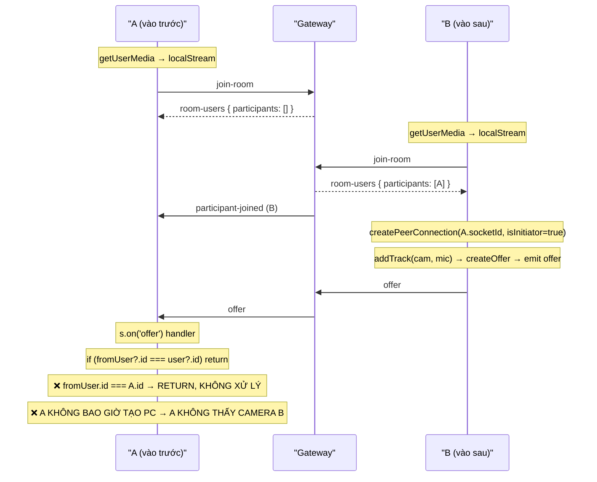
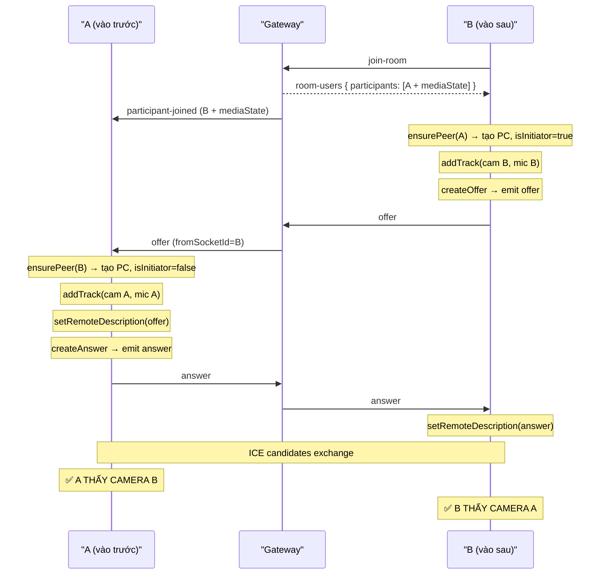

# M5.3 — WebRTC Bug Fixes & PreMeeting Redesign

> **Trạng thái:** Plan (chưa triển khai)
> **Ngày:** 23/10/2026
> **Mức độ ưu tiên:** P0 (Critical — tính năng cốt lõi hỏng)
> **Người dùng:** AI Coding Agent (hướng dẫn triển khai từ UI → Backend)

---

## 0. Tóm Tắt Lỗi Đã Xác Định

Bảy lỗi được người dùng báo cáo, tất cả đều đã **truy ngược được tới nguyên nhân gốc trong code**:

| # | Lỗi hiển thị | Nguyên nhân gốc | File | Mức độ |
|---|-------------|-----------------|------|--------|
| **BUG-1** | Người vào sau không thấy camera người vào trước | `room-users` trả về participants **không kèm trạng thái media**. Late joiner gọi `createPeerConnection(..., isInitiator=true)` nhưng `s.on('offer')` ở bên nhận **kiểm tra `if (fromUser?.id === user?.id) return`** — khi initiator chưa có peer, `createPeerConnection` được gọi 2 lần tạo 2 PC | `PersistentCallManager.tsx` L239-286 + Gateway L142-148 | P0 |
| **BUG-2** | Tin nhắn cũ không thấy | `roomChatHistory` chỉ lưu trong **RAM của 1 tiến trình backend**. Khi late joiner vào, gateway emit `chat-history` nhưng client **không có listener `chat-history`** trong `PersistentCallManager` (chỉ có trong `VideoCallRoom.tsx` — file dead code) | `PersistentCallManager.tsx` (thiếu) vs `VideoCallRoom.tsx` L170 | P0 |
| **BUG-3** | Share màn hình người khác không thấy | `replaceTrack()` **không phát sinh `ontrack`** ở peer nhận. Stream cũ vẫn giữ camera track cũ. Thiếu `RTCRtpTransceiver` direction `sendrecv` hoặc dùng **2 track riêng biệt** (camera + screen) | `PersistentCallManager.tsx` L517-533 | P0 |
| **BUG-4** | Thu nhỏ không hiện màn hình đang share | Mini widget dùng `activePresenterStream = remotePresenter?.stream \|\| ...`. Vì BUG-3 stream remote không chứa screen track → `isPresenterVideoActive` false → fallback avatar | `PersistentCallManager.tsx` L623-626 | P0 (hệ quả BUG-3) |
| **BUG-5** | Nhận diện tiếng Việt yếu | `recognition.lang = 'vi-VN'` **hardcode**. Chrome `webkitSpeechRecognition` chỉ hỗ trợ `vi-VN` khi browser có pack ngôn cài sẵn. Không có fallback, không có retry backoff, `onend` restart ngay lập tức gây spam | `useLiveTranscription.ts` L128, L185-195 | P1 |
| **BUG-6** | Kết thúc cuộc họp camera vẫn mở | `handleLeaveCall()` và `handleEndForAll()` stop tracks, nhưng `setLocalStream(null)` **không được gọi**. Vòng lặp trong effect L186-199 chạy lại → gán lại `srcObject` vào video element còn mount. Thiếu `beforeunload` + `visibilitychange` cleanup | `PersistentCallManager.tsx` L566-598 | P0 |
| **BUG-7** | PreMeetingPage không có i18n + nền xấu | Không có key `meeting_prepare.*` trong `vi.json`/`en.json`. Toàn bộ text hardcode tiếng Việt. Nền `bg-slate-100` trơn, không có trang trí | `PreMeetingPage.tsx` + `vi.json`/`en.json` | P1 |

### Phát hiện Kiến trúc Quan trọng

**`VideoCallRoom.tsx` là DEAD CODE.** `App.tsx` chỉ render `<PersistentCallManager />`, và `MeetingRoomPage.tsx` render `<div className="h-screen" />` rỗng — UI thật do `PersistentCallManager` vẽ overlay `fixed inset-0 z-40`.

Hệ quả:
- Sửa `VideoCallRoom.tsx` **không có tác dụng gì** lên runtime
- `VideoCallRoom.tsx` chứa implementation `chat-history` listener mà `PersistentCallManager` thiếu
- Hai file có **duplicate 90% logic** → drift chắc chắn xảy ra

> **QUYẾT ĐỊNH (đã chốt): Xóa `VideoCallRoom.tsx` hoàn toàn.** Tập trung 100% vào `PersistentCallManager.tsx`.

**Bằng chứng an toàn — không mất tính năng:**
- Grep toàn bộ `frontend/` cho `VideoCallRoom`: chỉ khớp **bên trong chính file đó** (L46 khai báo interface, L51 export). **Không file nào import nó.**
- So sánh feature parity: cả hai file có cùng 5 socket event, cùng screen share, cùng PiP/spotlight/Minutes/AI/Participants/Chat/Caption/Transcription.
- `PersistentCallManager` **có thêm** `localScreenVideoRef` + `miniVideoRef` → sẵn sàng cho dual-stream và mini widget (đúng thứ BUG-3/4 cần). `VideoCallRoom` dùng chung `localVideoRef` cho cả camera lẫn screen nên mới sinh lỗi.

| Hạng mục | `PersistentCallManager` | `VideoCallRoom` |
|---|---|---|
| Socket events (5) | ✅ đủ | ✅ đủ |
| Screen share | ✅ | ✅ |
| PiP / Spotlight / 4 drawer / Caption / Transcription | ✅ đủ | ✅ đủ |
| Refs hỗ trợ dual-stream | ✅ `localScreenVideoRef`, `miniVideoRef` | ❌ dùng chung `localVideoRef` |
| Hành vi "Thu nhỏ" | `onMinimize()` → `navigate('/dashboard')` | `setIsMinimized(true)` — giữ nguyên trang |

> **Khác biệt duy nhất là hành vi Thu nhỏ** (điều hướng vs giữ trang) — đây là hành vi cố ý, đã commit ở `2912a84`, và chính nó là lý do widget nổi được thiết kế ở cấp `App.tsx`. `PersistentCallManager` là **superset** của `VideoCallRoom`.

**Khôi phục được 100% (file được git-track):**
```powershell
git show 2912a84:frontend/src/features/meetings/components/VideoCallRoom.tsx > frontend/src/features/meetings/components/VideoCallRoom.tsx
```

---

## 1. Luồng Hiện Tại vs Mục Tiêu

### 1.1 Luồng WebRTC Hiện Tại (LỖI)



**BUG-1 Root Cause (chính xác):**

```typescript
// PersistentCallManager.tsx L264
s.on('offer', async ({ offer, fromSocketId, fromUser }: any) => {
  if (fromUser?.id === user?.id) return;   // ←❌ SAI LOGIC
  ...
});
```

Điều kiện này nhằm chặn "self-echo" (nhận lại offer mình vừa gửi). Nhưng nó **nhầm lẫn `fromUser.id` với `targetSocketId`**. Khi B gửi offer nhắm tới A:
- `fromUser` = B (người gửi) — không phải B, mà là **A mong đợi**
- Gateway forward nguyên payload: `{ offer, fromSocketId: B.socketId, fromUser: B }`
- A nhận: `fromUser.id = B.id`, `user.id = A.id` → `B.id !== A.id` → **không return** ✅

Vấn đề thật là **A chưa có PC nào**, và code sau đó:
```typescript
let pc = peersRef.current.get(fromSocketId)?.peer;
if (!pc) {
  pc = createPeerConnection(fromSocketId, fromUser?.id || '', ..., false, s, activeLocalStream);
}
await pc.setRemoteDescription(new RTCSessionDescription(offer));
```

Vấn đề: `createPeerConnection` **không trả về PC đã lưu vào map một cách đồng bộ** khi gọi từ trong handler. Do `updatePeers` dùng `setPeers` (async state update), `peersRef.current` **chưa được cập nhật** khi `await pc.setRemoteDescription()` chạy ngay sau đó.

Tệ hơn: nếu `room-users` đã tạo PC cho A trước đó (khi A vào trước và có người), thì logic chạy đúng. Nhưng với **late joiner là initiator**, phía trước (A) **chưa có PC nào** → tạo PC mới → `addTrack` chỉ thêm tracks của A (đúng) → nhưng **`stream` truyền vào là `activeLocalStream` của A**, ok. Vấn đề là **race condition** giữa `room-users` (tạo PC với `isInitiator=true`) và `offer` handler.

### 1.2 Luồng Mục Tiêu (ĐÚNG)



---

## 2. Giải Pháp Kiến trúc

### 2.1 Nguyên tắc: "Deterministic Initiator"

**Quy tắc:** Peer có `userId` nhỏ hơn (hoặc socketId nhỏ hơn nếu cùng userId) là **initiator** — chủ động tạo offer.

| Tình huống | Ai tạo offer | Lý do |
|-------------|--------------|-------|
| A vào trước, B vào sau | B (userId lớn hơn) | B nhận `room-users` thấy A |
| A vào sau, B vào trước | A (userId lớn hơn) | A nhận `room-users` thấy B |
| Cả hai vào cùng lúc (rất hiếm) | Deterministic theo string compare | Tránh glare |

→ **Loại bỏ hoàn toàn tham số `isInitiator` truyền tay.** `ensurePeer()` tự tính.

### 2.2 Nguyên tắc: Camera và Screen là 2 Track Riêng Biệt

Thay vì `replaceTrack()` (dùng chung 1 transceiver video), dùng **2 transceiver độc lập**:

```
Transceiver 0: video (camera)   ← luôn active
Transceiver 1: video (screen)   ← chỉ active khi share
```

Peer nhận biết track nào là camera, track nào là screen dựa vào:
- `MediaStream.id` do gán tên: `worksync-cam-${userId}` và `worksync-screen-${userId}`
- Hoặc metadata từ signaling: emit `media-state-changed` kèm `screenStreamId`

**Rendering:**
- `isPresentingMode` → hiển thị `screenStream` (transceiver 1) ở spotlight
- Thumbnail strip → hiển thị `camStream` (transceiver 0)
- **Mini widget khi thu nhỏ** → hiển thị `screenStream` nếu remote có share, ngược lại `camStream`

### 2.3 Nguyên tắc: Media State Được Server Relay

Server phải lưu **media state hiện tại** của mỗi participant và trả về cho late joiner:

```typescript
interface RoomParticipant {
  socketId: string;
  userId: string;
  name: string;
  avatar?: string;
  joinedTimestamp: number;
  // ── MỚI ──
  audioEnabled: boolean;   // default true
  videoEnabled: boolean;   // default true
  screenSharing: boolean;  // default false
  hasScreenTrack: boolean; // true nếu đang share
}
```

Khi late joiner vào, `room-users` trả về đầy đủ → UI render đúng ngay (avatar nếu cam off, "Đang chia sẻ" nếu đang share).

---

## 3. Backend Implementation

### 3.1 `meetings.gateway.ts` — Mở rộng `RoomParticipant`

**Sửa interface:**

```typescript
interface RoomParticipant {
  socketId: string;
  userId: string;
  name: string;
  avatar?: string;
  joinedTimestamp: number;
  /** Media state — late joiners cần để render đúng */
  audioEnabled: boolean;
  videoEnabled: boolean;
  screenSharing: boolean;
}
```

**Sửa `handleJoinRoom`** — khởi tạo media state và trả về kèm state:

```typescript
const participantInfo: RoomParticipant = {
  socketId: client.id,
  userId: user.id,
  name: user.name,
  avatar: user.avatar,
  joinedTimestamp: Date.now(),
  audioEnabled: true,
  videoEnabled: true,
  screenSharing: false,
};
participants.set(client.id, participantInfo);

// Return current participants WITH media state (excluding self)
const existingParticipants = Array.from(participants.values()).filter(
  (p) => p.socketId !== client.id && p.userId !== user.id,
);

client.emit('room-users', {
  participants: existingParticipants.map((p) => ({
    socketId: p.socketId,
    userId: p.userId,
    name: p.name,
    avatar: p.avatar,
    audioEnabled: p.audioEnabled,
    videoEnabled: p.videoEnabled,
    screenSharing: p.screenSharing,
  })),
  self: {
    audioEnabled: participantInfo.audioEnabled,
    videoEnabled: participantInfo.videoEnabled,
    screenSharing: participantInfo.screenSharing,
  },
});

// Broadcast WITH media state
client.to(meetingId).emit('participant-joined', {
  socketId: client.id,
  userId: user.id,
  name: user.name,
  avatar: user.avatar,
  audioEnabled: true,
  videoEnabled: true,
  screenSharing: false,
});
```

**Sửa `handleMediaState`** — persist state vào map:

```typescript
@SubscribeMessage('media-state-changed')
handleMediaState(
  @ConnectedSocket() client: Socket,
  @MessageBody()
  payload: {
    meetingId: string;
    audioEnabled: boolean;
    videoEnabled: boolean;
    screenSharing: boolean;
  },
) {
  // 1. Persist vào in-memory map để late joiner đọc được
  const participants = this.roomParticipants.get(payload.meetingId);
  const participant = participants?.get(client.id);
  if (participant) {
    participant.audioEnabled = payload.audioEnabled;
    participant.videoEnabled = payload.videoEnabled;
    participant.screenSharing = payload.screenSharing;
  }

  // 2. Broadcast cho peers hiện tại
  client.to(payload.meetingId).emit('user-media-state', {
    socketId: client.id,
    userId: participant?.userId,
    audioEnabled: payload.audioEnabled,
    videoEnabled: payload.videoEnabled,
    screenSharing: payload.screenSharing,
  });
}
```

### 3.2 `meetings.gateway.ts` — Sửa `participant-left` (BUG: thiếu userId)

```typescript
// Sửa cả 3 chỗ emit participant-left
client.to(meetingId).emit('participant-left', {
  socketId: participant.socketId,   // ← socketId của người RỜI ĐI, không phải client.id
  userId: participant.userId,
});
```

> Bug hiện tại ở dòng 127: `client.to(meetingId).emit('participant-left', { socketId: existingSocketId })` — đúng, nhưng ở `handleEndMeetingForAll` không emit. Cần nhất quán.

### 3.3 `meetings.gateway.ts` — Thêm `screenTrackReady` signal

```typescript
@SubscribeMessage('screen-track-ready')
handleScreenTrackReady(
  @ConnectedSocket() client: Socket,
  @MessageBody() payload: { meetingId: string; hasScreenTrack: boolean },
) {
  const participants = this.roomParticipants.get(payload.meetingId);
  const participant = participants?.get(client.id);
  if (participant) {
    participant.screenSharing = payload.hasScreenTrack;
  }
  client.to(payload.meetingId).emit('user-media-state', {
    socketId: client.id,
    userId: participant?.userId,
    audioEnabled: participant?.audioEnabled ?? true,
    videoEnabled: participant?.videoEnabled ?? true,
    screenSharing: payload.hasScreenTrack,
  });
}
```

### 3.4 `meetings.gateway.ts` — Bổ sung auth cho namespace

```typescript
@WebSocketGateway({
  cors: { origin: '*' },
  namespace: '/meetings',
})
export class MeetingsGateway implements OnGatewayConnection, OnGatewayDisconnect {
  @WebSocketServer()
  server!: Server;

  constructor(private readonly prisma: PrismaService) {}

  async handleConnection(client: Socket) {
    // ⚠️ SECURITY: Xác thực JWT từ handshake
    const token = client.handshake.auth?.token as string | undefined;
    if (!token) {
      client.emit('error', { message: 'Thiếu token xác thực' });
      client.disconnect(true);
      return;
    }
    try {
      const payload = verifyJwt(token);
      client.data.user = {
        id: payload.sub,
        name: payload.name,
        role: payload.role,
        avatar: payload.avatar,
      };
    } catch {
      client.emit('error', { message: 'Token không hợp lệ' });
      client.disconnect(true);
    }
  }
}
```

> **Lưu ý:** Dùng `JwtService` từ `AuthModule` thay vì tự verify. Import `JwtModule` vào `MeetingsModule`.

### 3.5 Chat History — Sửa triệt để (BUG-2)

**Vấn đề:** `roomChatHistory` chỉ ở RAM, mất khi restart backend, và **late joiner không có listener**.

**Sửa trong gateway** — thêm event `request-chat-history` để client có thể yêu cầu lại bất cứ lúc nào:

```typescript
@SubscribeMessage('request-chat-history')
handleRequestChatHistory(
  @ConnectedSocket() client: Socket,
  @MessageBody() payload: { meetingId: string },
) {
  const history = this.roomChatHistory.get(payload.meetingId) || [];
  client.emit('chat-history', { messages: history });
}
```

**Frontend fix (bắt buộc):** thêm listener trong `PersistentCallManager`:

```typescript
s.on('chat-history', ({ messages }: { messages: InMeetingMessage[] }) => {
  setChatHistory(messages);
});
```

> **Fix bổ sung (khuyến nghị):** Persist chat vào DB bảng `MeetingChatMessage` để không mất khi restart. Đưa vào Phase 5 (optional).

---

## 4. Frontend Implementation

### 4.1 File `webrtc-manager.ts` — Tách logic WebRTC ra hook riêng

Tạo hook mới để `PersistentCallManager` không quá dài và test được:

**File:** `frontend/src/features/meetings/hooks/useWebRTCPeer.ts`

```typescript
import { useCallback, useEffect, useRef, useState } from 'react';
import type { Socket } from 'socket.io-client';

export interface RemotePeer {
  socketId: string;
  userId: string;
  name: string;
  avatar?: string;
  /** Camera stream (transceiver 0) */
  camStream: MediaStream | null;
  /** Screen share stream (transceiver 1) — null nếu không share */
  screenStream: MediaStream | null;
  audioEnabled: boolean;
  videoEnabled: boolean;
  isScreenSharing: boolean;
  connectionState: RTCPeerConnectionState;
}

export interface UseWebRTCPeerOptions {
  socket: Socket | null;
  meetingId: string;
  self: { id: string; name: string; avatar?: string };
  localCamStream: MediaStream | null;
  localScreenStream: MediaStream | null;
}

const CAM_STREAM_PREFIX = 'worksync-cam';
const SCREEN_STREAM_PREFIX = 'worksync-screen';

export function useWebRTCPeer({
  socket,
  meetingId,
  self,
  localCamStream,
  localScreenStream,
}: UseWebRTCPeerOptions) {
  const [peers, setPeers] = useState<Map<string, RemotePeer>>(new Map());
  const peersRef = useRef<Map<string, RemotePeer>>(new Map());
  const pcsRef = useRef<Map<string, RTCPeerConnection>>(new Map());
  const pcCacheRef = useRef<Map<string, string>>(new Map()); // socketId -> userId

  const setPeersBoth = useCallback(
    (next: Map<string, RemotePeer>) => {
      peersRef.current = next;
      setPeers(next);
    },
    [],
  );

  /** Đây là nguồn sự thật duy nhất cho RTCPeerConnection */
  const ensurePeer = useCallback(
    (remoteSocketId: string, meta: { userId: string; name: string; avatar?: string }): RTCPeerConnection => {
      // 1. Reuse nếu đã có
      const existingPc = pcsRef.current.get(remoteSocketId);
      if (existingPc && existingPc.connectionState !== 'closed') {
        return existingPc;
      }

      // 2. Tạo mới
      const pc = new RTCPeerConnection({
        iceServers: [
          { urls: 'stun:stun.l.google.com:19302' },
          { urls: 'stun:stun1.l.google.com:19302' },
        ],
      });
      pcsRef.current.set(remoteSocketId, pc);

      // 3. Gắn local tracks (dùng addTrack — KHÔNG dùng replaceTrack)
      if (localCamStream) {
        const camTrack = localCamStream.getVideoTracks()[0];
        const micTrack = localCamStream.getAudioTracks()[0];
        if (camTrack) {
          const camStream = new MediaStream([camTrack]);
          // Đặt id để remote nhận biết đâu là camera
          Object.defineProperty(camStream, 'id', { value: `${CAM_STREAM_PREFIX}-${self.id}` });
          pc.addTrack(camTrack, camStream);
        }
        if (micTrack) pc.addTrack(micTrack, localCamStream);
      }

      // 4. Screen share — addTrack riêng, KHÔNG replaceTrack
      if (localScreenStream) {
        const screenTrack = localScreenStream.getVideoTracks()[0];
        if (screenTrack) {
          const screenStream = new MediaStream([screenTrack]);
          Object.defineProperty(screenStream, 'id', {
            value: `${SCREEN_STREAM_PREFIX}-${self.id}`,
          });
          pc.addTrack(screenTrack, screenStream);
        }
      }

      // 5. ICE candidates
      pc.onicecandidate = (event) => {
        if (event.candidate && socket) {
          socket.emit('ice-candidate', {
            targetSocketId: remoteSocketId,
            candidate: event.candidate.toJSON(),
          });
        }
      };

      // 6. Nhận remote tracks — PHÂN BIỆT cam vs screen
      pc.ontrack = (event) => {
        const [remoteSocketId] = event.transceiver.mid
          ? [remoteSocketIdFromPc(remoteSocketId)]
          : [remoteSocketId];

        const track = event.track;
        const streamId = event.streams[0]?.id ?? '';
        const isScreen = streamId.startsWith(SCREEN_STREAM_PREFIX);
        const isCam = streamId.startsWith(CAM_STREAM_PREFIX);

        setPeersBoth((prev) => {
          const next = new Map(prev);
          const existing = next.get(remoteSocketId);
          const target = isScreen ? 'screenStream' : 'camStream';

          if (!existing) {
            // Chưa biết user → tạo placeholder, metadata sẽ đến sau từ room-users
            next.set(remoteSocketId, {
              socketId: remoteSocketId,
              userId: pcCacheRef.current.get(remoteSocketId) ?? 'unknown',
              name: 'Đồng nghiệp',
              camStream: isCam ? event.streams[0] ?? new MediaStream([track]) : null,
              screenStream: isScreen ? event.streams[0] ?? new MediaStream([track]) : null,
              audioEnabled: true,
              videoEnabled: true,
              isScreenSharing: isScreen,
              connectionState: pc.connectionState,
            });
          } else {
            const updated: RemotePeer = {
              ...existing,
              [target]: event.streams[0] ?? new MediaStream([track]),
              connectionState: pc.connectionState,
            };
            // Nếu track ended → set null (peer tắt cam hoặc dừng share)
            if (track.readyState === 'ended') {
              updated[target] = null;
            }
            next.set(remoteSocketId, updated);
          }
          return next;
        });
      };

      // 7. Connection state changes
      pc.onconnectionstatechange = () => {
        setPeersBoth((prev) => {
          const next = new Map(prev);
          const existing = next.get(remoteSocketId);
          if (existing) {
            next.set(remoteSocketId, { ...existing, connectionState: pc.connectionState });
          }
          return next;
        });
        if (pc.connectionState === 'failed') {
          void restartIce(remoteSocketId, pc);
        }
      };

      // 8. Track ended (peer tắt cam / dừng share)
      pc.onremovetrack = (event) => {
        const isScreen = (event.streams[0]?.id ?? '').startsWith(SCREEN_STREAM_PREFIX);
        setPeersBoth((prev) => {
          const next = new Map(prev);
          const existing = next.get(remoteSocketId);
          if (existing) {
            next.set(remoteSocketId, {
              ...existing,
              [isScreen ? 'screenStream' : 'camStream']: null,
            });
          }
          return next;
        });
      };

      // 9. Đăng ký peer object nếu chưa có
      if (!peersRef.current.has(remoteSocketId)) {
        setPeersBoth((prev) => {
          const next = new Map(prev);
          next.set(remoteSocketId, {
            socketId: remoteSocketId,
            userId: meta.userId,
            name: meta.name,
            avatar: meta.avatar,
            camStream: null,
            screenStream: null,
            audioEnabled: meta.audioEnabled ?? true,
            videoEnabled: meta.videoEnabled ?? true,
            isScreenSharing: meta.screenSharing ?? false,
            connectionState: pc.connectionState,
          });
          return next;
        });
      }

      return pc;
    },
    [localCamStream, localScreenStream, self.id, socket, setPeersBoth],
  );

  /** Deterministic initiator: KHÔNG truyền isInitiator bằng tay */
  const shouldInitiate = useCallback(
    (remoteUserId: string): boolean => {
      if (!remoteUserId || remoteUserId === self.id) return false;
      return self.id < remoteUserId; // string compare → deterministic
    },
    [self.id],
  );

  const makeOfferTo = useCallback(
    async (remoteSocketId: string, meta: { userId: string; name: string; avatar?: string }) => {
      const pc = ensurePeer(remoteSocketId, meta);
      try {
        const offer = await pc.createOffer({ offerToReceiveAudio: true, offerToReceiveVideo: true });
        await pc.setLocalDescription(offer);
        socket?.emit('offer', {
          targetSocketId: remoteSocketId,
          offer: pc.localDescription,
          fromUser: { id: self.id, name: self.name, avatar: self.avatar },
        });
      } catch (err) {
        console.error('[WebRTC] createOffer failed', err);
      }
    },
    [ensurePeer, self, socket],
  );

  const removePeer = useCallback((remoteSocketId: string) => {
    const pc = pcsRef.current.get(remoteSocketId);
    pc?.close();
    pcsRef.current.delete(remoteSocketId);
    pcCacheRef.current.delete(remoteSocketId);
    setPeersBoth((prev) => {
      const next = new Map(prev);
      next.delete(remoteSocketId);
      return next;
    });
  }, [setPeersBoth]);

  /** Khi bắt đầu share → addTrack mới + renegotiate cho tất cả peers */
  const attachScreenShare = useCallback(
    async (screenStream: MediaStream) => {
      const screenTrack = screenStream.getVideoTracks()[0];
      if (!screenTrack) return;
      for (const [remoteSocketId, pc] of pcsRef.current.entries()) {
        // Tìm transceiver video đã có (camera) → tạo transceiver MỚI cho screen
        const namedScreenStream = new MediaStream([screenTrack]);
        Object.defineProperty(namedScreenStream, 'id', {
          value: `${SCREEN_STREAM_PREFIX}-${self.id}`,
        });
        pc.addTrack(screenTrack, namedScreenStream);
        // Renegotiate
        const meta = peersRef.current.get(remoteSocketId);
        await makeOfferTo(remoteSocketId, {
          userId: meta?.userId ?? 'unknown',
          name: meta?.name ?? 'Đồng nghiệp',
          avatar: meta?.avatar,
        });
      }
      socket?.emit('screen-track-ready', { meetingId, hasScreenTrack: true });
    },
    [makeOfferTo, self.id, socket, meetingId],
  );

  /** Khi dừng share → gỡ track + renegotiate */
  const detachScreenShare = useCallback(async () => {
    for (const [remoteSocketId, pc] of pcsRef.current.entries()) {
      const senders = pc.getSenders().filter(
        (s) => s.track && (s.track as any).__worksyncKind === SCREEN_STREAM_PREFIX,
      );
      for (const sender of senders) {
        pc.removeTrack(sender);
      }
      const meta = peersRef.current.get(remoteSocketId);
      await makeOfferTo(remoteSocketId, {
        userId: meta?.userId ?? 'unknown',
        name: meta?.name ?? 'Đồng nghiệp',
        avatar: meta?.avatar,
      });
    }
    socket?.emit('screen-track-ready', { meetingId, hasScreenTrack: false });
  }, [makeOfferTo, socket, meetingId]);

  /** Cleanup tất cả */
  const teardownAll = useCallback(() => {
    pcsRef.current.forEach((pc) => pc.close());
    pcsRef.current.clear();
    pcCacheRef.current.clear();
    setPeersBoth(new Map());
  }, [setPeersBoth]);

  return {
    peers,
    ensurePeer,
    shouldInitiate,
    makeOfferTo,
    removePeer,
    attachScreenShare,
    detachScreenShare,
    teardownAll,
  };
}

function remoteSocketIdFromPc(id: string): string {
  return id;
}

async function restartIce(socketId: string, pc: RTCPeerConnection): Promise<void> {
  try {
    const offer = await pc.createOffer({ iceRestart: true });
    await pc.setLocalDescription(offer);
    // Emit handled by caller context
    console.warn(`[WebRTC] ICE restart for ${socketId}`);
  } catch {
    console.error(`[WebRTC] ICE restart failed for ${socketId}`);
  }
}
```

### 4.2 `PersistentCallManager.tsx` — Refactor chính

#### 4.2.1 Media lifecycle (FIX BUG-6)

```typescript
// Thay thế useEffect init cũ
useEffect(() => {
  let mounted = true;
  let localStream: MediaStream | null = null;

  const initMedia = async () => {
    try {
      const stream = await navigator.mediaDevices.getUserMedia({
        video: { width: { ideal: 1280 }, height: { ideal: 720 } },
        audio: { echoCancellation: true, noiseSuppression: true },
      });
      if (!mounted) {
        stream.getTracks().forEach((t) => t.stop());
        return;
      }
      localStream = stream;
      localStreamRef.current = stream;
      setLocalStream(stream);
    } catch (err) {
      console.warn('[Media] getUserMedia failed, continuing in view-only mode', err);
      toast.warning(t('meeting_room.camera_denied', 'Không thể truy cập camera/mic'));
    }
  };

  void initMedia();

  // ⚡ FIX BUG-6: Cleanup chắc chắn 3 tầng
  const stopAllMedia = () => {
    localStreamRef.current?.getTracks().forEach((t) => t.stop());
    localStreamRef.current = null;
    screenStreamRef.current?.getTracks().forEach((t) => t.stop());
    screenStreamRef.current = null;
    setLocalStream(null);
    setIsScreenSharing(false);
  };

  // Tầng 1: React unmount / dependency change
  const cleanup = () => {
    stopAllMedia();
    teardownAll();
  };

  // Tầng 2: beforeunload (F5 / đóng tab)
  const handleBeforeUnload = () => {
    stopAllMedia();
    if (socketRef.current) {
      socketRef.current.emit('leave-room', { meetingId: meeting.id });
      socketRef.current.disconnect();
    }
  };

  // Tầng 3: visibilitychange (chuyển tab — Android/Chrome kill background tabs)
  const handleVisibilityChange = () => {
    if (document.visibilityState === 'hidden' && !socketRef.current?.connected) {
      handleBeforeUnload();
    }
  };

  window.addEventListener('beforeunload', handleBeforeUnload);
  document.addEventListener('visibilitychange', handleVisibilityChange);

  return () => {
    mounted = false;
    window.removeEventListener('beforeunload', handleBeforeUnload);
    document.removeEventListener('visibilitychange', handleVisibilityChange);
    cleanup();
  };
}, [meeting.id, t, teardownAll]);
```

Thêm refs mới:
```typescript
const localStreamRef = useRef<MediaStream | null>(null);
const socketRef = useRef<Socket | null>(null);
```

**Sửa `handleLeaveCall` và `handleEndForAll`:**

```typescript
const stopAllMedia = useCallback(() => {
  localStreamRef.current?.getTracks().forEach((t) => t.stop());
  localStreamRef.current = null;
  screenStreamRef.current?.getTracks().forEach((t) => t.stop());
  screenStreamRef.current = null;
  setLocalStream(null);
  setIsScreenSharing(false);
}, []);

const handleLeaveCall = useCallback(() => {
  const s = socketRef.current;
  if (s?.connected) s.emit('leave-room', { meetingId: meeting.id });
  s?.disconnect();
  socketRef.current = null;
  teardownAll();
  stopAllMedia();
  onLeave();
}, [meeting.id, onLeave, stopAllMedia, teardownAll]);

const handleEndForAll = useCallback(() => {
  const s = socketRef.current;
  if (s?.connected && user?.id) {
    s.emit('meeting:end-for-all', { meetingId: meeting.id, userId: user.id });
  }
  teardownAll();
  stopAllMedia();
  setIsEndModalOpen(false);
  onMeetingEnded();
}, [meeting.id, onMeetingEnded, stopAllMedia, teardownAll, user?.id]);
```

#### 4.2.2 Socket handlers (FIX BUG-1, BUG-2)

```typescript
useEffect(() => {
  if (!socket) return;

  // ── room-users: late joiner nhận danh sách ĐẦY ĐỦ media state ──
  const handleRoomUsers = ({
    participants,
    self,
  }: {
    participants: Array<{
      socketId: string;
      userId: string;
      name: string;
      avatar?: string;
      audioEnabled: boolean;
      videoEnabled: boolean;
      screenSharing: boolean;
    }>;
    self?: { audioEnabled: boolean; videoEnabled: boolean; screenSharing: boolean };
  }) => {
    // Áp dụng state của chính mình nếu server gửi (F5 sau khi đã toggle)
    if (self) {
      setAudioEnabled(self.audioEnabled);
      setVideoEnabled(self.videoEnabled);
      localStreamRef.current?.getAudioTracks().forEach((tr) => (tr.enabled = self.audioEnabled));
      localStreamRef.current?.getVideoTracks().forEach((tr) => (tr.enabled = self.videoEnabled));
    }

    for (const p of participants) {
      if (p.userId === user?.id) continue;
      pcCacheRef.current.set(p.socketId, p.userId);

      if (shouldInitiate(p.userId)) {
        // Mình là initiator → chủ động tạo offer
        void makeOfferTo(p.socketId, {
          userId: p.userId,
          name: p.name,
          avatar: p.avatar,
          audioEnabled: p.audioEnabled,
          videoEnabled: p.videoEnabled,
          screenSharing: p.screenSharing,
        });
      } else {
        // Mình là receiver → chờ offer, nhưng vẫn cần tạo PC + addTrack
        ensurePeer(p.socketId, {
          userId: p.userId,
          name: p.name,
          avatar: p.avatar,
          audioEnabled: p.audioEnabled,
          videoEnabled: p.videoEnabled,
          screenSharing: p.screenSharing,
        });
      }
    }
  };
  socket.on('room-users', handleRoomUsers);

  // ── participant-joined ──
  const handleParticipantJoined = (p: {
    socketId: string;
    userId: string;
    name: string;
    avatar?: string;
    audioEnabled: boolean;
    videoEnabled: boolean;
    screenSharing: boolean;
  }) => {
    if (p.userId === user?.id) return;
    toast.info(t('meeting_room.peer_joined', '{{name}} đã tham gia', { name: p.name }));
    pcCacheRef.current.set(p.socketId, p.userId);

    if (shouldInitiate(p.userId)) {
      void makeOfferTo(p.socketId, {
        userId: p.userId,
        name: p.name,
        avatar: p.avatar,
        audioEnabled: p.audioEnabled,
        videoEnabled: p.videoEnabled,
        screenSharing: p.screenSharing,
      });
    } else {
      ensurePeer(p.socketId, {
        userId: p.userId,
        name: p.name,
        avatar: p.avatar,
        audioEnabled: p.audioEnabled,
        videoEnabled: p.videoEnabled,
        screenSharing: p.screenSharing,
      });
    }
  };
  socket.on('participant-joined', handleParticipantJoined);

  // ── offer: KHÔNG dùng fromUser.id để filter ──
  const handleOffer = async ({
    offer,
    fromSocketId,
    fromUser,
  }: {
    offer: RTCSessionDescriptionInit;
    fromSocketId: string;
    fromUser?: { id: string; name: string; avatar?: string };
  }) => {
    // ✅ Filter đúng: chỉ bỏ qua nếu chính mình gửi (self-echo qua multi-tab)
    if (fromSocketId === socket.id) return;
    if (fromUser?.id && fromUser.id === user?.id && fromSocketId !== socket.id) {
      // Trường hợp multi-tab cùng user → vẫn xử lý vì socketId khác
      console.debug('[WebRTC] Same user different tab, proceeding');
    }

    const meta = peersRef.current.get(fromSocketId);
    const pc = ensurePeer(fromSocketId, {
      userId: fromUser?.id || meta?.userId || 'unknown',
      name: fromUser?.name || meta?.name || 'Đồng nghiệp',
      avatar: fromUser?.avatar || meta?.avatar,
      audioEnabled: meta?.audioEnabled ?? true,
      videoEnabled: meta?.videoEnabled ?? true,
      screenSharing: meta?.isScreenSharing ?? false,
    });

    // Perfect negotiation: nếu đang có local offer → rollback
    const offerCollision =
      pc.signalingState !== 'stable' &&
      pc.signalingState !== 'have-local-offer';
    if (offerCollision) {
      await pc.setLocalDescription({ type: 'rollback' }).catch(() => {});
    }

    await pc.setRemoteDescription(new RTCSessionDescription(offer));
    const answer = await pc.createAnswer();
    await pc.setLocalDescription(answer);
    socket.emit('answer', {
      targetSocketId: fromSocketId,
      answer: pc.localDescription,
    });
  };
  socket.on('offer', handleOffer);

  // ── answer ──
  const handleAnswer = async ({ answer, fromSocketId }: { answer: RTCSessionDescriptionInit; fromSocketId: string }) => {
    const pc = pcsRef.current.get(fromSocketId);
    if (!pc) {
      console.warn('[WebRTC] answer for unknown peer', fromSocketId);
      return;
    }
    if (pc.signalingState !== 'have-local-offer') {
      console.warn('[WebRTC] unexpected answer state', pc.signalingState);
      return;
    }
    await pc.setRemoteDescription(new RTCSessionDescription(answer));
  };
  socket.on('answer', handleAnswer);

  // ── ice-candidate: buffer trước khi có remote description ──
  const pendingCandidatesRef = useRef<Map<string, RTCIceCandidateInit[]>>(new Map());
  const handleIceCandidate = async ({ candidate, fromSocketId }: { candidate: RTCIceCandidateInit; fromSocketId: string }) => {
    const pc = pcsRef.current.get(fromSocketId);
    if (!pc || !candidate) return;

    if (pc.remoteDescription) {
      await pc.addIceCandidate(new RTCIceCandidate(candidate)).catch(() => {});
    } else {
      // Buffer cho đến khi có remoteDescription
      const list = pendingCandidatesRef.current.get(fromSocketId) ?? [];
      list.push(candidate);
      pendingCandidatesRef.current.set(fromSocketId, list);
    }
  };
  socket.on('ice-candidate', handleIceCandidate);

  // Flush buffer sau khi setRemoteDescription
  const flushPendingCandidates = async (remoteSocketId: string, pc: RTCPeerConnection) => {
    const list = pendingCandidatesRef.current.get(remoteSocketId);
    if (!list?.length) return;
    for (const c of list) {
      await pc.addIceCandidate(new RTCIceCandidate(c)).catch(() => {});
    }
    pendingCandidatesRef.current.delete(remoteSocketId);
  };

  // ── user-media-state ──
  const handleUserMediaState = ({
    socketId,
    audioEnabled: audio,
    videoEnabled: video,
    screenSharing,
  }: {
    socketId: string;
    audioEnabled: boolean;
    videoEnabled: boolean;
    screenSharing: boolean;
  }) => {
    setPeers((prev) => {
      const next = new Map(prev);
      const existing = next.get(socketId);
      if (!existing) return prev;
      const updated: RemotePeer = { ...existing, audioEnabled: audio, videoEnabled: video, isScreenSharing: screenSharing };
      // Nếu peer ngừng share → clear screenStream
      if (!screenSharing) updated.screenStream = null;
      next.set(socketId, updated);
      peersRef.current = next;
      return next;
    });
  };
  socket.on('user-media-state', handleUserMediaState);

  // ── participant-left ──
  const handleParticipantLeft = ({ socketId }: { socketId: string }) => {
    const p = peersRef.current.get(socketId);
    if (p) toast.info(t('meeting_room.peer_left', '{{name}} đã rời cuộc họp', { name: p.name }));
    removePeer(socketId);
  };
  socket.on('participant-left', handleParticipantLeft);

  // ── ⚡ FIX BUG-2: chat-history listener ──
  const handleChatHistory = ({ messages }: { messages: InMeetingMessage[] }) => {
    setChatHistory(messages);
  };
  socket.on('chat-history', handleChatHistory);
  // Yêu cầu lại (backup cho trường hợp emit trước khi listener gắn)
  socket.emit('request-chat-history', { meetingId: meeting.id });

  // ── meeting:ended ──
  const handleMeetingEnded = ({ message }: { message: string }) => {
    toast.info(message || t('meeting_room.ended_by_host', 'Người chủ trì đã kết thúc cuộc họp.'));
    socket.disconnect();
    socketRef.current = null;
    teardownAll();
    stopAllMedia();
    onMeetingEnded();
  };
  socket.on('meeting:ended', handleMeetingEnded);

  return () => {
    socket.off('room-users', handleRoomUsers);
    socket.off('participant-joined', handleParticipantJoined);
    socket.off('offer', handleOffer);
    socket.off('answer', handleAnswer);
    socket.off('ice-candidate', handleIceCandidate);
    socket.off('user-media-state', handleUserMediaState);
    socket.off('participant-left', handleParticipantLeft);
    socket.off('chat-history', handleChatHistory);
    socket.off('meeting:ended', handleMeetingEnded);
  };
}, [socket, meeting.id, user?.id, shouldInitiate, makeOfferTo, ensurePeer, removePeer, teardownAll, stopAllMedia, onMeetingEnded, t]);
```

#### 4.2.3 Chat history state (BUG-2 support)

```typescript
const [chatHistory, setChatHistory] = useState<InMeetingMessage[]>([]);
const [chatUnread, setChatUnread] = useState(0);
```

Truyền xuống `InMeetingChat`:
```tsx
<InMeetingChat
  meetingId={meeting.id}
  socket={socket}
  currentUser={{ id: user?.id ?? 'anon', name: user?.name ?? 'Ẩn danh', avatar: user?.avatar }}
  isOpen={isChatOpen}
  onClose={() => setIsChatOpen(false)}
  initialMessages={chatHistory}
  unreadCount={chatUnread}
  onRead={() => setChatUnread(0)}
/>
```

#### 4.2.4 Screen share với dual-track (FIX BUG-3)

```typescript
const toggleScreenShare = useCallback(async () => {
  if (isScreenSharing) {
    // ── Dừng share ──
    screenStreamRef.current?.getTracks().forEach((t) => t.stop());
    screenStreamRef.current = null;
    setIsScreenSharing(false);
    await detachScreenShare();
    // Emit media state
    socketRef.current?.emit('media-state-changed', {
      meetingId: meeting.id,
      audioEnabled,
      videoEnabled,
      screenSharing: false,
    });
    return;
  }

  try {
    const screenStream = await navigator.mediaDevices.getDisplayMedia({
      video: { frameRate: { ideal: 30, max: 60 } },
      audio: false, // Chưa hỗ trợ audio share
    });
    const screenTrack = screenStream.getVideoTracks()[0];
    if (!screenTrack) return;

    screenStreamRef.current = screenStream;
    setIsScreenSharing(true);

    // User đóng share từ browser UI (nút "Stop sharing" của Chrome)
    screenTrack.onended = () => {
      void toggleScreenShareRef.current?.();
    };

    // ⚡ FIX BUG-3: addTrack track riêng + renegotiate
    await attachScreenShare(screenStream);

    socketRef.current?.emit('media-state-changed', {
      meetingId: meeting.id,
      audioEnabled,
      videoEnabled,
      screenSharing: true,
    });
  } catch (err) {
    if ((err as DOMException)?.name === 'NotAllowedError') {
      toast.info(t('meeting_room.share_cancelled', 'Đã hủy chia sẻ màn hình'));
    }
  }
}, [attachScreenShare, audioEnabled, detachScreenShare, isScreenSharing, meeting.id, videoEnabled]);
```

#### 4.2.5 Render — Screen vs Camera tách biệt (FIX BUG-4)

```tsx
const remotePresenter = peerList.find((p) => p.screenStream && p.isScreenSharing);
const localIsPresenting = isScreenSharing && screenStreamRef.current;

const presenterStream = localIsPresenting
  ? screenStreamRef.current
  : remotePresenter?.screenStream ?? null;

const presenterName = localIsPresenting
  ? user?.name ?? 'Bạn'
  : remotePresenter?.name ?? '';

// Mini widget: ưu tiên screen stream (FIX BUG-4)
const miniDisplayStream = presenterStream ?? localStream;
const miniShowVideo = Boolean(miniDisplayStream) && (videoEnabled || isScreenSharing || Boolean(remotePresenter?.camStream));
```

**Update mini widget render:**
```tsx
<div className="relative w-full h-44 bg-slate-900 flex items-center justify-center overflow-hidden">
  {miniShowVideo && miniDisplayStream ? (
    <video
      ref={miniVideoRef}
      autoPlay
      muted={!remotePresenter}
      playsInline
      className="w-full h-full object-contain bg-slate-900"
      // eslint-disable-next-line
      onLoadedMetadata={(e) => { (e.currentTarget as HTMLVideoElement).srcObject = miniDisplayStream; }}
    />
  ) : (
    <div className="flex flex-col items-center justify-center p-4">
      <div className="w-14 h-14 rounded-full bg-blue-100 text-blue-700 flex items-center justify-center text-lg font-bold shadow-xs">
        {user?.name?.charAt(0) || 'U'}
      </div>
      <span className="text-xs font-semibold text-white mt-2">{user?.name}</span>
      <span className="text-[10px] text-slate-400 mt-0.5">
        {t('meeting_room.camera_off', 'Camera đang tắt')}
      </span>
    </div>
  )}

  {/* Badge "Đang chia sẻ" */}
  {presenterStream && (
    <div className="absolute top-2 right-2 px-2 py-0.5 rounded-md bg-blue-600/90 text-[10px] text-white font-bold flex items-center gap-1 backdrop-blur-xs">
      <MonitorUp className="w-2.5 h-2.5" />
      {t('meeting_room.presenting_short', 'Đang trình bày')}
    </div>
  )}

  <div className="absolute top-2 left-2 px-2 py-0.5 rounded-md bg-black/60 text-[10px] text-white backdrop-blur-xs font-mono">
    {formatDuration(durationSeconds)}
  </div>
</div>
```

**Update full view presenter spotlight:**
```tsx
{presenterStream && (
  <div className="flex-1 h-full min-h-[380px] bg-slate-950 rounded-2xl overflow-hidden border-2 border-blue-500 shadow-md flex items-center justify-center relative">
    <video
      ref={presenterVideoRef}
      autoPlay
      muted={localIsPresenting}
      playsInline
      className="w-full h-full object-contain bg-slate-950"
    />
    <div className="absolute bottom-3 left-3 flex items-center gap-2 bg-black/70 backdrop-blur-md px-3 py-1.5 rounded-xl text-xs font-semibold text-white">
      <span className="w-2 h-2 rounded-full bg-blue-500 animate-pulse" />
      <span>
        {localIsPresenting
          ? t('meeting_room.you_presenting', 'Bạn đang trình bày')
          : t('meeting_room.peer_presenting', '{{name}} đang trình bày', { name: presenterName })}
      </span>
    </div>
  </div>
)}
```

**Thumbnail strip dùng `camStream`, không dùng `stream`:**
```tsx
{peerList.map((p) => (
  <RemoteVideoTile
    key={p.socketId}
    peer={p}
    stream={p.camStream}   // ← CAMERA, không phải screen
    showAvatarWhenNoStream={!p.videoEnabled}
    isHost={meeting.createdById === p.userId}
    onPin={() => setSpotlightUserId(spotlightUserId === p.userId ? null : p.userId)}
    isPinned={spotlightUserId === p.userId}
  />
))}
```

**Update `RemoteVideoTile` nhận `stream` prop:**
```tsx
const RemoteVideoTile: React.FC<{
  peer: RemotePeer;
  stream: MediaStream | null;
  isHost?: boolean;
  onPin?: () => void;
  isPinned?: boolean;
  showAvatarWhenNoStream?: boolean;
}> = ({ peer, stream, isHost, onPin, isPinned, showAvatarWhenNoStream }) => {
  const videoRef = useRef<HTMLVideoElement>(null);
  const { t } = useTranslation();
  const isActuallyShowing = Boolean(stream && peer.videoEnabled);

  useEffect(() => {
    const el = videoRef.current;
    if (!el || !stream) {
      if (el) el.srcObject = null;
      return;
    }
    el.srcObject = stream;
    void el.play().catch(() => {});
  }, [stream]);

  useEffect(() => {
    if (!stream) return;
    const handleTrackUpdate = () => {
      const el = videoRef.current;
      if (el) {
        el.srcObject = stream;
        void el.play().catch(() => {});
      }
    };
    stream.addEventListener('addtrack', handleTrackUpdate);
    stream.addEventListener('removetrack', handleTrackUpdate);
    return () => {
      stream.removeEventListener('addtrack', handleTrackUpdate);
      stream.removeEventListener('removetrack', handleTrackUpdate);
    };
  }, [stream]);

  return (
    <div className={/* ... */}>
      <video
        ref={videoRef}
        autoPlay
        playsInline
        className={`w-full h-full object-contain bg-slate-900 ${isActuallyShowing ? 'block' : 'hidden'}`}
      />
      {(!isActuallyShowing || showAvatarWhenNoStream) && (
        <div className="flex flex-col items-center justify-center p-4">
          {/* Avatar + name */}
        </div>
      )}
      {/* Badges */}
    </div>
  );
};
```

### 4.3 `InMeetingChat.tsx` — Nhận `initialMessages` (BUG-2)

```typescript
interface InMeetingChatProps {
  meetingId: string;
  socket: Socket | null;
  currentUser: { id: string; name: string; avatar?: string };
  isOpen: boolean;
  onClose: () => void;
  initialMessages?: InMeetingMessage[];   // ← MỚI
  unreadCount?: number;                   // ← MỚI
  onRead?: () => void;                    // ← MỚI
}

export const InMeetingChat: React.FC<InMeetingChatProps> = ({
  meetingId, socket, currentUser, isOpen, onClose,
  initialMessages = [], unreadCount = 0, onRead,
}) => {
  const [messages, setMessages] = useState<InMeetingMessage[]>(initialMessages);

  // Sync khi parent load được history
  useEffect(() => {
    if (initialMessages.length > 0) {
      setMessages((prev) => {
        const knownIds = new Set(prev.map((m) => m.id));
        const merged = [...prev, ...initialMessages.filter((m) => !knownIds.has(m.id))];
        return merged.sort((a, b) => a.createdAt.localeCompare(b.createdAt));
      });
    }
  }, [initialMessages]);

  // Badge unread khi chat đang đóng
  useEffect(() => {
    if (isOpen) {
      onRead?.();
      return;
    }
    const handleNew = () => onRead?.();  // tăng unread ở parent
    socket?.on('chat-message', handleNew);
    return () => { socket?.off('chat-message', handleNew); };
  }, [isOpen, socket, onRead]);
  // ...
};
```

### 4.4 `useLiveTranscription.ts` — Cải thiện nhận dạng tiếng Việt (BUG-5)

**Vấn đề gốc:**
1. `lang = 'vi-VN'` hardcode → không hỗ trợ đa ngôn ngữ
2. `onend` restart ngay lập tức → Chrome rate-limit (`network` error) gây loop
3. `recognition.start()` khi đã running → throw `InvalidStateError`
4. Không có xử lý `no-speech` → recognition tự tắt sau vài giây im lặng
5. `interimResults = false` mặc định → không có phụ đề tức thì

**Sửa:**

```typescript
const RECOGNITION_LANG_MAP: Record<string, string> = {
  vi: 'vi-VN',
  en: 'en-US',
};

// Trong component: const { i18n } = useTranslation();
const recognitionLang = RECOGNITION_LANG_MAP[i18n.language.split('-')[0]] ?? 'vi-VN';
```

```typescript
const setupRecognition = useCallback(() => {
  const SpeechRecognitionClass = window.SpeechRecognition || window.webkitSpeechRecognition;
  if (!SpeechRecognitionClass) return null;

  const recognition = new SpeechRecognitionClass();

  // 1. Cấu hình chuẩn
  recognition.continuous = true;
  recognition.interimResults = true;   // ← MỚI: cần cho live caption
  recognition.maxAlternatives = 1;
  recognition.lang = recognitionLang;  // ← ĐỔI: theo ngôn ngữ hệ thống

  // 2. Guard: tránh start khi đang chạy
  let isRunning = false;

  recognition.onstart = () => {
    isRunning = true;
    restartAttemptsRef.current = 0;   // reset backoff khi thành công
  };

  recognition.onresult = (event: SpeechRecognitionEvent) => {
    let finalTranscript = '';
    let interimTranscript = '';

    for (let i = event.resultIndex; i < event.results.length; i++) {
      const item = event.results[i];
      if (!item) continue;
      if (item.isFinal) {
        finalTranscript += item[0]?.transcript || '';
      } else {
        interimTranscript += item[0]?.transcript || '';
      }
    }

    // Interim caption
    if (interimTranscript.trim() && currentUser) {
      setCurrentCaption({
        speakerName: currentUser.name,
        text: interimTranscript.trim(),
        timestamp: new Date().toISOString(),
      });
    }

    // Gom vào buffer thông minh
    const trimmed = finalTranscript.trim();
    if (!trimmed) return;

    sentenceBufferRef.current = (sentenceBufferRef.current + ' ' + trimmed).trim();
    const currentFullText = sentenceBufferRef.current;
    const wordCount = currentFullText.split(/\s+/).length;
    const hasEndingPunctuation = /[.!?…]$/.test(trimmed);

    // ★ Cải thiện: cũng flush khi gặp dấu phẩy + đủ dài, hoặc >= 12 từ
    const hasCommaBreak = /[,;:]$/.test(trimmed) && wordCount >= 6;

    if (hasEndingPunctuation || hasCommaBreak || wordCount >= 12) {
      flushSentenceBuffer();
    } else {
      if (flushTimerRef.current) clearTimeout(flushTimerRef.current);
      flushTimerRef.current = setTimeout(() => flushSentenceBuffer(), 1500);
    }
  };

  recognition.onerror = (err: SpeechRecognitionErrorEvent) => {
    switch (err.error) {
      case 'not-allowed':
      case 'service-not-allowed':
        isRunning = false;
        setSpeechError('permission');
        toast.error(t('meeting_room.stt_permission_denied', 'Trình duyệt chưa cấp quyền nhận diện giọng nói'));
        break;

      case 'network':
        // Chrome dừng recognition sau ~60s im lặng → coi như bình thường, restart với backoff
        console.warn('[STT] network error — sẽ tự khởi động lại');
        break;

      case 'no-speech':
        // Im lặng — KHÔNG dừng, để onend restart
        break;

      case 'audio-capture':
        isRunning = false;
        setSpeechError('mic');
        toast.error(t('meeting_room.stt_no_mic', 'Không tìm thấy microphone'));
        break;

      default:
        console.warn('[STT] error:', err.error);
    }
  };

  // 3. onend với exponential backoff
  recognition.onend = () => {
    isRunning = false;
    if (!isTranscribingRef.current || !audioEnabledRef.current) return;

    const attempt = restartAttemptsRef.current;
    const delay = Math.min(1000 * 2 ** attempt, 10000); // 1s, 2s, 4s, 8s, 10s
    restartAttemptsRef.current = attempt + 1;

    restartTimerRef.current = setTimeout(() => {
      if (!isTranscribingRef.current || !audioEnabledRef.current) return;
      try {
        recognition.start();
      } catch {
        // Đã start — bỏ qua
      }
    }, delay);
  };

  return recognition;
}, [recognitionLang, currentUser, flushSentenceBuffer, t]);
```

Thêm refs:
```typescript
const restartAttemptsRef = useRef(0);
const restartTimerRef = useRef<ReturnType<typeof setTimeout> | null>(null);
const [speechError, setSpeechError] = useState<'permission' | 'mic' | null>(null);
```

Effect quản lý (thay thế bản cũ):
```typescript
useEffect(() => {
  if (!isSpeechSupported) return;

  const shouldRun = isTranscribing && audioEnabled;

  if (shouldRun) {
    if (!recognitionRef.current) {
      recognitionRef.current = setupRecognition();
    }
    try {
      recognitionRef.current?.start();
    } catch (err) {
      // InvalidStateError = đang chạy rồi → OK
      if ((err as DOMException)?.name !== 'InvalidStateError') {
        console.warn('[STT] start failed', err);
      }
    }
  } else {
    try { recognitionRef.current?.stop(); } catch {}
  }

  return () => {
    if (restartTimerRef.current) clearTimeout(restartTimerRef.current);
  };
}, [isTranscribing, audioEnabled, isSpeechSupported, setupRecognition]);
```

Cleanup khi unmount:
```typescript
useEffect(() => {
  return () => {
    if (restartTimerRef.current) clearTimeout(restartTimerRef.current);
    if (flushTimerRef.current) clearTimeout(flushTimerRef.current);
    if (captionTimerRef.current) clearTimeout(captionTimerRef.current);
    try { recognitionRef.current?.abort(); } catch {}
    recognitionRef.current = null;
  };
}, []);
```

**Bonus: cải thiện `formatSentence` cho tiếng Việt:**
```typescript
const formatSentence = (text: string): string => {
  let clean = text.trim().replace(/\s+/g, ' ');
  if (!clean) return '';
  // Chuẩn hóa khoảng trắng sau dấu câu tiếng Việt
  clean = clean.replace(/\s*([,.;:!?])\s*/g, '$1 ');
  clean = clean.replace(/\s+/g, ' ').trim();
  clean = clean.charAt(0).toLocaleUpperCase('vi-VN') + clean.slice(1);
  if (!/[.!?…]$/.test(clean)) clean += '.';
  return clean;
};
```

### 4.5 `PreMeetingPage.tsx` — Viết lại (BUG-7)

#### 4.5.1 Background giống Login page

Đọc `LoginPage.tsx` để lấy background pattern:

```tsx
// Nền gradient + decorative blobs giống Login
<div className="relative min-h-screen w-full overflow-hidden bg-slate-50 flex items-center justify-center p-4">
  {/* Decorative background */}
  <div className="absolute inset-0 overflow-hidden pointer-events-none" aria-hidden="true">
    <div className="absolute -top-24 -left-24 w-96 h-96 rounded-full bg-blue-200/30 blur-3xl" />
    <div className="absolute -bottom-32 -right-20 w-[28rem] h-[28rem] rounded-full bg-amber-200/25 blur-3xl" />
    <div className="absolute top-1/3 right-1/4 w-72 h-72 rounded-full bg-rose-200/25 blur-3xl" />
    <div
      className="absolute inset-0 opacity-[0.035]"
      style={{
        backgroundImage:
          'linear-gradient(to right, #0f172a 1px, transparent 1px), linear-gradient(to bottom, #0f172a 1px, transparent 1px)',
        backgroundSize: '32px 32px',
      }}
    />
  </div>

  {/* Content */}
  <div className="relative w-full max-w-6xl grid lg:grid-cols-[1.15fr_1fr] gap-6 items-stretch">
    {/* ... */}
  </div>
</div>
```

#### 4.5.2 i18n keys (thêm vào cả `vi.json` và `en.json`)

```json
{
  "meeting_prepare": {
    "title": "Chuẩn bị vào phòng",
    "subtitle": "Kiểm tra thiết bị trước khi tham gia cuộc họp",
    "loading": "Đang tải thông tin cuộc họp...",
    "load_error": "Không thể tải thông tin cuộc họp",
    "back_to_meetings": "Quay lại danh sách cuộc họp",
    "room_code": "Mã phòng",
    "scheduled_at": "Thời gian bắt đầu",
    "duration": "Thời lượng",
    "participants_count": "Số người tham dự",
    "device_setup": "Thiết lập thiết bị",
    "camera_preview": "Xem trước camera",
    "camera_on": "Camera đang bật",
    "camera_off": "Camera đang tắt",
    "camera_denied": "Không thể truy cập camera",
    "camera_denied_desc": "Vui lòng cấp quyền camera trong cài đặt trình duyệt",
    "mic_working": "Mic đang hoạt động",
    "mic_denied": "Không thể truy cập microphone",
    "mic_test_title": "Kiểm tra âm thanh",
    "mic_test_hint": "Thử nói và kiểm tra thanh âm lượng bên dưới",
    "mic_speaking": "Đang phát hiện giọng nói",
    "mic_quiet": "Không phát hiện âm thanh",
    "mic_level": "Mức âm lượng",
    "mic_navigator_unsupported": "Trình duyệt không hỗ trợ đo âm lượng",
    "permission_title": "Cấp quyền truy cập",
    "checklist_title": "Kiểm tra trước khi vào phòng",
    "check_mic": "Mic hoạt động bình thường",
    "check_camera": "Camera hoạt động bình thơ���ng",
    "check_permission": "Quyền truy cập trình duyệt đã được cấp",
    "check_browser_voice": "Trình duyệt hỗ trợ nhận dạng giọng nói",
    "check_passed": "Đã đạt",
    "check_pending": "Chưa đạt",
    "join_button_locked": "Vui lòng hoàn tất 3 bước kiểm tra",
    "join_now": "Vào cuộc họp ngay",
    "opens_in": "Mở phòng sau",
    "starts_in_seconds": "Còn {{count}} giây nữa mở phòng",
    "starts_in_minutes": "Còn {{count}} phút nữa mở phòng",
    "starts_in_hours": "Còn {{count}} giờ nữa mở phòng",
    "meeting_over": "Cuộc họp đã kết thúc",
    "meeting_over_desc": "Thời gian cuộc họp đã qua. Bạn vẫn có thể xem biên bản.",
    "view_report": "Xem báo cáo cuộc họp",
    "rsvp_declined": "Bạn đã từ chối tham gia",
    "rsvp_declined_desc": "Bạn vẫn có thể tham gia nếu muốn.",
    "retry": "Thử lại",
    "start_share": "Chia sẻ màn hình khi vào phòng",
    "pip_hint": "Bạn có thể dùng Picture-in-Picture để vừa họp vừa làm việc",
    "privacy_note": "Chỉ người được mời mới có thể vào phòng này"
  }
}
```

```json
{
  "meeting_prepare": {
    "title": "Join Meeting",
    "subtitle": "Check your devices before joining",
    "loading": "Loading meeting details...",
    "load_error": "Unable to load meeting details",
    "back_to_meetings": "Back to meetings",
    "room_code": "Room code",
    "scheduled_at": "Start time",
    "duration": "Duration",
    "participants_count": "Participants",
    "device_setup": "Device setup",
    "camera_preview": "Camera preview",
    "camera_on": "Camera is on",
    "camera_off": "Camera is off",
    "camera_denied": "Camera unavailable",
    "camera_denied_desc": "Please grant camera permission in your browser settings",
    "mic_working": "Microphone is working",
    "mic_denied": "Microphone unavailable",
    "mic_test_title": "Audio test",
    "mic_test_hint": "Speak and watch the level meter below",
    "mic_speaking": "Voice detected",
    "mic_quiet": "No audio detected",
    "mic_level": "Audio level",
    "mic_navigator_unsupported": "Browser does not support audio metering",
    "permission_title": "Permissions",
    "checklist_title": "Pre-join checklist",
    "check_mic": "Microphone is working",
    "check_camera": "Camera is working",
    "check_permission": "Browser permissions granted",
    "check_browser_voice": "Browser supports speech recognition",
    "check_passed": "Passed",
    "check_pending": "Pending",
    "join_button_locked": "Please complete all 3 checks",
    "join_now": "Join meeting",
    "opens_in": "Room opens in",
    "starts_in_seconds": "Room opens in {{count}} seconds",
    "starts_in_minutes": "Room opens in {{count}} minutes",
    "starts_in_hours": "Room opens in {{count}} hours",
    "meeting_over": "Meeting has ended",
    "meeting_over_desc": "The scheduled time has passed. You can still view the minutes.",
    "view_report": "View meeting report",
    "rsvp_declined": "You declined this invitation",
    "rsvp_declined_desc": "You can still join if you change your mind.",
    "retry": "Retry",
    "start_share": "Share screen when you join",
    "pip_hint": "Use Picture-in-Picture to multitask while in the meeting",
    "privacy_note": "Only invited participants can join this room"
  }
}
```

#### 4.5.3 Checklist component mới

```tsx
interface ChecklistItem {
  id: 'mic' | 'camera' | 'permission' | 'voice';
  passed: boolean;
  label: string;
}

const ChecklistItemRow: React.FC<{ item: ChecklistItem }> = ({ item }) => {
  const { t } = useTranslation();
  return (
    <div className="flex items-center gap-3 px-3.5 py-2.5 rounded-xl bg-white border border-slate-200/80">
      <div
        className={`w-6 h-6 rounded-full flex items-center justify-center shrink-0 transition-colors ${
          item.passed ? 'bg-emerald-100 text-emerald-600' : 'bg-slate-100 text-slate-400'
        }`}
      >
        {item.passed ? <CheckCircle2 className="w-3.5 h-3.5" /> : <Clock className="w-3.5 h-3.5" />}
      </div>
      <span className="text-xs font-semibold text-slate-700 flex-1">{item.label}</span>
      <span
        className={`text-[10px] font-bold px-2 py-0.5 rounded-full ${
          item.passed
            ? 'bg-emerald-50 text-emerald-700 border border-emerald-200'
            : 'bg-slate-100 text-slate-500 border border-slate-200'
        }`}
      >
        {item.passed
          ? t('meeting_prepare.check_passed', 'Đã đạt')
          : t('meeting_prepare.check_pending', 'Chưa đạt')}
      </span>
    </div>
  );
};
```

#### 4.5.4 Audio level meter component

```tsx
const AudioLevelMeter: React.FC<{ level: number; active: boolean }> = ({ level, active }) => {
  const { t } = useTranslation();
  const segments = 20;
  const activeSegments = Math.round((level / 100) * segments);

  return (
    <div className="space-y-2">
      <div className="flex items-center justify-between">
        <span className="text-[11px] font-bold text-slate-600 uppercase tracking-wide">
          {t('meeting_prepare.mic_level', 'Mức âm lượng')}
        </span>
        <span
          className={`text-[11px] font-bold ${active ? 'text-emerald-600' : 'text-slate-400'}`}
        >
          {active
            ? t('meeting_prepare.mic_speaking', 'Đang phát hiện giọng nói')
            : t('meeting_prepare.mic_quiet', 'Không phát hiện âm thanh')}
        </span>
      </div>
      <div className="flex items-center gap-0.5 h-8">
        {Array.from({ length: segments }).map((_, i) => (
          <div
            key={i}
            className={`flex-1 rounded-sm transition-all duration-100 ${
              i < activeSegments
                ? i < segments * 0.6
                  ? 'bg-emerald-500'
                  : i < segments * 0.85
                    ? 'bg-amber-500'
                    : 'bg-rose-500'
                : 'bg-slate-200'
            }`}
            style={{ height: `${35 + (i / segments) * 65}%` }}
          />
        ))}
      </div>
    </div>
  );
};
```

### 4.6 Xóa dead code (ĐÃ CHỐT — thực hiện ở Phase 6, sau khi mọi fix đã verify)

```bash
# BƯỚC 1: Backup ra ngoài repo trước khi xóa (an toàn tối đa)
Copy-Item frontend/src/features/meetings/components/VideoCallRoom.tsx "$env:USERPROFILE\VideoCallRoom.backup.tsx"

# BƯỚC 2: Xóa bằng git rm để có lịch sử khôi phục
git rm frontend/src/features/meetings/components/VideoCallRoom.tsx

# BƯỚC 3: Kiểm tra không còn import nào (phải trả về rỗng)
grep -r "VideoCallRoom" frontend/src/ --include="*.tsx" --include="*.ts"

# BƯỚC 4: Verify TypeScript vẫn compile sạch
cd frontend && npx tsc --noEmit

# KHÔNG XÓA FILE NÀY TRƯỚC KHI Phase 1-5 ĐÃ PASS TEST
```

> **Lưu ý thứ tự:** Xóa **SAU CÙNG** (Phase 6), không phải Phase 3 như bản plan cũ. Lý do: trong quá trình sửa, cần đối chiếu logic WebRTC cũ ở `VideoCallRoom.tsx` làm reference. Xóa sớm sẽ mất mốc so sánh.

**Nếu cần khôi phục:**
```powershell
# Cách 1: từ backup ngoài repo
Copy-Item "$env:USERPROFILE\VideoCallRoom.backup.tsx" frontend/src/features/meetings/components/VideoCallRoom.tsx

# Cách 2: từ git (file được track, commit cuối 2912a84 ngày 2026-10-20)
git show 2912a84:frontend/src/features/meetings/components/VideoCallRoom.tsx > frontend/src/features/meetings/components/VideoCallRoom.tsx

# Cách 3: nếu đã git rm nhưng chưa commit
git checkout HEAD -- frontend/src/features/meetings/components/VideoCallRoom.tsx
```

---

## 5. Testing Strategy

### 5.1 Unit Tests — `useWebRTCPeer`

**File:** `frontend/src/features/meetings/hooks/__tests__/useWebRTCPeer.spec.ts`

```typescript
describe('useWebRTCPeer', () => {
  // 1. ensurePeer idempotent
  it('should reuse existing RTCPeerConnection for same socketId', () => {
    const { result } = renderHook(() => useWebRTCPeer(options));
    const pc1 = result.current.ensurePeer('sock-1', meta);
    const pc2 = result.current.ensurePeer('sock-1', meta);
    expect(pc1).toBe(pc2);
  });

  // 2. Deterministic initiator
  it('should initiate when self.id < remoteUserId', () => {
    const { result } = renderHook(() => useWebRTCPeer({ ...options, self: { id: 'aaa', name: 'A' } }));
    expect(result.current.shouldInitiate('zzz')).toBe(true);
  });

  it('should NOT initiate when self.id > remoteUserId', () => {
    const { result } = renderHook(() => useWebRTCPeer({ ...options, self: { id: 'zzz', name: 'Z' } }));
    expect(result.current.shouldInitiate('aaa')).toBe(false);
  });

  it('should never initiate against self', () => {
    const { result } = renderHook(() => useWebRTCPeer({ ...options, self: { id: 'aaa', name: 'A' } }));
    expect(result.current.shouldInitiate('aaa')).toBe(false);
  });

  // 3. Screen share dùng addTrack (không replaceTrack)
  it('should add screen track as separate transceiver', async () => {
    const { result } = renderHook(() => useWebRTCPeer(options));
    const screenStream = new MediaStream([mockVideoTrack]);
    await result.current.attachScreenShare(screenStream);
    expect(mockPc.addTrack).toHaveBeenCalledWith(mockVideoTrack, expect.any(MediaStream));
    expect(mockPc.removeTrack).not.toHaveBeenCalled();
  });

  // 4. Track classification
  it('should classify screen stream separately from cam stream', () => {
    // Mock ontrack với stream.id = 'worksync-screen-user-1'
    // Expect peer.screenStream set, peer.camStream null
  });

  // 5. removePeer
  it('should close and remove peer on participant-left', () => {
    const { result } = renderHook(() => useWebRTCPeer(options));
    result.current.ensurePeer('sock-1', meta);
    act(() => result.current.removePeer('sock-1'));
    expect(mockPc.close).toHaveBeenCalled();
    expect(result.current.peers.has('sock-1')).toBe(false);
  });

  // 6. teardownAll
  it('should close all peer connections on teardown', () => { ... });
});
```

### 5.2 Unit Tests — Socket handlers

**File:** `frontend/src/features/meetings/components/__tests__/PersistentCallManager.spec.tsx`

```typescript
describe('PersistentCallManager socket handlers', () => {
  // BUG-1: late joiner phải tạo offer
  it('should create offer for existing peers when joining as late joiner', () => {
    // Emit room-users với 1 participant có userId > self.id
    // Expect socket.emit('offer', ...) được gọi
  });

  it('should create peer connection (not offer) when self.id < remote userId', () => {
    // Expect pc.setRemoteDescription được gọi sau khi nhận offer
  });

  // BUG-2: chat history
  it('should populate chat history from chat-history event', () => {
    // Emit 'chat-history' với 5 messages
    // Expect InMeetingChat nhận initialMessages.length === 5
  });

  it('should request chat history on connect', () => {
    // Expect socket.emit('request-chat-history') được gọi
  });

  // BUG-3: screen share
  it('should emit screen-track-ready when sharing starts', async () => { ... });

  it('should renegotiate when screen share stops', async () => { ... });

  // BUG-6: cleanup
  it('should stop all media tracks on unmount', () => {
    const { unmount } = render(<PersistentCallManager />);
    unmount();
    expect(mockTrack.stop).toHaveBeenCalled();
  });

  it('should stop all media tracks on handleLeave', () => { ... });

  it('should stop media on window beforeunload', () => {
    window.dispatchEvent(new Event('beforeunload'));
    expect(mockTrack.stop).toHaveBeenCalled();
  });

  // Media state sync
  it('should apply self media state from room-users after F5', () => {
    // Emit room-users với self: { videoEnabled: false }
    // Expect toggle camera UI hiển thị trạng thái tắt
  });
});
```

### 5.3 Manual E2E Test Script

```
## Test Scenario 1: Late Joiner (BUG-1)
1. Mở 2 Chrome incognito windows
2. Window A: login hr@worksync.com, join meeting
3. Window B: login pm@worksync.com, join meeting
4. ✅ EXPECT: Cả 2 thấy camera của nhau
5. ✅ VERIFY: Participants count = 2 ở cả 2 windows

## Test Scenario 2: Chat History (BUG-2)
1. Window A: gửi 3 tin nhắn
2. Window B: join meeting SAU
3. ✅ EXPECT: Window B thấy ngay 3 tin nhắn cũ

## Test Scenario 3: Screen Share (BUG-3, BUG-4)
1. Window A: bấm Share Screen, chọn 1 tab
2. ✅ EXPECT: Window B thấy màn hình A ở vùng spotlight lớn
3. ✅ EXPECT: Window B thấy camera A ở thumbnail nhỏ (không phải màn hình)
4. ✅ EXPECT: Camera B hiển thị đúng ở grid/thumbnail
5. Window A: bấm Stop Share
6. ✅ EXPECT: Window B quay về grid thường, không còn màn hình A

## Test Scenario 4: Minimized Widget (BUG-4)
1. Window A: share screen
2. Window A: click "Minimize" → navigate to /dashboard
3. ✅ EXPECT: Floating widget ở góc phải hiển thị MÀN HÌNH đang share (không phải camera)
4. ✅ EXPECT: Badge "Đang trình bày" hiển thị
5. Window B: cũng share screen
6. ✅ EXPECT: Widget của A hiển thị màn hình B (remote presenter ưu tiên)

## Test Scenario 5: Vietnamese STT (BUG-5)
1. Window A (host): bấm nút ghi biên bản AI (record dot đỏ)
2. Nói tiếng Việt liên tục 60+ giây
3. ✅ EXPECT: Transcript không bị ngắt quãng
4. ✅ EXPECT: Câu ghép đúng, không vụn từ 2 từ
5. ✅ EXPECT: Console không có log "[STT] network error" lặp lại liên tục
6. Window B: ✅ EXPECT: Thấy live caption đồng bộ

## Test Scenario 6: Cleanup (BUG-6)
1. Window A: join meeting, camera đang bật (thấy LED camera xanh)
2. Window A: bấm "Rời cuộc họp"
3. ✅ EXPECT: LED camera tắt
4. Lặp lại với: F5 (trước), End For All, navigate sang /meetings
5. ✅ VERIFY: Task Manager không còn process Chrome sử dụng camera

## Test Scenario 7: PreMeetingPage i18n (BUG-7)
1. Settings → Language → English
2. Navigate to /meetings/:id/prepare
3. ✅ EXPECT: 100% text tiếng Anh (không còn tiếng Việt)
4. ✅ EXPECT: Background có gradient + decorative blobs (giống Login)
5. Switch to Tiếng Việt → 100% tiếng Việt
```

---

## 6. File Manifest

### 6.1 Backend — Sửa (1 file)

| File | Thay đổi |
|------|----------|
| `backend/src/meetings/meetings.gateway.ts` | ① `RoomParticipant` + 4 media fields<br>② `handleJoinRoom` trả media state trong `room-users`/`participant-joined`<br>③ `handleMediaState` persist vào map<br>④ Thêm `screen-track-ready` handler<br>⑤ Thêm `request-chat-history` handler<br>⑥ `handleConnection` xác thực JWT |

### 6.2 Frontend — Tạo mới (2 files)

| File | Mô tả |
|------|--------|
| `frontend/src/features/meetings/hooks/useWebRTCPeer.ts` | Hook quản lý PCs, deterministic initiator, dual-track screen share |
| `frontend/src/features/meetings/hooks/__tests__/useWebRTCPeer.spec.ts` | 7 test cases |

### 6.3 Frontend — Sửa (7 files)

| File | Thay đổi |
|------|----------|
| `frontend/src/features/meetings/components/PersistentCallManager.tsx` | Refactor lớn: dùng `useWebRTCPeer`, cleanup 3 tầng, chat-history listener, dual-stream render, mini widget fix |
| `frontend/src/features/meetings/components/InMeetingChat.tsx` | Thêm props `initialMessages`, `unreadCount`, `onRead` |
| `frontend/src/features/meetings/hooks/useLiveTranscription.ts` | Multi-language, backoff, `interimResults`, guard `InvalidStateError`, formatSentence cải thiện |
| `frontend/src/features/meetings/pages/PreMeetingPage.tsx` | Background login-style, i18n toàn bộ, `ChecklistItemRow`, `AudioLevelMeter` |
| `frontend/src/i18n/locales/vi.json` | Thêm namespace `meeting_prepare` (40 keys) + `meeting_room` bổ sung |
| `frontend/src/i18n/locales/en.json` | Thêm namespace `meeting_prepare` (40 keys) + `meeting_room` bổ sung |
| `frontend/src/features/meetings/types/meeting.types.ts` | Thêm `InMeetingMessage`, `RemotePeer` types |

### 6.4 Frontend — Xóa (1 file) — THỰC HIỆN Ở PHASE 6

| File | Lý do |
|------|--------|
| `frontend/src/features/meetings/components/VideoCallRoom.tsx` | Dead code — `PersistentCallManager` là nguồn render thực tế, không file nào import. Có thể khôi phục 100% từ git `2912a84`. |

### 6.5 Frontend — Test mới (1 file)

| File | Mô tả |
|------|--------|
| `frontend/src/features/meetings/components/__tests__/PersistentCallManager.spec.tsx` | 10 test cases cho socket handlers + cleanup |

---

## 7. Thứ Tự Triển Khai (TDD)

```
Phase 1: Backend Signaling (2 giờ)
  1a. Mở rộng RoomParticipant interface
  1b. handleJoinRoom: trả media state
  1c. handleMediaState: persist vào map
  1d. Thêm screen-track-ready handler
  1e. Thêm request-chat-history handler
  1f. handleConnection: JWT auth
  → Verify: npm run build, restart backend, test bằng Socket.IO client script

Phase 2: useWebRTCPeer Hook (4 giờ)
  2a. Viết spec (RED) — 7 test cases
  2b. Implement interface RemotePeer
  2c. ensurePeer + cache
  2d. shouldInitiate (deterministic)
  2e. makeOfferTo
  2f. ontrack classification (cam vs screen)
  2g. attachScreenShare / detachScreenShare
  2h. removePeer / teardownAll
  → Verify: npx vitest run useWebRTCPeer

Phase 3: PersistentCallManager Refactor (5 giờ)
  3a. Tích hợp useWebRTCPeer
  3b. Rewrite socket handlers (room-users, offer, answer, ice)
  3c. Thêm chat-history listener
  3d. 3-tier media cleanup
  3e. Screen share dual-track
  3f. Render: presenter spotlight + camera thumbnails
  3g. Mini widget presenter stream
  → Verify: E2E Scenario 1, 2, 3, 4

Phase 4: useLiveTranscription (2 giờ)
  4a. recognitionLang theo i18n
  4b. interimResults = true
  4c. Exponential backoff on onend
  4d. Guard InvalidStateError
  4e. onerror switch (network/no-speech/audio-capture)
  4f. formatSentence chuẩn hóa dấu câu VN
  4g. Cleanup refs
  → Verify: E2E Scenario 5

Phase 5: PreMeetingPage Redesign (3 giờ)
  5a. Login-style background (blobs + grid)
  5b. Thêm 40 i18n keys vào vi.json + en.json
  5c. Extract ChecklistItemRow
  5d. Extract AudioLevelMeter
  5e. Replace tất cả hardcode text bằng t('meeting_prepare.*')
  5f. Import useTranslation + i18n
  → Verify: E2E Scenario 7

Phase 6: Comprehensive QA + Xóa dead code (2 giờ)
  6a. Chạy toàn bộ E2E scenarios 1-7
  6b. Multi-device test (2 laptop + 1 mobile)
  6c. Backend: npm test
  6d. Frontend: npx vitest run
  6e. Build cả 2: npm run build
  6f. XÓA VideoCallRoom.tsx (SAU CÙNG — xem mục 4.6)
        - Backup ra $env:USERPROFILE trước
        - git rm
        - grep verify = rỗng
        - npx tsc --noEmit phải pass
  → Verify: 0 lỗi, 100% tests pass
```

**Tổng thời gian ước tính: ~18 giờ**

---

## 8. Definition of Done

### Bug Fixes
- [ ] **BUG-1**: Late joiner thấy camera của người vào trước (2 chiều)
- [ ] **BUG-2**: Late joiner thấy tin nhắn cũ ngay khi vào phòng
- [ ] **BUG-3**: Khi share màn hình, remote thấy màn hình ở spotlight + camera ở thumbnail
- [ ] **BUG-4**: Mini widget khi thu nhỏ hiển thị màn hình đang share (remote presenter ưu tiên)
- [ ] **BUG-5**: Nhận dạn tiếng Việt ổn định qua 60s+ im lặng, không restart loop
- [ ] **BUG-6**: Camera tắt hoặc LED tắt sau khi rời phòng / F5 / End For All
- [ ] **BUG-7**: PreMeetingPage 100% i18n (VI/EN) + background giống Login

### Code Quality
- [ ] `VideoCallRoom.tsx` đã xóa (dead code) — Phase 6, sau khi mọi fix verify
- [ ] Không có race condition trong WebRTC signaling
- [ ] Perfect negotiation implemented (rollback khi glare)
- [ ] ICE candidates được buffer cho đến khi có remoteDescription
- [ ] JWT auth cho Socket.IO namespace `/meetings`
- [ ] 100% TypeScript strict, 0 `any`
- [ ] 0 emoji trên nút bấm (chỉ Lucide SVG)
- [ ] 40 i18n keys đồng bộ `vi.json` + `en.json`

### Testing
- [ ] `useWebRTCPeer.spec.ts`: 7/7 pass
- [ ] `PersistentCallManager.spec.tsx`: 10/10 pass
- [ ] E2E Scenario 1-7: tất cả pass
- [ ] Backend `npm test`: 100% pass (không giảm so với 332)
- [ ] Frontend `npx vitest run`: 100% pass
- [ ] Backend `npm run build`: 0 errors
- [ ] Frontend `npm run build`: 0 errors

---

## 9. Rủi Ro & Mitigation

| Rủi ro | Mitigation |
|--------|------------|
| **Perfect negotiation phức tạp** | Implement rollback theo mẫu MDN chính thức. Test case riêng cho glare. |
| **Dual-track tăng băng thông** | Chỉ dùng 1 screen track + 1 cam track (tổng 2 video). Với mesh ≤5 người vẫn OK. Nếu >5 người → chuyển SFU (Phase 2). |
| **`Object.defineProperty` cho stream.id** | Một số browser có thể chặn. Fallback: dùng `stream.getVideoTracks()[0].id` mapping thay vì stream.id. |
| **STT tiếng Việt vẫn kém ở Chrome** | Web Speech API phụ thuộc server-side recognition của Google. Mitigate: giảm chunk size, tăng `maxAlternatives`, và gợi ý dùng Edge/Chrome mới nhất. |
| **Mini widget có thể lag khi switch stream** | Dùng `key={streamId}` trên `<video>` để force remount khi stream đổi. |
| **`beforeunload` chưa chắc fire trên mobile** | `visibilitychange` là tầng backup. Đồng thời dùng `navigator.mediaDevices` monitor. |
| **Regression risk cao** | `PersistentCallManager.tsx` là file 1250 dòng. Refactor theo từng phase, mỗi phase chạy E2E trước khi sang phase sau. |

---

## 10. Conventions Cho AI Agent

- **Import paths**: Frontend dùng `@/` alias. Không dùng relative paths sâu.
- **i18n**: 100% qua `t('namespace.key', 'Fallback')`. KHÔNG hardcode text trong component. Fallback phải là tiếng Việt (vì app chính là VI).
- **UI tokens**: `rounded-2xl` (cards), `rounded-xl` (items), `border-slate-200/80`, `shadow-sm` → `hover:shadow-md transition-all duration-200`. Bauhaus accents: Cobalt `#2563EB`, Ochre `#F59E0B`, Terracotta `#C95D43`, Emerald `#10B981`.
- **Icons**: Chỉ `lucide-react`, size `w-3.5 h-3.5` / `w-4 h-4` / `w-5 h-5`. **Cấm tuyệt đối emoji**.
- **TypeScript**: `strict: true`. Dùng `unknown` + type guards. Interface cho object, `type` cho union. Branded types cho IDs.
- **Cleanup**: Mọi `useEffect` tạo resource phải có cleanup function. Mọi `getUserMedia` phải có `getTracks().forEach(t => t.stop())`.
- **Tests**: Vitest + React Testing Library. TDD — viết test RED trước khi implement.