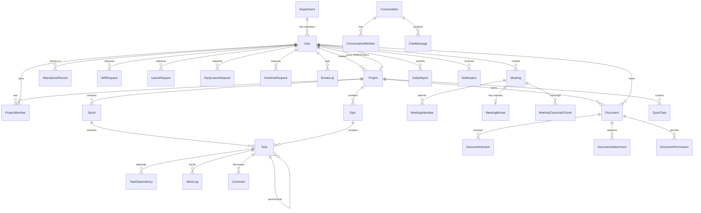

# 02 — Dữ Liệu & Hệ Thống Database

> **Nguồn:** `backend/prisma/schema.prisma` — **37 model, 26 enum**, đọc trực tiếp từ file.

---

## 1. Tại Sao PostgreSQL + Prisma?

| Yêu cầu nghiệp vụ | PostgreSQL đáp ứng | Prisma đáp ứng |
|--------------------|-------------------|----------------|
| Nội dung rich-text Tiptap | `Json` / `JSONB` — lưu & query được | Kiểu `Json` native, không cần serialize thủ công |
| Action Items từ AI | `Json` — mảng object có cấu trúc | `actionItems Json?` type-safe |
| Quy trình duyệt (phép/WFH/OT) | Transaction ACID mạnh | `$transaction()` API rõ ràng |
| Tìm kiếm toàn văn tài liệu | Full-text search, GIN index | `contains` + index thường (đủ dùng hiện tại) |
| Soft delete | Cột `deletedAt DateTime?` + index | `@@index([scope, deletedAt])` |

**Lựa chọn DB khác đã cân nhắc:**
- *MySQL*: không có JSONB → phải serialize thành `TEXT`, mất truy vấn vào action items.
- *MongoDB*: transaction đa document yếu hơn nhiều → nghiệp vụ "trừ quỹ phép + tạo bản ghi" không atomic an toàn.
- *SQLite*: không phù hợp production, không hỗ trợ `String[]` (Postgres array).

---

## 2. 26 Enum — Bảng Tra Nhanh

### 2.1 Enum người dùng & phân quyền

```prisma
enum Role        { ADMIN  HR  PM  EMPLOYEE  DEPARTMENT_HEAD }
enum UserStatus  { ACTIVE  INACTIVE  SUSPENDED }
enum Language    { VI  EN  KO }   // ← KO có trong DB nhưng UI chỉ làm VI/EN
```

### 2.2 Enum chấm công

```prisma
enum AttendanceStatus {
  ON_TIME              // Check-in trước 09:00
  LATE                 // 09:01 – 09:30
  VERY_LATE            // Sau 09:30
  WFH                  // Đã duyệt làm việc từ xa
  BUSINESS_TRIP        // Công tác
  ABSENT_APPROVED      // Nghỉ có phép
  ABSENT_UNAPPROVED    // Vắng không phép
  EARLY_LEAVE_APPROVED  // Về sớm có đơn
  EARLY_LEAVE_UNAPPROVED // Về sớm không đơn
}
enum RequestStatus { PENDING  APPROVED  REJECTED  AUTO_APPROVED }
enum BreakType     { MANUAL  EARLY_LEAVE_OUT }
enum LeaveType     { ANNUAL  SICK  UNPAID  COMPENSATORY }
```

### 2.3 Enum dự án & công việc

```prisma
enum ProjectKind         { TEAM  PERSONAL }   // ← tách bạch cá nhân / nhóm
enum ProjectStatus       { PLANNING  ACTIVE  ON_HOLD  COMPLETED  ARCHIVED }
enum ProjectWorkflowType { SCRUM  KANBAN  DAILY  SIMPLE }
enum SprintStatus        { PLANNING  ACTIVE  COMPLETED }
enum TaskStatus          { TODO  IN_PROGRESS  IN_REVIEW  BLOCKED  DONE }
enum Priority            { LOW  MEDIUM  HIGH  URGENT }
enum DependencyType      { FINISH_TO_START  START_TO_START  FINISH_TO_FINISH }
enum CustomFieldType     { TEXT  NUMBER  DATE  DROPDOWN  CHECKBOX }
```

### 2.4 Enum họp & tài liệu

```prisma
enum MeetingStatus { SCHEDULED  IN_PROGRESS  COMPLETED  CANCELLED }
enum MeetingScope  { PROJECT  DEPARTMENT  ONE_ON_ONE }
enum RSVP          { PENDING  ACCEPTED  DECLINED }
enum AiJobStatus   { PENDING  PROCESSING  DONE  FAILED }

enum DocumentScope { PERSONAL  PROJECT  DEPARTMENT  COMPANY }
enum DocumentType  { STANDARD  TASK_REQUIREMENT  TASK_SUBMISSION
                     MEETING_MINUTES  COMPANY_POLICY  TEMPLATE }
enum DocVisibility { PUBLIC  PRIVATE  SHARED }
enum SharePerm     { VIEW  EDIT }
```

### 2.5 Enum thông báo & chat

```prisma
enum NotificationType { MEETING  ATTENDANCE_APPROVAL  QUICK_TASK
                        MENTION  TASK  SYSTEM  CHAT  DAILY_REPORT }
enum ConversationType { DIRECT  PROJECT  DEPARTMENT }
enum ChatMessageType  { TEXT  FILE  SYSTEM }
```

---

## 3. ERD — 6 Nhóm Thực Thể



---

## 4. 37 Model — Chi Tiết Theo Nhóm

### 4.1 Nhóm Danh tính (3 model)

#### `User` (L203) — Bảng trung tâm, 30 quan hệ

```prisma
model User {
  id           String      @id @default(cuid())
  email        String      @unique
  passwordHash String
  name         String
  avatar       String?
  role         Role        @default(EMPLOYEE)
  status       UserStatus  @default(ACTIVE)
  position     String?
  language     Language    @default(VI)
  departmentId String?
  department   Department? @relation(fields: [departmentId], references: [id])
  createdAt    DateTime    @default(now())
  updatedAt    DateTime    @updatedAt
  deletedAt    DateTime?      // ← soft delete
}
```

**Điểm cần nhấn:** `User` có **30 quan hệ ngược** — là bảng trung tâm của toàn hệ thống. Khi thêm tính năng mới liên quan user, phải khai báo quan hệ 2 chiều ở cả 2 model.

#### `Department` (L269)

```prisma
model Department {
  id          String    @id @default(cuid())
  name        String
  description String?
  managerId   String?       // ← trưởng phòng (tham chiếu logic, không FK cứng)
  users       User[]
  projects    Project[]
  meetings    Meeting[]
  documents   Document[]
  conversations Conversation[]
}
```

#### `SystemConfig` (L285) — Cấu hình toàn hệ thống, 1 dòng duy nhất

```prisma
model SystemConfig {
  id                 String   @id @default(cuid())
  companyName        String
  companyLogoUrl     String?
  timezone           String   @default("Asia/Ho_Chi_Minh")
  workStartTime      String   @default("08:00")
  workEndTime        String   @default("17:30")
  checkinStartTime   String   @default("06:00")
  checkinEndTime     String   @default("12:00")
  allowedIpRanges    String[]
  officeLatitude     Float
  officeLongitude    Float
  gpsRadiusMeters    Int      @default(100)     // ← 100m, KHÔNG phải 500m
  wfhAutoApproveTime String   @default("09:30")
  geminiApiKey       String?                   // ← lưu DB thay vì .env
  smtpHost           String?
  smtpPort           Int?
  smtpUser           String?
  smtpPass           String?
  updatedAt          DateTime @updatedAt
}
```

> **Quan trọng:** `gpsRadiusMeters` mặc định là **100**. `docs/01-FEATURES.md` và `MO_TA_DU_AN.md` ghi 500m — đó là tài liệu thiết kế cũ. Code thực tế dùng **100m** (commit `891b458` "geofence 100m").

### 4.2 Nhóm Chấm công (6 model)

#### `AttendanceRecord` (L307)

```prisma
model AttendanceRecord {
  id            String           @id @default(cuid())
  userId        String
  date          DateTime         @db.Date     // ← @db.Date: chỉ ngày, không giờ
  status        AttendanceStatus
  checkInTime   DateTime?
  checkOutTime  DateTime?
  checkInIp     String?
  checkInLat    Float?
  checkInLng    Float?
  checkInMethod String?
  note          String?
  editedBy      String?          // ← ai sửa tay (HR)
  editedAt      DateTime?
  createdAt     DateTime         @default(now())

  @@unique([userId, date])      // ← 1 người 1 bản ghi/ngày, DB tự chặn trùng
  @@index([userId, date])
  @@index([date])                // ← index cho báo cáo toàn công ty
}
```

**`@@unique([userId, date])` là chống gian lận ở tầng DB** — dù code có bug thì database vẫn không cho 2 bản ghi cùng ngày. Đây là ví dụ tốt về "defense in depth".

#### 4 model đơn từ — cùng cấu trúc

| Model | Trường đặc thù | Unique |
|-------|------------------|--------|
| `WfhRequest` (L383) | `reason`, `expectedStart/End` (String HH:mm) | — |
| `LeaveRequest` (L399) | `startDate`, `endDate`, `leaveType`, `dayCount Float` | — |
| `EarlyLeaveRequest` (L329) | `expectedLeaveTime`, `reason` | `@@unique([userId, date])` |
| `OvertimeRequest` (L347) | `registeredStart/End`, `registeredHours`, `actualHours?` | `@@unique([userId, date])` |
| `BreakLog` (L368) | `startTime`, `endTime`, `duration Int?`, `type BreakType` | — |

> **Điểm hay:** `dayCount` là `Float` (0.5 = nửa ngày) — cho phép nghỉ phép nửa ngày linh hoạt.

### 4.3 Nhóm Dự án & Công việc (10 model)

#### `Project` (L415) — Mô hình tách biệt cá nhân / nhóm

```prisma
model Project {
  id              String               @id @default(cuid())
  name            String
  description     String?
  kind            ProjectKind          @default(TEAM)
  workflowType    ProjectWorkflowType  @default(KANBAN)
  personalOwnerId String?              @unique   // ← @unique: 1 user chỉ có 1 personal project
  personalOwner   User?                @relation("PersonalProjectOwner", ...)
  pmId            String?              // ← PM chính (M3.5)
  pm              User?                @relation("ProjectManager", ...)
  departmentId    String?              // ← phòng ban quản lý (M3.5)
  status          ProjectStatus        @default(PLANNING)
  color           String               @default("#3B82F6")
  startDate       DateTime?
  endDate         DateTime?
  createdById     String
  ...
}
```

**Tại sao `personalOwnerId` có `@unique`?** Đảm bảo mỗi user chỉ có **đúng 1** dự án cá nhân — đây là invariant nghiệp vụ được DB enforce, không cần check ở code.

**`pmId` + `departmentId` thêm từ M3.5** cho phép Trưởng phòng quản lý dự án thuộc phòng mà không cần là PM.

#### `Task` (L502) — Bảng trung tâm của công việc

```prisma
model Task {
  id           String     @id @default(cuid())
  projectId    String
  sprintId     String?
  epicId       String?
  parentTaskId String?        // ← tự tham chiếu: sub-task
  assigneeId   String?
  createdById  String
  completedById String?
  completedAt  DateTime?
  title        String
  description  String?
  status       TaskStatus @default(TODO)
  priority     Priority   @default(MEDIUM)
  storyPoints  Int?
  timeEstimate Int?
  timeTracked  Int        @default(0)
  position     Int        @default(0)   // ← thứ tự trong cột Kanban
  dueDate      DateTime?
  labels       String[]
  notified24h  Boolean    @default(false)  // ← cờ chống gửi trùng notification
  notified1h   Boolean    @default(false)
  deletedAt    DateTime?

  @@index([projectId, status])   // ← query chính: board theo cột
  @@index([assigneeId])
  @@index([sprintId])
}
```

**Giải thích các field đáng chú ý:**

| Field | Ý nghĩa |
|-------|---------|
| `position Int` | Vị trí trong cột Kanban. Drag-drop đổi `status` + `position` |
| `timeEstimate Int` vs `timeTracked Int` | Ước tính vs thực tế → tính hiệu suất |
| `storyPoints Int?` | Đơn vị ước lượng Jira → đầu vào cho Burndown |
| `notified24h` / `notified1h` | Cờ chống gửi trùng "task sắp đến hạn" nhiều lần |
| `parentTaskId` | Sub-task, tự tham chiếu (`@relation("SubTasks")`) |

#### `TaskDependency` (L548) — Quan hệ nhiều-nhiều tự tham chiếu

```prisma
model TaskDependency {
  taskId         String
  dependsOnId    String
  dependencyType DependencyType
  @@unique([taskId, dependsOnId])
}
```

Cần **2 relation name** (`"TaskDependsOn"` và `"TaskDependencySource"`) vì cùng 2 model tham chiếu lẫn nhau theo 2 chiều.

#### `ProjectMember` (L449)

```prisma
model ProjectMember {
  projectId   String
  userId      String
  projectRole String      // ← "PM" | "MEMBER" | "VIEWER" (String, không phải enum)
  joinedAt    DateTime
  @@unique([projectId, userId])
}
```

### 4.4 Nhóm Họp trực tuyến (4 model)

#### `Meeting` (L625)

```prisma
model Meeting {
  title       String
  scopeType   MeetingScope  @default(ONE_ON_ONE)   // ← 3 loại phạm vi
  projectId   String?
  departmentId String?
  startTime   DateTime
  endTime     DateTime
  status      MeetingStatus @default(SCHEDULED)
  roomCode    String        @unique @default(cuid())  // ← mã phòng, unique
  createdById String
  rsvpReminderSentAt DateTime?   // ← cờ chống gửi nhắc RSVP trùng
  ...
  @@index([scopeType, projectId, departmentId])
  @@index([startTime, status])
}
```

**`scopeType` + `projectId`/`departmentId` là mô hình "polymorphic"** — 1 bảng `Meeting` phục vụ 3 loại hội thoại, truy vấn theo `scopeType` để biết filter theo project hay department.

#### `MeetingMinute` (L674) — Chứa cả AI output

```prisma
model MeetingMinute {
  meetingId         String   @unique      // ← 1 meeting : 1 minute
  content           String   @db.Text     // ← biên bản thủ công
  rawTranscript     String?  @db.Text     // ← transcript gốc từ STT
  isTranscribing    Boolean  @default(false)
  aiSummary         String?  @db.Text     // ← tóm tắt từ Gemini
  actionItems       Json?                  // ← mảng ActionItem
  decisions         Json?                  // ← mảng string
  risksAndQuestions Json?                  // ← { risks: [], openQuestions: [] }
  aiGeneratedAt     DateTime?
  aiModel           String?
  aiTokensUsed      Int?
}
```

**Điểm thiết kế tốt:** Lưu **cả** `rawTranscript` (dữ liệu gốc) lẫn `aiSummary` (kết quả AI). Nếu Gemini sai → người dùng sửa `aiSummary`, `rawTranscript` vẫn còn để đối chiếu. **Không mất dữ liệu gốc.**

#### `MeetingTranscriptChunk` (L697) — Lưu từng đoạn thoại

```prisma
model MeetingTranscriptChunk {
  meetingId   String
  speakerId   String
  speakerName String
  speakerRole String?
  text        String   @db.Text
  timestamp   DateTime @default(now())
  @@index([meetingId, timestamp])
}
```

**Lưu mảnh độc lập** thay vì 1 chuỗi lớn → khi nhiều người nói song song, không ghi đè lẫn nhau (tránh race condition). Đây chính là lý do docs nhấn mạnh "lưu trữ phân mảnh độc lập".

### 4.5 Nhóm Tài liệu (5 model)

#### `Document` (L710) — Phân quyền theo 4 scope

```prisma
model Document {
  title       String
  content     Json          // ← Tiptap JSON (rich text)
  contentText String        @db.Text   // ← plain text để full-text search
  scope       DocumentScope // ← PERSONAL | PROJECT | DEPARTMENT | COMPANY
  type        DocumentType  @default(STANDARD)
  ownerId     String
  projectId   String?
  departmentId String?
  linkedTaskId    String?   // ← cho tài liệu đặc tả task
  linkedMeetingId String?   // ← cho biên bản họp
  aiSummary   String?
  templateKey String?
  parentId    String?       // ← cây tài liệu lồng nhau
  tags        String[]
  currentVersion Int        @default(1)
  viewCount   Int           @default(0)
  lastViewedAt DateTime?
  createdById String
  updatedById String?
  deletedAt   DateTime?
}
```

**`content` (Json) + `contentText` (Text) là 2 cột cố ý:**
- `content` → giữ cấu trúc rich-text (bold, table, image) để render lại
- `contentText` → flatten ra text thuần để **search** (JSONB không index text tốt bằng text)

**`scope` quyết định ai được đọc** — xem `documents-access.service.ts`.

#### `DocumentVersion` / `DocumentAttachment` / `DocumentPermission`

```prisma
model DocumentVersion {
  documentId  String
  version     Int
  content     Json
  contentText String   @db.Text
  changeNote  String?
  savedById   String
  @@unique([documentId, version])   // ← mỗi phiên bản 1 số thứ tự
}

model DocumentAttachment {
  documentId  String
  fileName    String
  fileSize    Int
  mimeType    String
  minioKey    String        // ← path trong MinIO/S3
  minioBucket String        @default("worksync-documents")
  uploadedById String
}

model DocumentPermission {
  documentId String
  userId     String
  canEdit    Boolean @default(false)
  canComment Boolean @default(true)
  canShare   Boolean @default(false)
  grantedById String
  @@unique([documentId, userId])
}
```

### 4.6 Nhóm Chat (4 model)

#### `Conversation` (L935)

```prisma
model Conversation {
  type            ConversationType @default(DIRECT)  // ← DIRECT | PROJECT | DEPARTMENT
  name            String?
  avatarUrl       String?
  projectId       String?
  departmentId    String?
  createdById     String
  lastMessageText String?      // ← denormalize: sidebar list không cần query messages
  lastMessageAt   DateTime?
  lastSenderId    String?
  lastSenderName  String?
  ...
  @@index([lastMessageAt])
}
```

**Kỹ thuật denormalization:** lưu `lastMessage*` trực tiếp trên `Conversation` để danh sách sidebar hiển thị nhanh mà không join bảng messages. Đánh đổi: phải cập nhật 4 cột mỗi khi có tin nhắn mới — code làm việc này trong `chat.service.ts`.

#### `ConversationMember` (L963) — Trạng thái riêng cho từng thành viên

```prisma
model ConversationMember {
  conversationId String
  userId         String
  unreadCount    Int      @default(0)
  lastReadAt     DateTime?
  isPinned       Boolean  @default(false)
  isMuted        Boolean  @default(false)
  leftAt         DateTime?
  @@unique([conversationId, userId])
  @@index([userId, isPinned])   // ← ghim lên đầu
  @@index([userId, unreadCount])
}
```

`unreadCount` + `lastReadAt` ở **mức từng thành viên** → mỗi người có "read receipt" riêng, không ai ảnh hưởng người khác.

#### `ChatMessage` (L981)

```prisma
model ChatMessage {
  conversationId String
  senderId       String
  type           ChatMessageType @default(TEXT)
  content        String
  fileUrl        String?
  fileName       String?
  fileSize       Int?
  fileMime       String?
  replyToId      String?
  isEdited       Boolean
  ...
  @@index([conversationId, createdAt])
}
```

### 4.7 Nhóm khác (7 model)

| Model | Dòng | Mục đích |
|-------|------|----------|
| `Epic` | 484 | Nhóm task lớn trong Sprint, Jira-style |
| `WorkLog` | 559 | Ghi giờ làm việc (phút) — đầu vào báo cáo cuối ngày |
| `Comment` | 572 | Bình luận task/tài liệu/họp, có `mentions String[]` |
| `Reaction` | 590 | Emoji reaction cho comment |
| `CustomField` | 601 | Field tùy chỉnh cho project |
| `CustomFieldValue` | 613 | Giá trị field tùy chỉnh trên task |
| `QuickTask` | 909 | Giao việc nhanh (M3.5) — không cần Sprint |
| `DailyReport` | 838 | Báo cáo cuối ngày (M10) |
| `Notification` | 860 | Thông báo trong hệ thống |
| `PushSubscription` | 886 | Đăng ký Web Push VAPID |

#### `DailyReport` (L838) — Điểm đáng chú ý

```prisma
model DailyReport {
  userId      String
  date        DateTime   @db.Date
  content     String
  tasksDone   String[]
  blockers    String?
  plannedTomorrow String?
  aiDrafted   Boolean  @default(false)   // ← AI điền sẵn
  isLocked    Boolean  @default(false)   // ← khóa sau khi gửi
  lateSubmission Boolean @default(false) // ← gửi muộn, PM cần biết
  submittedAt DateTime?
  @@unique([userId, date])
}
```

`aiDrafted` + `isLocked` cùng tồn tại = **AI điền, người duyệt, rồi khóa**. Không bao giờ gửi tự động không qua người.

---

## 5. Các Kỹ Thuật Prisma Được Dùng

| Kỹ thuật | Ví dụ | Tác dụng |
|-----------|-------|----------|
| `@id @default(cuid())` | mọi model | ID không đoán được → chống enumeration |
| `@unique` | `User.email`, `AttendanceRecord(userId,date)` | Ràng buộc ở tầng DB |
| `@@index` | `Task(projectId,status)` | Tăng tốc query board |
| `@@unique([a, b])` | `ProjectMember(projectId,userId)` | Composite key logic |
| `@db.Date` | `AttendanceRecord.date` | Chỉ ngày, không lưu giờ → tránh sai lệch timezone |
| `@db.Text` | `MeetingMinute.content` | Text dài (không giới hạn varchar) |
| `Json` | `Document.content`, `actionItems` | Dữ liệu schema-linhtinh |
| `String[]` | `Task.labels`, `Notification`... | Postgres array |
| Self-relation | `Task.parentTaskId` | Sub-task |
| 2 relation names | `TaskDependency` | Tránh ambiguous relation |
| `onDelete: Cascade` | `MeetingAttendee` → `Meeting` | Xóa meeting → xóa luôn attendee/chunk/version |
| `onDelete: SetNull` | `Notification.actor` | Xóa user → giữ notification, bỏ actor |
| `@@index([scope, deletedAt])` | `Document` | Query tài liệu theo scope + loại deleted |
| `@updatedAt` | mọi model có `updatedAt` | Tự cập nhật timestamp khi modify |

### 5.1 Chính sách `onDelete` trong dự án

```
Cascade   → bảng con chết theo cha (MeetingAttendee, ChatMessage, DocumentVersion)
SetNull   → giữ dữ liệu lịch sử (Notification.actor)
(mặc định) → chặn xóa (User, Project — dùng soft delete)
```

> **Quyết định:** dùng **soft delete** (`deletedAt`) cho entity nghiệp vụ chính (User, Project, Task, Document) để không mất lịch sử. Dùng `Cascade` cho bảng con thuần (không có ý nghĩa độc lập).

---

## 6. Transaction — Khi Nào Bắt Buộc Dùng

```typescript
// ✅ ĐÚNG — thao tác nhiều bảng phải atomic
await this.prisma.$transaction([
  this.prisma.task.update({ where: { id }, data: { status, boardOrder } }),
  this.prisma.workLog.create({ data: { taskId, duration, logDate } }),
]);
```

| Nghiệp vụ | Các bảng liên quan | Vì sao phải atomic |
|-----------|-------------------|-------------------|
| Check-in | `AttendanceRecord` + `BreakLog` + `Notification` | Tránh tạo bản ghi trùng |
| Duyệt nghỉ phép | `LeaveRequest` + `AttendanceRecord` (ABSENT_APPROVED) + `User.leaveBalance` | Trừ quỹ phép + ghi nhận vắng phải cùng lúc |
| Đăng ký user | `User` + `Project(PERSONAL)` + `ProjectMember` | Không được có user mà không có project cá nhân |
| Kéo thả Kanban | `Task` + `WorkLog` | Vị trí + log giờ phải khớp |
| Hoán đổi PM | `Project.pmId` + `Notification` (2 người) | Cả 2 phải nhận thông báo |
| Hoàn thành Sprint | `Sprint.status` + `Task.status` (về TODO) | Trả task dở dang về Backlog |

---

## 7. Index Đã Đánh Dán — Ý Nghĩa

| Index | Query được tối ưu |
|-------|-------------------|
| `AttendanceRecord(userId, date)` | Lịch sử chấm công cá nhân, heatmap 365 ngày |
| `AttendanceRecord(date)` | Báo cáo toàn công ty theo ngày |
| `Task(projectId, status)` | Load bảng Kanban theo cột |
| `Task(assigneeId)` | "Việc của tôi" |
| `Task(sprintId)` | Task trong Sprint |
| `Notification(userId, isRead, createdAt)` | Chuông thông báo chưa đọc |
| `Notification(userId, type, createdAt)` | Lọc theo loại |
| `ChatMessage(conversationId, createdAt)` | Load lịch sử tin nhắn |
| `Conversation(lastMessageAt)` | Sort sidebar theo tin mới nhất |
| `ConversationMember(userId, isPinned)` | Ghim lên đầu |
| `Document(scope, deletedAt)` | List tài liệu theo scope |
| `Meeting(scopeType, projectId, departmentId)` | Filter meeting theo phạm vi |
| `Meeting(startTime, status)` | Lịch họp sắp tới |
| `MeetingTranscriptChunk(meetingId, timestamp)` | Ghép transcript cho AI |

---

## 8. Câu Hỏi Thường Gặp Về Database

**Q: Vì sao dùng `cuid()` thay vì UUID hay số tự tăng?**
> `cuid()` (Collision-resistant ID) an toàn hơn UUID v4 ở chỗ **không tiết lộ thứ tự tạo** — kẻ tấn công đoán ID không thể biết record nào cũ hơn. Cũng ngắn hơn UUID và index-friendly hơn `Int` auto-increment khi phân tán nhiều server.

**Q: Soft delete có làm chậm query không?**
> Có nếu không index. Dự án đã index `deletedAt` kèm cột lọc chính (`@@index([scope, deletedAt])`). Ngoài ra soft delete là **yêu cầu nghiệp vụ** (`docs/00-PRD.md` §5: "nghiêm cấm xóa vĩnh viễn khỏi CSDL vật lý").

**Q: Tại sao `Meeting` dùng `scopeType` thay vì 3 bảng riêng?**
> Tránh trùng lặp schema. 3 loại hội thoại (PROJECT/DEPARTMENT/ONE_ON_ONE) có cùng cấu trúc chỉ khác nguồn ràng buộc. Dùng enum + 2 FK nullable → query theo `scopeType` là biết filter theo `projectId` hay `departmentId`.

**Q: `Json` của Prisma có index được không?**
> Được (Postgres JSONB + GIN index) nhưng dự án chưa dùng. Thay vào đó lưu `contentText` (Text) cho search — đơn giản và hiệu quả hơn cho full-text search tiếng Việt.

**Q: `onDelete: Cascade` có nguy hiểm không?**
> Có, nếu áp dụng sai. Dự án chỉ dùng Cascade cho bảng con **không có nghĩa độc lập** (attendee của meeting, version của document). Bảng nghiệp vụ chính dùng soft delete. Nếu xóa nhầm Meeting → mất luôn toàn bộ transcript — nên `Meeting` không bị cascade mà chỉ `Meeting` → `MeetingAttendee` mới cascade.

---

## 9. Script Seed — Dữ Liệu Mẫu

```bash
npm run seed:all            # chạy cả 4
npm run seed:enterprise     # 19 user + phòng ban + dự án mẫu
npm run seed:meetings       # 10 cuộc họp + transcript + AI minutes cache
npm run seed:calendar       # task/sprint/meeting để test timeline
npm run seed:chat           # conversation + tin nhắn mẫu
```

Tất cả script dùng `--experimental-strip-types` (Node chạy TS trực tiếp, không cần build).

**Vì sao cần seed?** Giáo viên muốn xem demo → có dữ liệu thật ngay. Cũng giúp test trạng thái "đã có dữ liệu" (late joiner, lịch trình nhiều nguồn, chat có lịch sử).

---

## 10. Bảng Tra Nhanh — 37 Model

| # | Model | Nhóm | Mô tả 1 dòng |
|---|-------|------|--------------|
| 1 | `User` | Danh tính | Người dùng, 30 quan hệ |
| 2 | `Department` | Danh tính | Phòng ban |
| 3 | `SystemConfig` | Danh tính | Config toàn hệ thống (1 dòng) |
| 4 | `AttendanceRecord` | Chấm công | Bản ghi check-in/out |
| 5 | `EarlyLeaveRequest` | Chấm công | Đơn về sớm |
| 6 | `OvertimeRequest` | Chấm công | Đơn làm thêm giờ |
| 7 | `BreakLog` | Chấm công | Nhật ký ra ngoài |
| 8 | `WfhRequest` | Chấm công | Đơn làm việc từ xa |
| 9 | `LeaveRequest` | Chấm công | Đơn nghỉ phép |
| 10 | `Project` | Dự án | Dự án nhóm/cá nhân |
| 11 | `ProjectMember` | Dự án | Thành viên dự án |
| 12 | `Sprint` | Dự án | Chu kỳ Scrum |
| 13 | `Epic` | Dự án | Nhóm task lớn |
| 14 | `Task` | Dự án | Công việc (bảng trung tâm) |
| 15 | `TaskDependency` | Dự án | Phụ thuộc giữa task |
| 16 | `WorkLog` | Dự án | Log giờ làm việc |
| 17 | `Comment` | Dự án | Bình luận |
| 18 | `Reaction` | Dự án | Emoji reaction cho comment |
| 19 | `CustomField` | Dự án | Field tùy chỉnh |
| 20 | `CustomFieldValue` | Dự án | Giá trị field trên task |
| 21 | `Meeting` | Họp | Cuộc họp |
| 22 | `MeetingAttendee` | Họp | Người tham dự + RSVP |
| 23 | `MeetingMinute` | Họp | Biên bản + AI output |
| 24 | `MeetingTranscriptChunk` | Họp | Đoạn thoại STT |
| 25 | `Document` | Tài liệu | Tài liệu (Tiptap JSON) |
| 26 | `DocumentVersion` | Tài liệu | Lịch sử phiên bản |
| 27 | `DocumentAttachment` | Tài liệu | File đính kèm 25MB |
| 28 | `DocumentPermission` | Tài liệu | Quyền từng user |
| 29 | `DocumentTemplate` | Tài liệu | Mẫu tài liệu |
| 30 | `DailyReport` | Báo cáo | Báo cáo cuối ngày |
| 31 | `Notification` | Thông báo | Thông báo trong hệ thống |
| 32 | `PushSubscription` | Thông báo | Đăng ký Web Push |
| 33 | `QuickTask` | Giao việc nhanh | Task nhanh (M3.5) |
| 34 | `Conversation` | Chat | Hội thoại |
| 35 | `ConversationMember` | Chat | Thành viên + trạng thái đọc |
| 36 | `ChatMessage` | Chat | Tin nhắn |
| 37 | `ChatMessageReaction` | Chat | Emoji reaction tin nhắn |
